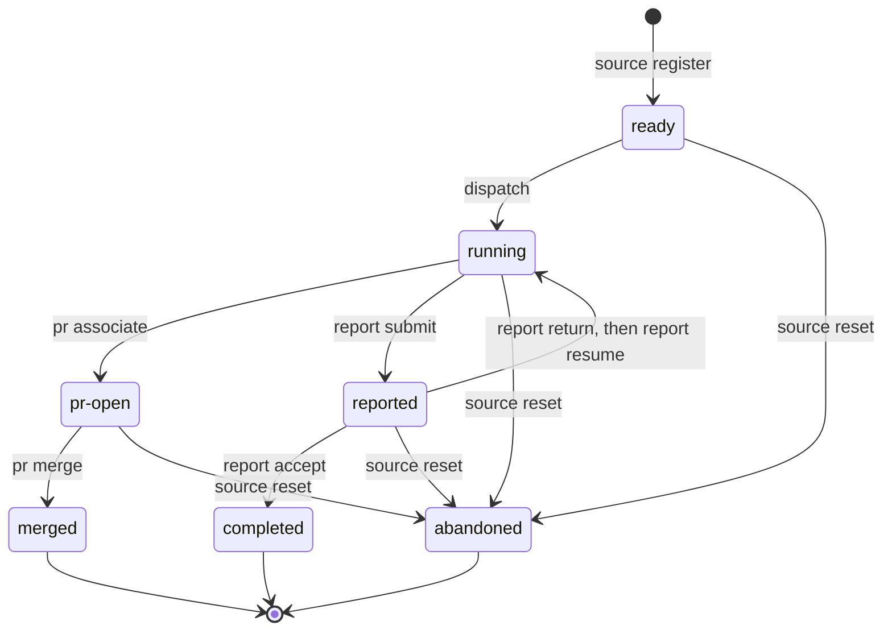

# Operator

Personal skills and CLI tools for coordinating coding agents in OpenCode and Claude Code through [Herdr](https://herdr.dev/).


> Inspired by Matrix: an Operator loads programs, guides missions, and keeps the crew in the field connected.

Operator is based on [Matt Pocock's agent skills and workflow](https://github.com/mattpocock/skills).
His skills guide the work from clarifying a goal and writing a spec through tickets, implementation, and review.
Operator builds on that workflow by coordinating the agents, worktrees, and recorded decisions that carry the work between those steps.

A SuperAgent coordinates WorkerAgents.
The CLI keeps the workflow state and tells each agent its next action.
One installed release serves every project on the device, and Operator keeps its settings and state on the device, not in a checkout.
`CONTEXT.md` defines the terms, and `docs/adr/` records the decisions.

## How the workflow runs

The SuperAgent registers a work source, which is a plan of assignments from the tracker.
Each assignment completes through a pull request or through a report.
The CLI keeps the state of each source and assignment, and `operator next` returns the next action for each one.



- `ready`: the assignment waits for its dependencies.
  A pull request dependency must be open or merged, and a report dependency must be completed.
- `running`: a WorkerAgent works in its own Herdr pane or worktree.
- `pr-open`: with internal review on, the default, the implementer opens a draft PR and stops.
  The SuperAgent closes the implementer's pane and dispatches a fresh WorkerAgent into the same worktree.
  That reviewer checks the draft against the issue, the standards, and the skills that the brief names, and it applies the valid findings in at most two rounds.
  It posts one summary comment, marks the PR ready with `gh pr ready`, and then owns the PR.
  The owner answers review feedback and failing checks, then merges after an approving review.
  With internal review off, the implementer opens a ready PR and owns it to the merge.
- `reported`: the SuperAgent accepts the report, or returns it with a follow-up.
- `merged` and `completed`: the work is done, and the CLI removes the branch, pane, and worktree.
  Work that did not land stays until you decide.
- `abandoned`: you ended the source with `source reset` before the work was done.

A source is `open` until each assignment is merged or completed, and then it is `finished`.
`source prune` deletes an ended source 14 days after its end.

## Install

Bun 1.4.0 or later is required, except with Nix, which brings its own Bun.
Install Operator one time for the device, in one of these three ways.

### JSR with Bun

Add the JSR scope to Bun's global config.
When `XDG_CONFIG_HOME` is set, Bun reads `$XDG_CONFIG_HOME/.bunfig.toml` and ignores `~/.bunfig.toml`.
Otherwise, Bun reads `~/.bunfig.toml`.

```toml
[install.scopes]
"@jsr" = "https://npm.jsr.io"
```

Install the latest release, then register the project and write the `operator` command:

```sh
bun add -g --exact "@fveracoechea/operator@npm:@jsr/fveracoechea__operator@latest"
OPERATOR_PACKAGE="$(bun pm ls -g | head -n 1 | sed 's/ node_modules (.*//')/node_modules/@fveracoechea/operator"
bun "$OPERATOR_PACKAGE/cli.js" project register --json
bun "$OPERATOR_PACKAGE/cli.js" install launcher --json
operator --version --json
```

To update, run the same `bun add -g` command again.
Keep `--exact`, because `install launcher` refuses a release without an exact version, and `ready` reports one.

### Repository source

```sh
bun add -g "git+https://github.com/fveracoechea/operator.git#<full-commit>"
operator project register --json
operator --version --json
```

Use the full 40-character commit, so that a Bun update cannot move the installation.

### Nix flake

Pin the release tag:

```nix
inputs.operator.url = "github:fveracoechea/operator/v<version>";
```

Add the package and link its skills.
This example uses Home Manager:

```nix
let
  operator = inputs.operator.packages.${pkgs.stdenv.hostPlatform.system}.default;
  ownedSkills = lib.genAttrs operator.skills (name: "${operator}/share/skills/operator/${name}");
in
{
  home.packages = [ operator ];
  programs.claude-code.skills = ownedSkills;
  programs.opencode.skills = ownedSkills;
}
```

Then register the project:

```sh
operator project register --json
operator --version --json
```

To update, change the tag and rebuild your configuration.

### PATH

Put `bun` and the folder that `bun pm bin -g` reports on `PATH`, for your shells and for Herdr.
With Nix, the profile's bin folder is enough.
`operator ready --json` reports a missing or wrong `operator` command.

## First run

Run the first registration from the main checkout of a project with a GitHub remote:

```sh
operator project register --json
operator --help
operator --version --json
```

Every other command refuses with `state_missing` until you register a project.

## Commands

`operator --help` lists every command, and every command takes `--json`.

### Device and projects

```sh
operator config show --json
operator config plan --set superAgent.host=opencode --json
operator config apply --set superAgent.host=opencode --plan <plan-id> --json
operator config recover --json
operator config resolve --role workerAgent --json
operator host models --host claude-code --json
operator project show --json
operator project list --json
operator project move --json
operator project remove owner/repository --person-instructed --json
```

Settings are in `$XDG_CONFIG_HOME/operator/config.json`, and state is in `$XDG_STATE_HOME/operator/`.
The hosts are `opencode` and `claude-code`.
WorkerAgents use the SuperAgent's host and model, unless a profile under `profiles.<name>` sets others.
`project remove` deletes Operator records only, never checkouts, branches, or worktrees.

### Skills and readiness

```sh
operator install --opencode --claude --json
operator install --opencode --claude --check --json
operator install matt --opencode --claude --json
operator ready --json
```

`install` copies the Operator skills into the host folders, and it does not overwrite your edits.
`install --check` reports `skills_missing` for skills that are not installed, and `skill_copy_conflict` for skills with different contents.
`install matt` installs Matt Pocock's skills.
`ready` requires them, so run `install matt` for each host that settings select.
`ready` checks `gh` and its login, `herdr`, the `operator` command, the host, and the skills.

### Assignments and dispatch

```sh
operator source register --file /absolute/path/assignments.json --json
operator source show --source <source-id> --json
operator next --json
operator herdr install --json
operator dispatch --source <source-id> --assignment <key> --json
operator source reset --source <source-id> --person-instructed --json
operator source prune --json
```

The SuperAgent reads the tracker and gives the CLI a JSON plan.
`next` returns the next actions and writes nothing.
`herdr install` links the Herdr plugin that prepares each worktree and records worker activity.
`dispatch` starts a ready assignment in a Herdr pane or worktree.

### Reports

```sh
operator report submit --file <report.json> --json
operator report resume --json
operator report accept --source <source-id> --assignment <key> --json
operator report return --source <source-id> --assignment <key> --file <follow-up.md> --json
```

The WorkerAgent submits and resumes from its own pane.
Only the SuperAgent accepts or returns a report.

### Pull requests

```sh
operator pr associate --json
operator pr wait --timeout 300 --json
operator pr merge --json
operator cleanup --source <source-id> --assignment <key> --json
```

The WorkerAgent runs the `pr` commands in its worktree.
`pr wait` reports new feedback, failing checks, and a merged parent pull request.
`pr merge` merges only with an approving review, passing checks, and no unresolved thread.
Internal review is on by default, and `review.internal` set to `false` in settings turns it off for the device.
A plan's `internalReview` field sets it for all its assignments, and a PR assignment's `internalReview` field sets it for that assignment.
The most specific value wins.

### Reviews

```sh
operator review add <pr-url> --json
operator review start <pr-url> --json
operator review wait --json
operator review next --json
operator review post <pr-url> --json
operator review skip <pr-url> --json
operator review cleanup <pr-url> --json
```

A reviewer agent writes a draft with the `pr-review` skill, and only `review post` posts it.
With `review.assignments` set to `true`, each PR assignment also gets this reviewer after its PR is open.
It posts a comment and is separate from internal review.
In this release, `pr associate` queues it while the PR is still a draft, so keep `review.assignments` off while internal review is on.
With `review.channel`, `review.repos`, and `review.authors` in settings, `review wait --slack` takes review requests from Slack.
