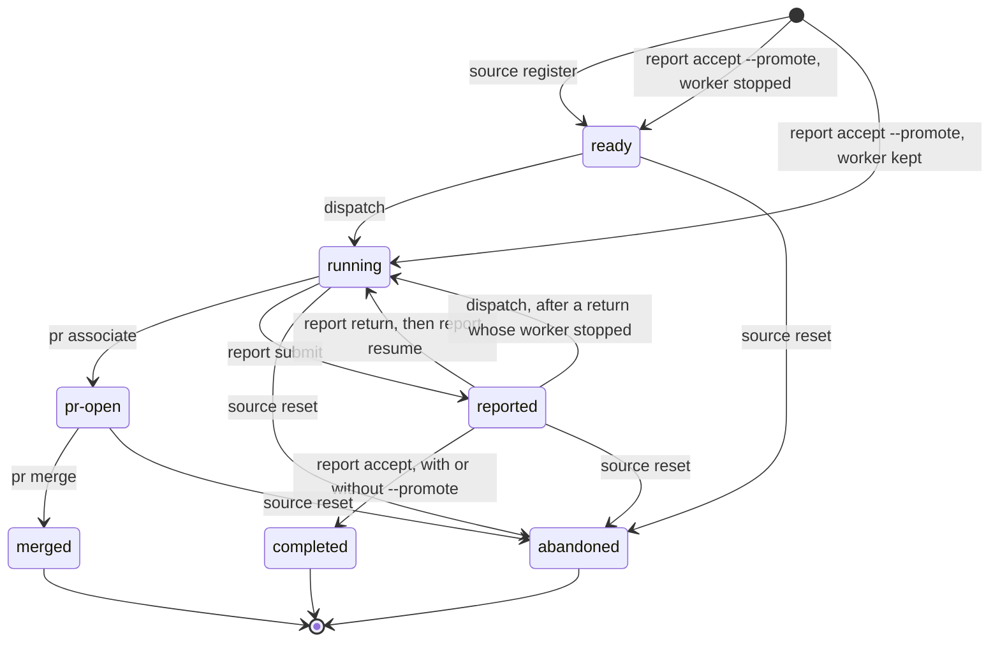
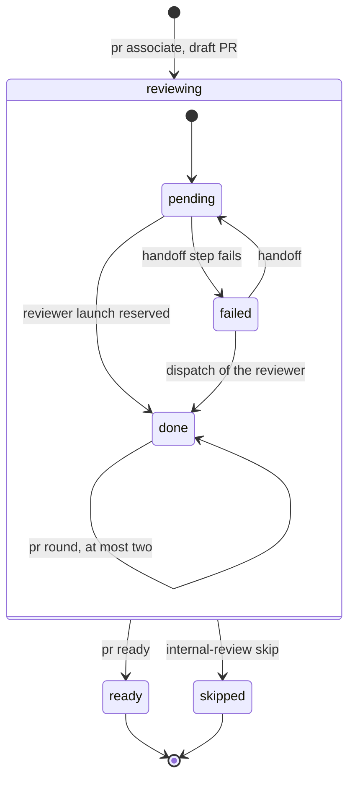

# Operator

Personal skills and CLI tools for coordinating coding agents in OpenCode and Claude Code through [Herdr](https://herdr.dev/).


> Inspired by Matrix: an Operator loads programs, guides missions, and keeps the crew in the field connected.

Operator is based on [Matt Pocock's agent skills and workflow](https://github.com/mattpocock/skills).
His skills guide the work from clarifying a goal and writing a spec through tickets, implementation, and review.
Operator builds on that workflow by coordinating the agents, worktrees, and recorded decisions that carry the work between those steps.

A SuperAgent coordinates WorkerAgents.
The CLI keeps the workflow state and tells each agent its next action.
One installed release serves every project on the device, and Operator keeps its settings and state on the device, not in a checkout.
`CONTEXT.md` defines the terms, and `docs/adr/` records the decisions.

## How the workflow runs

The SuperAgent registers a work source, which is a plan of assignments from the tracker.
Each assignment completes through a pull request or through a report.
The CLI keeps the state of each source and assignment, and `operator next` returns the next action for each one.

This diagram shows the assignment states of `modules/work-sources/assignment-machine.ts`, with the transitions that `report-machine.ts`, `source-machine.ts`, dispatch, and the PR commands record.



- `ready`: the assignment waits for its dependencies.
  A pull request dependency must be open or merged, and a report dependency must be completed.
  A PR assignment also waits while more than one of its parent PRs is open.
  When the plan sets `maxRunning`, ready work also waits while that many of its assignments have a starting or live worker.
  `dispatch` refuses it then.
- `running`: a WorkerAgent works in its own Herdr pane or worktree.
- `pr-open`: the owner carries the PR to its merge.
  With internal review on, the default, the PR starts as a draft and goes through the internal review below first.
  With internal review off, the implementer opens a ready PR and owns it to the merge.
  The owner answers review feedback and failing checks, then merges with `pr merge`.
- `reported`: the SuperAgent accepts the report, returns it with a follow-up, or promotes it.
  After a return, the worker resumes, or a dispatch replaces a worker that stopped.
  A promotion accepts the report and adds a new PR assignment that takes over the report's worktree.
  When the report's worker still runs, the PR assignment starts `running` with that worker, and the worker gets its new brief by steering message.
  Otherwise the PR assignment starts `ready`, and a dispatch reopens the worktree.
- `merged` and `completed`: the work is done, and the CLI removes the branch, pane, and worktree.
  A promoted report keeps its pane and worktree for the PR assignment.
  Work that did not land stays until you decide.
- `abandoned`: you ended the source with `source reset` before the work was done.

A source is `open` until each assignment is merged or completed, and then it is `finished`.
`source prune` deletes an ended source 14 days after its end.

### Internal review

With internal review on, `pr associate` of a draft PR records an internal review.
It refuses a PR that is not a draft, and a worktree with changes that are not pushed.
This diagram shows `modules/pull-requests/internal-review-machine.ts`, with the handoff states that `modules/device-state/internal-reviews.ts` records.



- `pending`: the CLI closes the implementer's pane and starts a fresh WorkerAgent in the same worktree.
  `next` shows a running handoff as a wait, and a handoff whose process stopped as `retry_handoff`.
- `failed`: `next` shows `retry_handoff`.
  The SuperAgent runs `operator handoff` from the controlling checkout.
- `done`: the reviewer checks the draft against the issue, the standards, and the skills that the brief names.
  Each `pr round` records the findings at the worktree head, and leaves the handoff state `done`.
  A second round needs a newer head, and there is no third round.
  An applied blocker from round 1 requires round 2.
- `ready`: `pr ready` checks a disposition for each finding, posts one summary comment, and marks the PR ready.
  The reviewer then owns the PR to its merge.
- `skipped`: on your instruction, the SuperAgent ends a running review with `internal-review skip`, which marks the PR ready with no comment.

The implementer runs no PR command after the handoff.
`pr merge` refuses until the internal review is `ready` or `skipped`.

## Install

Bun 1.4.0 or later is required, except with Nix, which brings its own Bun.
Install Operator one time for the device, in one of these three ways.
To move to a new release, follow [Update Operator](https://github.com/fveracoechea/operator/blob/main/docs/update.md).

### JSR with Bun

Add the JSR scope to Bun's global config.
When `XDG_CONFIG_HOME` is set, Bun reads `$XDG_CONFIG_HOME/.bunfig.toml` and ignores `~/.bunfig.toml`.
Otherwise, Bun reads `~/.bunfig.toml`.

```toml
[install.scopes]
"@jsr" = "https://npm.jsr.io"
```

Install the latest release, then register the project and write the `operator` command:

```sh
bun add -g --exact "@fveracoechea/operator@npm:@jsr/fveracoechea__operator@latest"
OPERATOR_PACKAGE="$(bun pm ls -g | head -n 1 | sed 's/ node_modules (.*//')/node_modules/@fveracoechea/operator"
bun "$OPERATOR_PACKAGE/cli.js" project register --json
bun "$OPERATOR_PACKAGE/cli.js" install launcher --json
operator --version --json
```

Keep `--exact`, because `install launcher` refuses a release without an exact version, and `ready` reports one.

### Repository source

```sh
bun add -g "git+https://github.com/fveracoechea/operator.git#<full-commit>"
operator project register --json
operator --version --json
```

Use the full 40-character commit, so that a Bun update cannot move the installation.

### Nix flake

The flake supports `x86_64-linux` and `aarch64-darwin` and includes the pinned Bun runtime.
Operator exports a package, not a Home Manager module.
Pin a published release tag in your `flake.nix`:

```nix
inputs.operator.url = "github:fveracoechea/operator/v<version>";
```

Replace `<version>` with a version from [GitHub Releases](https://github.com/fveracoechea/operator/releases).
The `v2.2.1` flake has an incomplete dependency cache and does not build, so use a later release.

Add the package, skill links, and host hooks to your Home Manager configuration.
For standalone Home Manager, set `extraSpecialArgs = { inherit inputs; };` in `homeManagerConfiguration`.
For NixOS or nix-darwin, set `home-manager.extraSpecialArgs = { inherit inputs; };`.
This makes `inputs` available to the module.
Keep only the host configuration that you use:

```nix
{ config, inputs, lib, pkgs, ... }:

let
  operator = inputs.operator.packages.${pkgs.stdenv.hostPlatform.system}.default;
  ownedSkills = lib.genAttrs operator.skills (name: "${operator}/share/skills/operator/${name}");
in
{
  home.packages = [ operator ];

  programs.claude-code = {
    enable = true;
    configDir = "${config.home.homeDirectory}/.claude";
    skills = ownedSkills;
    settings.hooks = {
      PreToolUse = [{
        matcher = "Bash";
        hooks = [{
          type = "command";
          "if" = "Bash(git *)";
          command = "operator claude hook";
        }];
      }];
      Stop = [{
        hooks = [{
          type = "command";
          command = "operator claude hook";
        }];
      }];
    };
  };

  programs.opencode = {
    enable = true;
    skills = ownedSkills;
  };
  xdg.configFile."opencode/plugins/operator.ts".source = "${operator}/share/opencode/plugins/operator.ts";
}
```

Update the lock file from your configuration's directory:

```sh
nix flake update operator
```

Rebuild and activate your Home Manager, NixOS, or nix-darwin configuration.
Then register the project from its main checkout and check the installed package.
Use only the flags for the hosts that you configured:

```sh
operator project register --json
operator --version --json
operator install --opencode --claude --check --json
```

Nix owns the Operator skill links, Claude Code hooks, and OpenCode plugin.
Operator checks them but does not write or repair them.
Run `operator install --opencode --claude --json` without `--check` to install the upstream skills.
Those upstream skills are not part of the Nix package.
Use [Update Operator](docs/update.md#nix-flake) for later releases.

### PATH

Put `bun` and the folder that `bun pm bin -g` reports on `PATH`, for your shells and for Herdr.
With Nix, the profile's bin folder is enough.
`operator ready --json` reports a missing or wrong `operator` command.

## First run

Run the first registration from the main checkout of a project with a GitHub remote:

```sh
operator project register --json
operator --help
operator --version --json
```

Every other command refuses with `state_missing` until you register a project.

## Commands

`operator --help` lists every command, and every command takes `--json`.

### Device and projects

```sh
operator config show --json
operator config plan --set superAgent.host=opencode --json
operator config apply --set superAgent.host=opencode --plan <plan-id> --json
operator config recover --json
operator config resolve --role workerAgent --json
operator host models --host claude-code --json
operator project show --json
operator project list --json
operator project move --json
operator project remove owner/repository --person-instructed --json
```

Settings are in `$XDG_CONFIG_HOME/operator/config.json`, and state is in `$XDG_STATE_HOME/operator/`.
The hosts are `opencode` and `claude-code`.
WorkerAgents use the SuperAgent's host and model, unless a profile under `profiles.<name>` sets others.
`project remove` deletes Operator records only, never checkouts, branches, or worktrees.

### Skills and readiness

```sh
operator install --opencode --claude --json
operator install --opencode --claude --check --json
operator ready --json
```

Run `install` after each install or update of Operator, for each host that settings select.
`install` copies the Operator skills into the host folders, and it does not overwrite your edits.
Then it installs these upstream skills globally with the pinned `skills` installer, at the current commit of each repository:

- Matt Pocock's skills from the `skills/productivity` and `skills/engineering` folders of `mattpocock/skills`, except names that Operator owns.
- `unslop` from `cursor/plugins`.
- `show-me` from `humanlayer/skills`.

The upstream installer can replace your edits to those skills.
`install --claude` also adds the commit hook to `~/.claude/settings.json`, as a `PreToolUse` group and a `Stop` group that both run `operator claude hook`.
Before a git command, the hook blocks a commit whose message has a Co-Authored-By trailer.
At the end of a SuperAgent's turn, the hook is the turn-end guard: while the sources that its Herdr pane supervises have running work and no `next --wait` from that pane runs, it blocks the end once and tells the SuperAgent to start the wait in the background. Missing or unusable device state lets the turn end.
When that file is a link, for example into a dotfiles repository, `install` changes nothing and reports `claude_settings_external` with the hook groups to add.
`install --opencode` also writes Operator's OpenCode plugin to `~/.config/opencode/plugins/operator.ts`, which runs `operator opencode hook` with the same two guards.
It refuses a shell `git commit` with a Co-Authored-By trailer, and when a SuperAgent's session goes idle under the same condition, it continues the session once with the same reason. Another continuation needs a person prompt or a background wait that ran in between.
A wait that the session already runs in the background skips the check. The plugin finds the session's pane through Herdr, because one OpenCode server runs every session.
A linked plugin file or folder, or a file there that Operator did not write, stays unchanged, and `install` reports `opencode_plugin_external` with the file to link. A Nix install ships the plugin at `share/opencode/plugins/operator.ts` for the consumer to link.
`ready` requires the Operator skills and Matt's `code-review` skill.
`install --check` checks the Operator skills, with `--claude` the commit hook, and with `--opencode` the plugin. It reports `skills_missing` for skills that are not installed, `skill_copy_conflict` for skills with different contents, `claude_hook_missing` when Claude Code settings do not run the commit hook on both events, and `opencode_plugin_missing` or `opencode_plugin_outdated` when the plugin file is absent or carries an older version marker.
`ready` checks `gh` and its login, `herdr`, the `operator` command, the host, the skills, and the commit hook on Claude Code or the plugin on OpenCode.

### Assignments and dispatch

```sh
operator source register --file /absolute/path/assignments.json --json
operator source show --source <source-id> --json
operator next --json
operator next --wait --timeout 300 --json
operator herdr install --json
operator dispatch --source <source-id> --assignment <key> --json
operator ask --question "<question>" [--profile <name>] --json
operator source reset --source <source-id> --person-instructed --json
operator source prune --json
```

The SuperAgent reads the tracker and gives the CLI a JSON plan.
`next` returns the next actions and writes nothing.
`next --wait` blocks until the next actions other than waits change, or until its timeout, and then returns the normal next answer.
The SuperAgent runs it in the background, so worker events reach it without text typed into its pane.
`herdr install` links the Herdr plugin that prepares each worktree and records worker activity.
`dispatch` starts a ready assignment in a Herdr pane or worktree.
`ask` registers one research question as its own source with a read-only report assignment, and dispatches its worker in the same command.
OpenCode workers use the full TUI, with the selected model and effort set on their session before attachment.
Herdr's OpenCode terminal integration must be enabled to report their activity; Mini does not load it.

### Reports

```sh
operator report submit --file <report.json> --json
operator report resume --json
operator report accept --source <source-id> --assignment <key> --json
operator report accept --source <source-id> --assignment <key> --promote <promotion.json> --json
operator report return --source <source-id> --assignment <key> --file <follow-up.md> --json
```

The WorkerAgent submits and resumes from its own pane.
Only the SuperAgent accepts or returns a report.
`--promote` accepts a report whose worker had a worktree, and adds the PR assignment that the file describes.

### Worker questions

```sh
operator question ask --file <question.json> --json
operator question wait --key <key> --timeout 300 --json
operator question withdraw --key <key> --json
operator question escalate --source <source-id> --assignment <key> --key <question> --json
operator question answer --source <source-id> --assignment <key> --key <question> --by super-agent --file <answer.md> --json
```

The WorkerAgent asks, waits for the answer, and withdraws from its own pane.
`next` shows an open question as `answer_question`, and a question that the SuperAgent escalates to the person as `person_decision`.
Only the SuperAgent answers, and `--by person` records an answer that the person gave.

### Steering messages

```sh
operator message send --source <source-id> --assignment <key> --file <message.json> --json
operator message ring --source <source-id> --assignment <key> --key <message> --json
operator message close --source <source-id> --assignment <key> --key <message> --json
operator message read --key <message> --json
operator message ack --key <message> [--file <reply.md>] --json
```

The SuperAgent records a keyed message for a running WorkerAgent, and the CLI types a fixed doorbell line that names the key into the worker's pane.
The WorkerAgent reads and acknowledges the message from its own pane, with an optional reply.
`next` shows a reply as `read_reply` until the SuperAgent closes the message, and a message whose doorbell failed or that stays pending for 15 minutes as `worker_attention`.
An answer to a worker question reaches the worker as the message `answer:<question>`, and `question wait` acknowledges it.

### Pull requests

```sh
operator pr associate --json
operator pr round --file <findings.json> --json
operator pr wait --timeout 300 --json
operator pr ready --file <summary.json> --json
operator pr merge --json
operator handoff --source <source-id> --assignment <key> --json
operator internal-review skip --source <source-id> --assignment <key> --person-instructed --json
operator cleanup --source <source-id> --assignment <key> --json
```

The WorkerAgent runs the `pr` commands in its worktree.
`pr wait` reports new feedback, failing checks, and a merged parent pull request.
`pr merge` merges only a ready PR whose base is the default branch.
It also needs an approving review, passing checks, no unresolved thread, a finished parent relay, the worktree at the PR head, and an internal review that ended ready or skipped.
It asks GitHub for the merge in the background, then records it only after GitHub shows the PR merged.
`pr round` records the findings of one internal review round at the worktree head, and refuses a third round or a second round at the first round's head.
The SuperAgent runs `handoff` from the controlling checkout when `next` shows `retry_handoff`.
Internal review is on by default, and `review.internal` set to `false` in settings turns it off for the device.
A plan's `internalReview` field sets it for all its assignments, and a PR assignment's `internalReview` field sets it for that assignment.
The most specific value wins.
A plan's or an assignment's optional `intent` holds the person's own words, and the brief shows it as the acceptance criteria. The assignment's value wins.

### Reviews

```sh
operator review add <pr-url> --json
operator review start <pr-url> --json
operator review wait --json
operator review next --json
operator review post <pr-url> --json
operator review skip <pr-url> --json
operator review cleanup <pr-url> --json
```

A reviewer agent writes a draft with the `pr-review` skill, and only `review post` posts it.
With `review.assignments` set to `true`, each PR assignment also gets this reviewer after its PR is open.
It posts a comment and is separate from internal review.
With internal review on, it is queued when the internal review ends, so it reviews the ready PR.
With `review.channel`, `review.repos`, and `review.authors` in settings, `review wait --slack` takes review requests from Slack.
