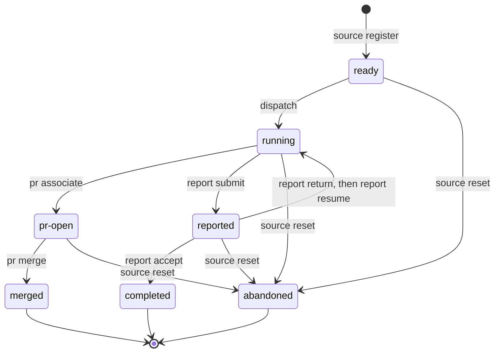

# Operator

Personal skills and CLI tools for coordinating coding agents in OpenCode and Claude Code through [Herdr](https://herdr.dev/).


> [!NOTE]
> Inspired by The Matrix, an Operator loads programs, guides missions, and keeps the crew in the field connected.

Operator is based on [Matt Pocock's agent skills and workflow](https://github.com/mattpocock/skills).
His skills guide the work from clarifying a goal and writing a spec through tickets, implementation, and review.
Operator builds on that workflow by coordinating the agents, worktrees, and recorded decisions that carry the work between those steps.

Operator 1.0.0 is a device-level tool.
One installed release serves every registered project on the device, and settings and state live on the device, not in a checkout.
A SuperAgent coordinates WorkerAgents, and the CLI owns the workflow state machines and returns the next actions.
`CONTEXT.md` defines the terms, and `docs/adr/` records the decisions.

## How the workflow runs

The SuperAgent registers a work source, which is a plan of assignments from the tracker.
Each assignment completes through a pull request or through a report.
The CLI keeps the state of each source and assignment, and `operator next` returns the next action for each one.



- **ready**: the assignment waits for its dependencies.
  A pull request dependency must be open or merged, and a report dependency must be completed.
  A pull request with an open parent pull request stacks on the parent branch.
- **running**: a WorkerAgent works in its own Herdr pane or worktree.
- **pr-open**: the owner WorkerAgent answers feedback and failing checks with `pr wait`.
  It merges with `pr merge` only after an approving review and passing checks.
- **reported**: the report waits for the SuperAgent.
  The SuperAgent accepts it, or returns it with a follow-up that the WorkerAgent resumes.
- **merged** and **completed**: the work is done, and the CLI cleans up the branch, pane, and worktree.
  Work that did not land stays until the person decides.
- **abandoned**: the person ended the source with `source reset` before the work was done.

A source is `open` until each assignment is merged or completed, and then it is `finished`.
A `source reset` changes it to `reset`.
`source prune` deletes an ended source 14 days after its end.
Each state machine is a pure decision over gathered facts, as ADR-0003 records.

## Install Operator for the device

One installed release serves every registered project.
The running installation is the release authority, and projects select no release.
Bun, Nix, or the person updates the installation, and the next command migrates compatible device state.
Bun 1.4.0 or later is required on the JSR and source paths.
The Nix package brings its own pinned Bun.

### JSR with Bun

Put the JSR scope in the global Bun configuration, `~/.bunfig.toml` or `$XDG_CONFIG_HOME/.bunfig.toml`:

```toml
[install.scopes]
"@jsr" = "https://npm.jsr.io"
```

Install one exact version, then run its CLI once from the main checkout to register the project and write the launcher:

```sh
bun add -g "@fveracoechea/operator@npm:@jsr/fveracoechea__operator@<exact-version>"
OPERATOR_PACKAGE="$(bun pm ls -g | head -n 1 | sed 's/ node_modules (.*//')/node_modules/@fveracoechea/operator"
bun "$OPERATOR_PACKAGE/cli.js" project register --json
bun "$OPERATOR_PACKAGE/cli.js" install launcher --json
operator --version --json
```

JSR rewrites the package manifest and drops its binary declaration, so Bun links no command.
`install launcher` writes `operator` into the folder that `bun pm bin -g` reports.
The launcher names Bun's global package folder and no version, registry, cache, or staging folder.
It refuses with exit 3 unless the running package is Bun's global package at the exact version in Bun's global manifest.
It refuses with exit 4 and changes nothing when another `operator` command is already there.
To update, run the same `bun add -g` command with the new exact version.
The same launcher then runs the new release.
Do not install a version range, because Bun then records `^<version>` rather than the exact release.

### Repository source at a full commit

```sh
bun add -g "git+https://github.com/fveracoechea/operator.git#<full-commit>"
operator project register --json
operator --version --json
```

Bun links `operator` to the package's `cli.ts` in its global folder, with no install-time build.
Name the 40-character commit, so that a later Bun update cannot move the installation.
Version JSON reports the commit that Bun recorded.
A source install has no artifact identity, because it runs the source rather than the built artifact.
Bun blocks the package's preinstall script, and Operator checks the Bun version at startup instead.

### Nix flake

The flake exposes `packages.<system>.default` for `aarch64-darwin` and `x86_64-linux`.
Pin the release tag, so that the package records the commit that the tag and the JSR release name:

```nix
inputs.operator.url = "github:fveracoechea/operator/v<version>";
```

Add the package to a profile and link every owned skill from your own configuration.
The package lists the names in `skills`.
For example, with the skills options of Home Manager `release-26.05`:

```nix
let
  operator = inputs.operator.packages.${pkgs.stdenv.hostPlatform.system}.default;
  ownedSkills = lib.genAttrs operator.skills (name: "${operator}/share/skills/operator/${name}");
in
{
  home.packages = [ operator ];
  programs.claude-code.skills = ownedSkills;
  programs.opencode.skills = ownedSkills;
}
```

Then register the project once from the main checkout:

```sh
operator project register --json
operator --version --json
```

The package holds the same built artifact as the JSR release, with the same commit, release record, and artifact identity.
It builds the locked dependencies with bun2nix and the Bun that `packageManager` pins, and it fetches nothing at runtime.
`bin/operator` runs that Bun on the artifact, and puts that Bun last on `PATH` for delegated installs.
Each owned skill folder is at `share/skills/operator/<name>`.
Operator has no Home Manager module, and it never changes your Nix wiring.
`operator install` only checks the linked skills on this path, and `operator install matt` still works.
To update, change the tag and rebuild your configuration.
The next command migrates compatible device state.

### Global command discovery

Put Bun's global bin folder, from `bun pm bin -g`, on `PATH` for your shells and for Herdr.
Put `bun` itself on the same `PATH`, because the launcher and the source command both run through `bun`.
A Nix install needs only the profile's bin folder on `PATH`.
Herdr hooks and agents find Operator through `PATH`, never through a release-specific path.
All delivery paths keep working after the registry, the source repository, or the Bun cache is gone.
Installing an unrelated global Bun package changes Bun's global lock but not Operator's release identity.
`operator ready --json` reports a missing global command, a global command that runs another release, and an installation that names no exact version or full commit.

## First run

Run the first registration from the main checkout of a project with a GitHub remote:

```sh
operator project register --json
operator --help
operator --version --json
```

Until registration creates device state, every other command, including help and version, refuses with `state_missing`.
Every command checks device-state compatibility first.
An older matching history migrates automatically after a verified backup.
Use `bun cli.ts` in place of `operator` from a source checkout.

## Commands

`operator --help` lists every command.
Every command takes `--json`.

### Device and projects

```sh
operator config show --json
operator config plan --set superAgent.host=opencode --json
operator config apply --set superAgent.host=opencode --plan <plan-id> --json
operator config recover --json
operator config resolve --role workerAgent --json
operator host models --host claude-code --json
operator project show --json
operator project list --json
operator project move --json
operator project remove owner/repository --person-instructed --json
```

Settings are in `$XDG_CONFIG_HOME/operator/config.json`, and state is in `$XDG_STATE_HOME/operator/`.
Hosts are `opencode` and `claude-code`.
WorkerAgents inherit the SuperAgent's host and model, and named profiles under `profiles.<name>` override them.
Project removal needs the person's instruction.
It deletes Operator records only, never checkouts, branches, or worktrees.

### Skills and readiness

```sh
operator install --opencode --claude --json
operator install --opencode --claude --check --json
operator install matt --opencode --claude --json
operator ready --json
```

`install` copies the owned skills of the running release into the personal host folders, and it refuses to overwrite edited content.
A Nix install only checks the skills that your configuration links.
`install matt` runs the pinned upstream skills installer.
`ready` checks `gh`, its GitHub login, `herdr`, the global `operator` command, the host executable, and the owned skills.
It launches nothing.

### Assignments and dispatch

```sh
operator source register --file /absolute/path/assignments.json --json
operator source show --source <source-id> --json
operator next --json
operator herdr install --json
operator dispatch --source <source-id> --assignment <key> --json
operator source reset --source <source-id> --person-instructed --json
operator source prune --json
```

The SuperAgent reads the tracker and supplies a JSON plan, because the CLI reads no tracker.
`next` returns ready candidates, dependency blockers, waits, and attention rows, and it writes nothing.
`herdr install` links one stable Herdr plugin, whose hooks prepare each new worktree and record worker activity.
`dispatch` starts a ready assignment in a Herdr pane or worktree, with an absolute brief in device state.
`source reset` ends a source on the person's instruction, and `source prune` deletes ended sources after 14 days.

### Reports

```sh
operator report submit --file <report.json> --json
operator report resume --json
operator report accept --source <source-id> --assignment <key> --json
operator report return --source <source-id> --assignment <key> --file <follow-up.md> --json
```

A WorkerAgent submits and resumes from its own pane.
Only the SuperAgent's acceptance completes a report assignment and unblocks its dependents.

### Pull requests

```sh
operator pr associate --json
operator pr wait --timeout 300 --json
operator pr merge --json
operator cleanup --source <source-id> --assignment <key> --json
```

The owner WorkerAgent runs the `pr` commands in its recorded worktree.
`pr wait` reports new feedback, failing checks, an eligible head, and a merged parent PR, which it relays onto the default branch.
`pr merge` merges only with an approving review, passing checks, no unresolved thread, the default branch as base, and the worktree at the PR head.
After the merge, a separate process deletes the remote branch, closes the pane, and removes the worktree.
Work that did not land stays until the person instructs `cleanup --person-instructed`.

### Reviews

```sh
operator review add <pr-url> --json
operator review start <pr-url> --json
operator review wait --json
operator review next --json
operator review post <pr-url> --json
operator review skip <pr-url> --json
operator review cleanup <pr-url> --json
```

A review request is a separate record for one PR of a registered project.
The reviewer writes a draft with the `pr-review` skill, and `review post` is the only path that posts.
`review wait` starts rounds when the PR changes, and keeps one reviewer for each request.
With `review.channel`, `review.repos`, and `review.authors` in settings, `review wait --slack` drives the `slack-pr-review-workflow` skill in Claude Code through `review ingest` and `review slack-done`.

## Development

```sh
bun install --frozen-lockfile
bun run quality
bun run mutate --since HEAD
```

`quality` runs formatting, lint, typechecking, the module and skill shape checks, deliberate boundary breaks, and the tests.
`bun run test` stops with exit code 124 when no test makes progress for 120 seconds.
Mutation testing is local only, and the `unit-testing` development skill explains it.
`AGENTS.md` holds the rules for agents that work in this repository.

## Release

Changesets opens a version pull request.
Its merge publishes the version to JSR and creates the GitHub tag and release, after quality and the release smoke pass on that commit.
A publication never moves a tag or replaces a version, and a retry sends only the missing part.

```sh
SOURCE_DATE_EPOCH="$(git log -1 --format=%ct <full-commit>)" \
  bun scripts/release.ts build --out dist --commit <full-commit>
```

`scripts/release.ts` also has the maintainer-only `plan`, `publish`, `check`, and `verify` operations for the release workflows.
