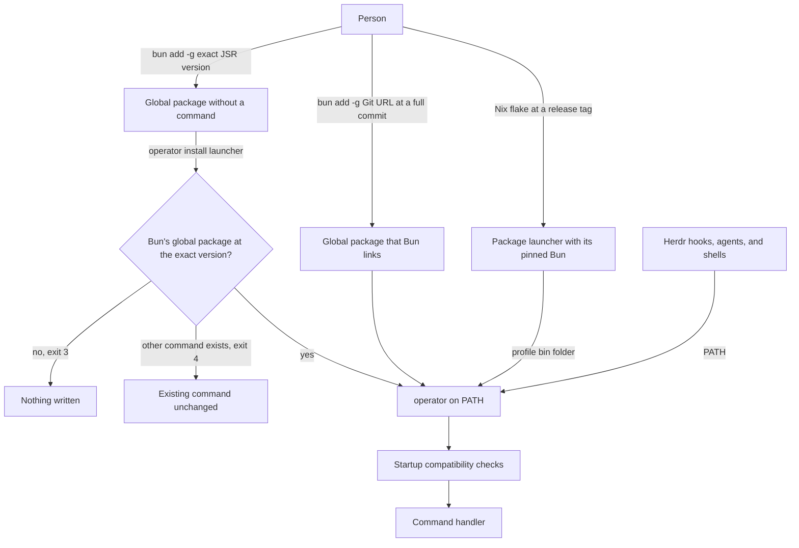

# Operator

Personal skills and CLI tools for coordinating coding agents in OpenCode and Claude Code through [Herdr](https://herdr.dev/).

## Breaking replacement in progress

Issue [#234](https://github.com/fveracoechea/operator/issues/234) defines the device-level replacement.
This branch starts with [#235](https://github.com/fveracoechea/operator/issues/235), which removes the legacy architecture before new workflows land.
It is not an intermediate release.
Help, version reporting, global installation, the Nix package, device settings, launch selection, project registration, skill installation, static readiness, supplied assignment plans, next actions, worker dispatch, the global Herdr plugin, the PR feedback loop with parent-merge relay, report assignments, the guarded PR merge, and cleanup after a merge are available.

Finish old work with the old release before updating to the eventual breaking release.
This code does not inspect, migrate, repair, or delete legacy Operator state.
Do not use it to resume an old session.

The device-level design in `CONTEXT.md` and `docs/adr/` remains planned.
The base lint policy in ADR-0018 is now enforced.
Local mutation testing from ADR-0016 is also available for repository development.
Reviews are not implemented here.
There are no replacement-command placeholders or compatibility aliases.

## Install Operator for the device

One installed release serves every registered project.
The running installation is the release authority, and projects select no release.
Bun, Nix, or the person updates the installation, and the next command migrates compatible device state.
Bun 1.4.0 or later is required on the JSR and source paths.
The Nix package brings its own pinned Bun.

### JSR with Bun

Put the JSR scope in the global Bun configuration, `~/.bunfig.toml` or `$XDG_CONFIG_HOME/.bunfig.toml`:

```toml
[install.scopes]
"@jsr" = "https://npm.jsr.io"
```

Install one exact version, then run its CLI once from the main checkout to register the project and write the launcher:

```sh
bun add -g "@fveracoechea/operator@npm:@jsr/fveracoechea__operator@<exact-version>"
OPERATOR_PACKAGE="$(bun pm ls -g | head -n 1 | sed 's/ node_modules (.*//')/node_modules/@fveracoechea/operator"
bun "$OPERATOR_PACKAGE/cli.js" project register --json
bun "$OPERATOR_PACKAGE/cli.js" install launcher --json
operator --version --json
```

JSR rewrites the package manifest and drops its binary declaration, so Bun links no command.
`install launcher` writes `operator` into the folder that `bun pm bin -g` reports.
The launcher names Bun's global package folder and no version, registry, cache, or staging folder.
It refuses with exit 3 unless the running package is Bun's global package at the exact version in Bun's global manifest.
It refuses with exit 4 and changes nothing when another `operator` command is already there.
To update, run the same `bun add -g` command with the new exact version.
The same launcher then runs the new release.
Do not install a version range, because Bun then records `^<version>` rather than the exact release.

### Repository source at a full commit

```sh
bun add -g "git+https://github.com/fveracoechea/operator.git#<full-commit>"
operator project register --json
operator --version --json
```

Bun links `operator` to the package's `cli.ts` in its global folder, with no install-time build.
Name the 40-character commit, so that a later Bun update cannot move the installation.
Version JSON reports the commit that Bun recorded.
A source install has no artifact identity, because it runs the source rather than the built artifact.
Bun blocks the package's preinstall script, and Operator checks the Bun version at startup instead.

### Nix flake

The flake exposes `packages.<system>.default` for `aarch64-darwin` and `x86_64-linux`.
Pin the release tag, so that the package records the commit that the tag and the JSR release name:

```nix
inputs.operator.url = "github:fveracoechea/operator/v<version>";
```

Add the package to a profile and link every owned skill from your own configuration.
The package lists the names in `skills`.
For example, with the skills options of Home Manager `release-26.05`:

```nix
let
  operator = inputs.operator.packages.${pkgs.stdenv.hostPlatform.system}.default;
  ownedSkills = lib.genAttrs operator.skills (name: "${operator}/share/skills/operator/${name}");
in
{
  home.packages = [ operator ];
  programs.claude-code.skills = ownedSkills;
  programs.opencode.skills = ownedSkills;
}
```

Then register the project once from the main checkout:

```sh
operator project register --json
operator --version --json
```

The package holds the same built artifact as the JSR release, with the same commit, release record, and artifact identity.
It builds the locked dependencies with bun2nix and the Bun that `packageManager` pins, and it fetches nothing at runtime.
`bin/operator` runs that Bun on the artifact, and puts that Bun last on `PATH` for delegated installs.
Each owned skill folder is at `share/skills/operator/<name>`.
Operator has no Home Manager module, and it never changes your Nix wiring.
`operator install` only checks the linked skills on this path, and `operator install matt` still works.
To update, change the tag and rebuild your configuration.
The next command migrates compatible device state.

### Global command discovery

Put Bun's global bin folder, from `bun pm bin -g`, on `PATH` for your shells and for Herdr.
Put `bun` itself on the same `PATH`, because the launcher and the source command both run through `bun`.
A Nix install needs only the profile's bin folder on `PATH`.
Herdr hooks and agents find Operator through `PATH`, never through a release-specific path.
All delivery paths keep working after the registry, the source repository, or the Bun cache is gone.
Installing an unrelated global Bun package changes Bun's global lock but not Operator's release identity.
`operator ready --json` reports a missing global command, a global command that runs another release, and an installation that names no exact version or full commit.
See `docs/implementation/256-global-installation.md` and `docs/implementation/257-nix-package.md` for the decision diagram and verification limits.



## Run the CLI from a checkout

For development from a source checkout:

```sh
bun install --frozen-lockfile
bun cli.ts project register --json
bun cli.ts --help
bun cli.ts --version
bun cli.ts --version --json
```

Run the first registration from a main checkout with a GitHub remote and no legacy `.operator` folder.
Until registration creates device state, every other command, including setup, help, and version, refuses with `state_missing`.
Version output describes the running installation, not a project-selected release.
A built artifact also reports its commit and artifact identity in JSON.
After startup succeeds, unknown or removed commands exit with code 2 and perform no workflow operation.
An unsupported Bun exits with code 1 before a command runs.
An installed package also exports `main(args)` from `@fveracoechea/operator/cli`.

## Personal owned skills

```sh
operator install --opencode --json
operator install --claude --json
operator install --opencode --claude --json
operator install --opencode --claude --check --json
```

Owned skills come from the running package, with complete supporting assets copied to personal host locations.
OpenCode uses `$XDG_CONFIG_HOME/opencode/skills/`, or `~/.config/opencode/skills/` when unset.
Claude Code uses `~/.claude/skills/`.
The device ledger permits replacement only of unchanged managed content.
Matching content stays unwritten.
Modified or unrelated contents refuse with exit 4 rather than overwrite your edits.
Old role names are removed only with unchanged device-ledger proof, without forwarding skills or legacy-ledger adoption.

`--check` follows links and compares contents without writing host folders or device state.
Packages under `/nix/store/` always check consumer-owned wiring rather than copy skills.
The role skills are `super-agent` and `worker-agent`.
Workflow commands remain in their later implementation tickets.

## Upstream skills and static readiness

```sh
operator install matt --opencode --json
operator install matt --claude --json
operator install matt --opencode --claude --json
operator ready --json
```

Use `bun cli.ts` in place of `operator` from a source checkout.
An explicit Matt install permits the upstream tool's replacement policy.
It can replace local edits without an Operator preview.
Operator invokes `bun x --bun skills@1.7.4` with a resolved full Matt repository commit, global scope, explicit hosts, and every upstream skill name except names owned by the running Operator release.
The upstream tool owns its shared copies, host links, and lock record, including on Nix devices.
Operator has no upstream plan/apply commands or second upstream-content ledger.
Failed or interrupted installs can have partial effects, so inspect their destinations before another install.
An unconfirmed installer answer exits with code 5.

`ready` checks `gh`, GitHub authentication for `github.com`, `herdr`, that the global `operator` command runs this release from a pinned installation, and the executable for `superAgent.host` in device settings.
It follows links and compares complete owned contents with the running release.
Required upstream `code-review` must have a nonempty `SKILL.md` in the expected personal location.
OpenCode uses the upstream shared `~/.agents/skills/`, while Claude Code uses `~/.claude/skills/`.
Independent upstream revisions need not match Operator.
Missing prerequisites return current blockers and exit 3, while a ready result exits 0.
The command writes no readiness record, changes no project, and launches no host, metadata handshake, or live probe.
It requires no Slack MCP tools on either host.
Static readiness is not proof of host loading or provider access.
See `docs/implementation/243-static-readiness.md` for ownership, the decision diagram, and verification limits.

## Device settings

Linux and macOS use the same XDG layout.
Settings are in `$XDG_CONFIG_HOME/operator/config.json`, or `~/.config/operator/config.json` when the variable is unset.
Settings receipts and their SQLite write lock are in `$XDG_STATE_HOME/operator/config/`, or `~/.local/state/operator/config/`.
An explicitly empty or relative root is an error before any command runs.
There is no `OPERATOR_HOME`, cache root, or runtime root.

```sh
bun cli.ts config show --json
bun cli.ts config plan --set superAgent.host=opencode --json
bun cli.ts config apply --set superAgent.host=opencode --plan <plan-id> --json
bun cli.ts config recover --json
```

Use the plan ID returned by `config plan` and repeat the same edits for `config apply`.
`--set` and `--unset` accept `superAgent.host`, `superAgent.model`, `superAgent.reasoningEffort`, and the corresponding `workerAgent` fields.
Hosts are `opencode` and `claude-code`.
Effort names come from the selected host and model's current metadata.
This includes custom OpenCode variant names, rather than only a fixed effort list.
Planning and apply validate every complete selection against current host metadata.
Incomplete host-only or effort-only settings can be saved before a model is selected.
An absent document reads as empty role settings and creates no files.
The first applied edit creates the document with `$schema` set to `./config.schema.json`.
An applied edit also writes current editor support unless that destination is linked or read-only.
Inspection and planning write nothing.

Apply refuses a stale plan and protects repeated or interrupted writes with a durable receipt and a process-safe SQLite lock.
Recovery reconciles the receipt from the recorded before and after file identities, without editing settings.
An unmatched or unreadable receipt remains blocked for inspection.
An unconfirmed write exits with code 5 and requires recovery, not a blind new edit.
Linked or read-only settings remain readable, but edits refuse with instructions to change their external owner, such as Nix or Home Manager.
Settings commands do not inspect legacy state or change a project checkout.
See `docs/implementation/239-device-settings.md` for the state diagram and test rules.

## Hosts and start profiles

Read the selected host's available models and efforts before choosing them:

```sh
operator host models --host opencode --json
operator host models --host claude-code --json
operator config plan --set superAgent.host=opencode --set superAgent.model=<advertised-model> --json
operator config apply --set superAgent.host=opencode --set superAgent.model=<advertised-model> --plan <plan-id> --json
operator config resolve --role superAgent --json
operator config resolve --json
operator config plan --set profiles.investigation.reasoningEffort=high --json
operator config apply --set profiles.investigation.reasoningEffort=high --plan <plan-id> --json
operator config resolve --profile investigation --json
```

Use `bun cli.ts` instead of `operator` from a source checkout.
Model identifiers in examples are placeholders, not availability claims.
An unset host or model refuses resolution rather than selecting a fallback.
The SuperAgent defaults to high effort.
WorkerAgents inherit the SuperAgent's host and model, with medium effort.
Worker defaults override those fields individually, then a named profile overrides them, then explicit `config resolve` flags override them.
The flags are `--host`, `--model`, and `--effort`.

Profile names use a lowercase letter followed by up to 63 lowercase letters, digits, or hyphens.
`constructor` and `prototype` are reserved.
Use `profiles.<name>.host`, `.model`, or `.reasoningEffort` with the same protected settings commands.
Use `--unset profiles.<name>.<field>` to restore inheritance, or `--unset profiles.<name>` to remove the profile.
Profiles describe launch choices, not a closed list of worker tasks.

OpenCode V2 supplies a directory-scoped model catalog and variant names.
Claude Code supplies supported models and effort levels through its metadata initialization handshake.
That handshake sends no prompt or generation request and does not save a conversation.
Neither metadata path is a readiness probe or proof that a provider request will succeed.
Missing or malformed metadata and unsupported choices refuse without substitution.
Claude aliases with an advertised concrete model resolve to that model, and the result retains the requested name.
`default` and the multi-model `opusplan` mode are not launch selections.

Resolution returns a value and its host command arguments, not a launched worker.
Later settings edits change later resolutions but cannot change an earlier returned value or a running worker.
Dispatch records each launch's resolved selection, release, and skill identities.
Operator adds no host permission rules, allow lists, permission modes, or fallback flags.
Host configuration remains under its external owner's control.
See `docs/implementation/241-host-profiles.md` for the selection diagram and verification limits.

## Project registration and management

Run from the main checkout or one of its subdirectories:

```sh
operator project register --json
operator project register --repository owner/repository --json
operator project show --json
operator project list --json
operator project move --json
operator project move --repository owner/repository --json
operator project remove owner/repository --person-instructed --json
```

For a source checkout, use `bun cli.ts` in place of `operator`.
Registration records one lowercase GitHub identity and real controlling-checkout path.
Several distinct GitHub remote identities require an explicit matching `--repository` choice.
Remote names have no special authority.
Repeating registration from the same controller returns the original record.
An alternate clone refuses and names the controller.
Bare repositories, linked controlling worktrees, and legacy `.operator` entries refuse without modification.

Explicit registration atomically creates `$XDG_STATE_HOME/operator/operator.sqlite` when needed.
It uses the same home fallback as settings state and creates the project's directory in device state.
It changes no checkout files.
`project show` resolves the current controller without creating missing state.
`project list` runs anywhere and reports each controller's current status and open-source count.
It also reports pending project file removals, even after their registrations are gone.
`project move` runs from the new main clone, requires the same remote identity and no open source, and preserves the registration time.
Removal requires the person's explicit instruction and no open source.
`--person-instructed` attests that instruction, it does not grant permission to infer it.
Removal deletes project records and device-state content, never checkouts, branches, worktrees, tracker content, or migration backups.
If file cleanup fails, the command exits 1 and keeps a durable pending removal.
Resolve the reported filesystem problem, then repeat the same person-instructed removal.
Registration of that identity stays blocked until cleanup completes.
See `docs/implementation/246-project-management.md` for the decision diagram and failure limits.
Every command checks device compatibility before its handler, including help and version reporting.
An older matching Drizzle history applies all pending fixed migrations automatically, with a verified SQLite snapshot and writer protection.
Migration waits for device-wide idle work and declared held-record blockers.
The latest three verified migration backups remain under the device state's `backups/` folder.
Damaged or incompatible state is not repaired or replaced.
Corruption reports the last currently verified backup, if one is available.
Only explicit registration creates a missing database.
See [automatic compatibility](docs/implementation/245-automatic-compatibility.md) for refusals and backup limits.
Project management and recoverable file cleanup are recorded in `docs/implementation/246-project-management.md`.
See `docs/implementation/240-project-registration.md` for the state diagram, refusals, and test rules.

## Assignment plans and next actions

From a registered controlling checkout, supply a JSON plan rather than ask the CLI to read a tracker:

```sh
operator source register --file /absolute/path/assignments.json --json
operator source show --source <source-id> --json
operator next --json
operator next --source <source-id> --json
```

Use `bun cli.ts` instead of `operator` in a source checkout.
The plan supplies tracker keys, instructions, PR or report completion, dependencies, optional named profiles, resources, and branch names for worktrees.
See `docs/implementation/244-assignment-plans.md` for the complete JSON example and decision diagram.
Invalid or cyclic plans refuse before writes.
A second open source for the same project and tracker parent refuses.
Each registration after an ended source gets a new identity.
An empty plan finishes immediately.

`next` reads one snapshot and returns ready candidates, dependency blockers, active waits, and ended sources without writing a schedule.
PR dependencies permit start at `pr-open` or `merged`.
Report dependencies require accepted `completed`, not submitted `reported`.
The commands launch no host and perform no tracker operations.
Report submission, acceptance, and parent-merge relay are described below.
A PR assignment with several open parent PRs waits until all but one merge, because a PR stacks on one parent branch.

## Worker dispatch and the Herdr plugin

```sh
operator herdr install --json
operator dispatch --source <source-id> --assignment <key> --json
```

`herdr install` writes one stable plugin manifest under the device state root and links it in Herdr.
Its hooks call the global `operator herdr event` command, so they need no release-specific path.
The hook prepares every new Herdr worktree of a registered project.
It copies ignored `.env*.local` files from the controlling checkout at any depth outside `node_modules`, keeps existing files, and refuses links.
Then it runs `bun install --frozen-lockfile` when the worktree has a Bun lockfile.

`dispatch` starts one ready assignment, or replaces a failed, interrupted, or abandoned launch.
Run it in a Herdr pane, because hooks match launches by the Herdr socket.
It refuses before any Herdr effect when it runs outside a Herdr session, the assignment is not dispatchable, the device is not ready, or the plugin is missing or from another release.
Read-only `pane` work gets a tab in the project's Herdr workspace.
`worktree` work gets an isolated worktree whose path Herdr chooses and Operator records.
The brief lives in device state, and the worker receives its absolute path.
Names use the completion type, tracker key, and assignment key, with a numbered suffix on a collision.
A failed launch keeps its recorded resources and appears in `next` as `replace_worker`.
A start whose dispatch process stopped appears as `replace_worker` with `launch_abandoned`.
Herdr activity is shown as an observation only, never as completion.
See `docs/implementation/247-dispatch.md` for the diagram, live evidence, and limits.

## PR feedback loop

```sh
operator pr associate --json
operator pr wait --timeout 300 --json
```

The owner WorkerAgent opens its PR with its own tools and closing keywords, then runs these commands in its recorded worktree.
No flag selects an assignment or a PR.
The real Git top level must be the recorded worktree of the running owner, on the recorded branch, in the registered repository.
`pr associate` records the one open PR from that branch and moves the assignment to `pr-open`.
`pr wait` polls GitHub until it sees new feedback, a failing check on the current head, a newly eligible head, or a merged or closed PR, and reports each item once.
Its progress is in device state, so a restarted wait does not repeat a result.
`next` shows `owner_attention` for a timed-out or stopped wait, an owner that Herdr reports idle between waits, or a PR that is no longer open, and `replace_worker` for an ended owner pane.
A replacement keeps the PR, its progress, and the PR's recorded worktree, and refuses when that worktree is missing.
See `docs/implementation/249-pr-feedback.md` for the diagrams, refusals, and evidence.

A PR assignment whose dependency has an open PR starts on that PR's pushed branch, and its owner opens its PR against that branch.
`pr associate` accepts only the default branch or the branch of a dependency's PR as the base, never a source-wide integration branch.
After the parent PR merges into the default branch, the child's `pr wait` rebases the child branch onto it, pushes with a lease on the PR head, changes the PR base, and reports `parent_relayed`.
A conflict or a failed Git or GitHub step is a `relay_*` blocker that keeps the branch, and `next` shows `owner_attention` with `pr_relay_blocked`.
The child is not merge eligible while its base is not the default branch.
See `docs/implementation/250-pr-relay.md` for the relay diagram, its progress record, and evidence.

## Report assignments

```sh
operator report submit --file <report.json> --json
operator report resume --json
operator report accept --source <source-id> --assignment <key> --json
operator report return --source <source-id> --assignment <key> --file <follow-up.md> --json
```

A WorkerAgent runs `submit` and `resume` in the Herdr pane that Operator dispatched for it, and names no assignment.
The report holds a short conclusion, evidence references, unresolved points, answers labeled as human answers or SuperAgent decisions, and supporting files that Operator copies into device state.
Submission moves the assignment to `reported`, and `next` shows `review_report` to the SuperAgent.
Only acceptance completes the assignment and unblocks its dependents. Herdr activity never does.
`return` records follow-up instructions. A live worker runs `resume`, and a stopped worker is replaced with every earlier report and follow-up in its brief.
Acceptance closes the worker pane and removes a report worktree only when Git shows no unlanded work.
A kept worktree waits for the person, and a failed cleanup stays in `next` as `retry_cleanup`.
See `docs/implementation/248-report-assignments.md` for the report file, the lifecycle, and cross-project use.

## Guarded merge and cleanup

```sh
operator pr merge --json
operator cleanup --source <source-id> --assignment <key> [--person-instructed] --json
```

The owner runs `pr merge` in its recorded worktree.
It reads the PR from GitHub again and merges the observed head only with an approving review decision, at least one check and every check passing, no unresolved review thread, the default branch as base, and the worktree at that head.
A refusal sends no merge request and writes nothing.
The merge is recorded only after GitHub reports the PR merged with a merge commit.
Then a separate process deletes the remote branch, closes the owner's pane, and removes the worktree, in that order.
A step that fails stays in `next` as `retry_cleanup`, and the SuperAgent repeats it with `cleanup` from the controlling checkout.
Commits that are not in the merged head, changed or untracked files, and ignored content that preparation did not write stay, and `next` shows `person_decision`.
Lockfile-installed `node_modules` folders and unchanged copies of `.env*.local` files are preparation output and do not block.
Only the person's instruction, `--person-instructed`, deletes unlanded work, and it covers only the step that is blocked when the cleanup starts.
A moved remote branch is deleted only on the person's instruction, and a foreign checkout is never deleted.
See `docs/implementation/251-merge-cleanup.md` for the diagrams, refusals, and evidence.

## Retained code and checks

Features and capabilities live under root `modules/`.
Each module exposes one interface object from `main.ts`, and other files are private.
Focused reusable functions live under root `lib/`, with direct named imports and beside-tests.
Lib code imports no application module or tooling.

```sh
bun run quality
bun run test:module-boundaries
```

Quality runs formatting, lint, typechecking, structural checks, skill checks, deliberate module-boundary violations, and the remaining tests.
The tests use isolated globals.
`bun run test` stops with exit code 124 when no test makes progress for 120 seconds.
It then prints the processes, working directories, sockets, and pipes of its own run, and kills only that run.
Two quality runs in separate worktrees can run at the same time.
See `docs/implementation/220-concurrent-quality.md` for the concurrency evidence and the open Bun defects.
Oxlint owns dependency cycles and type-aware code policy, while the module checker owns structural boundaries.
The deliberate-break tests run the real lint command in disposable checkout copies.
See `docs/implementation/237-lint-policy.md` for policy coverage, exception boundaries, and verification.
The installed delivery smoke uses real Bun global and project installs, Git, a local registry fixture, and the built public declarations.
Publication tests use controlled GitHub and official-client commands.
They publish no real release.

See `docs/implementation/235-legacy-removal.md` for the inventory, retained ownership, diagram, and verification results.
`skills/` contains complete owned engineering skills.
The old role and posting-review skills are removed, and replacements arrive with their workflows.

## Local mutation testing

```sh
bun run mutate lib/sha256.ts
bun run mutate lib/sha256.test.ts
bun run mutate --since HEAD
```

Pass explicit unit or beside-test paths, or changed lines against an explicit Git ref.
Only direct same-folder tests count for each unit.
No target is a usage error.
Mutation testing is not part of `quality` or CI and adds no `operator` command.
See [the development mutation topic](.agents/skills/unit-testing/mutation-testing.md) for exits, target rules, and survivor repairs.
The development-only `unit-testing` skill has a Claude Code link and does not ship in the release.

## Release tooling

The existing Changesets workflow remains automatic after a merged version change passes quality and release smoke.
It uses pinned actions and the exact official JSR client with short-lived credentials.
Publication refuses conflicting tags or versions, and retries supply only missing delivery.

```sh
SOURCE_DATE_EPOCH="$(git log -1 --format=%ct <full-commit>)" \
  bun scripts/release.ts build --out dist --commit <full-commit>
```

Build refuses without `SOURCE_DATE_EPOCH`, because the release record names the commit time as its build time.
The JSR artifact and the Nix package of one commit then have the same release record.
Build writes runnable ESM, declarations, complete retained skills, the settings editor schema at `schemas/config.schema.json`, the Herdr plugin manifest at `modules/worker-dispatch/herdr-plugin.toml`, the fixed migrations, documentation, and a content-identified release record.
The old project configuration schemas and release-specific Herdr hooks no longer ship.
The maintainer-only `plan` and `publish` operations remain in `scripts/release.ts` for the release workflow.
Do not publish this partial implementation.
