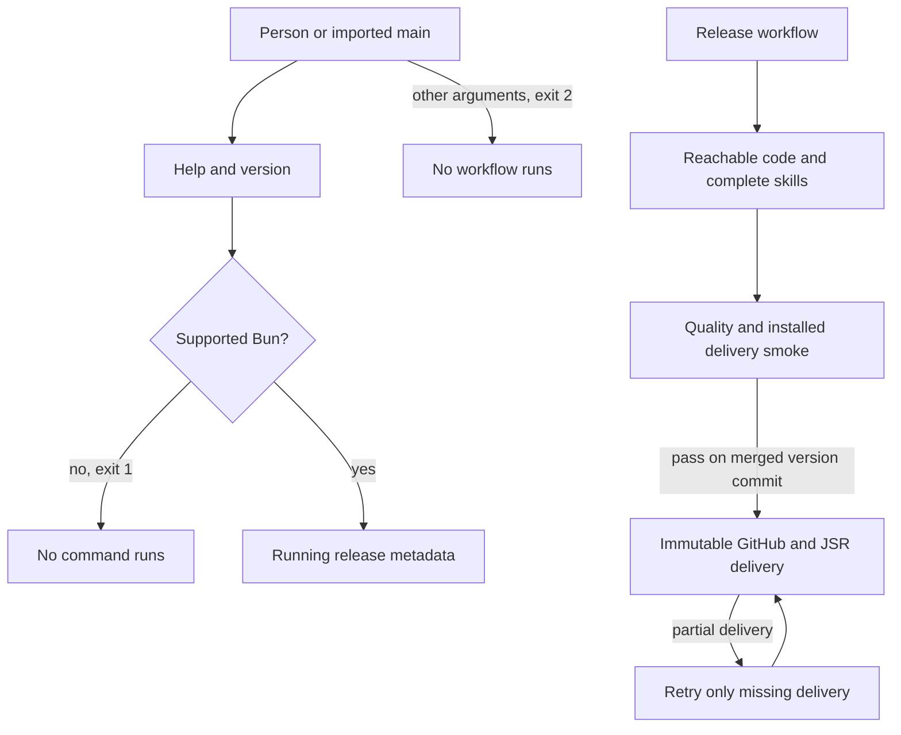

# Legacy removal, issue 235

This is the first implementation slice of #234 on `global-operator-home` in PR #222.
It intentionally removes working legacy workflows before their replacements exist.
It is not an intermediate release.
The accepted glossary and ADR suite describe the target design, not completed runtime support.

## Inventory and ownership

The inventory covers tracked source at `508cd90`.
No real Operator settings, device records, or checkout-local legacy records are inputs to this work.

| Existing paths | Disposition and named use |
| --- | --- |
| `cli.ts`, `modules/operator-cli/main.ts`, `run.ts` | Retain the importable entry point and runtime check. Replace command routing with help and running-release version reporting. |
| Other `modules/operator-cli/` commands, tests, and fixtures | Remove legacy workflow callers. Replace with isolated public CLI tests for the remaining commands and rejection of removed commands. |
| `modules/operator-release/` | Retain release identification, reachable-source compilation, declarations, complete skill assets, and artifact inspection. Remove project schemas, plugin packaging, and installation-lock fingerprints. |
| `modules/release-publish/` | Retain immutable GitHub and JSR publication, staged official-client invocation, deterministic packing, partial-delivery recovery, and controlled external-tool fixtures. |
| `modules/github-api/` | Retain HTTP outcome classification used by release publication. |
| `modules/tool-invocation/` | Retain bounded external-tool execution used by GitHub and JSR publication. Remove unused Git operations and field readers. Move the shared text-field parser to `lib/text-field.ts` with beside-tests. |
| `modules/content-identity/` | Remove the interface wrapper and unused canonical-value hashing. Put the shared SHA-256 operation in `lib/sha256.ts` with beside-tests. |
| `modules/release-install/` | Remove project selection, inspection, and worktree copying. Move the real Bun source and registry delivery scenarios and registry fixture beside release building. |
| `modules/skill-install/` | Remove project copies, committed-copy exceptions, and the custom upstream installer and ledger. Artifact identity covers bundled content. Remove the unused launch-only release identity API. Personal installation is later work. |
| `modules/operator-config/`, `modules/operator-update/`, `modules/project-setup/` | Remove checkout-local settings, update adoption, setup plans, and recovery. Device settings and registration are later work. |
| `modules/agent-selection/`, `modules/environment-probe/`, `modules/project-readiness/`, `modules/live-probe/` | Remove legacy selection, readiness evidence, host discovery, live probes, and dedicated tests. Static device readiness and launch profiles are later work. |
| `modules/crew-state/` | Remove its schema, migrations, ownership, replay, planning records, grants, quotas, frontier, questions, result review, rework, outside-change scanning, and all dedicated fixtures and tests. Do not reuse the legacy database as device state. |
| `modules/crew-wake/`, `modules/herdr-control/`, `modules/operative-dispatch/`, `modules/operative-cleanup/`, `herdr/` | Remove local brief references, launch snapshots, wake bindings, gate hooks, and legacy resource protocols. Device dispatch and the stable global-command hook are later work. |
| `modules/gate-runner/`, `modules/project-gate/`, `operator-gate.json` | Remove product gate declarations, execution, schemas, and dedicated tests. Keep the repository's ordinary quality scripts. |
| `modules/integration-branch/`, `modules/pull-request-stack/` | Remove source-wide branch mutation, rewrite, publication, and dedicated tests. Assignment-owned PRs are later work. |
| `modules/github-tracker/`, `modules/tracker-update/` | Remove CLI issue reads, writes, operation records, and recovery. Agents still use `gh` for repository development. |
| `skills/operator/`, `skills/operative/`, `skills/pr-review/` and their development links | Remove instructions for deleted workflows and direct review posting. Do not ship forwarding or placeholder skills. New role and draft-only review skills arrive with their workflows. |
| Other `skills/` directories | Retain owned engineering guidance and complete assets. Update module guidance for the root `modules/` and `lib/` split. |
| Other `.agents/skills/`, `.claude/skills/`, `skills-lock.json`, `opencode.json` | Retain development skills, upstream development provenance, and the person's host configuration. These are not CLI-owned workflow state or installed permission rules. |
| `scripts/check-module-shape.ts`, `prove-module-boundaries.ts`, `dependency-cruiser.config.cjs` | Retain structural checks and cycle proof until the scheduled lint-adoption slice. Permit focused lib exports, reject lib imports of application modules, and remove guards owned by deleted branch workflows. |
| `scripts/check-skill-shape*`, `oxlint-policy.test.ts`, `require-bun*`, `ci-pipefail.test.ts`, `tools/oxlint/anti-slop/` | Retain skill packaging, current lint policy, Bun-only installation, and CI failure propagation checks. |
| `scripts/test-bun.preload.ts`, `bunfig.toml`, `test-timings.json` | Retain same-runtime child execution and refresh timings for surviving tests. Test files run in isolated globals. |
| `.github/workflows/`, `scripts/release.ts`, `.changeset/`, `CHANGELOG.md` | Retain automatic versioning, quality checks, installed delivery smoke, pinned actions, short-lived publication credentials, and immutable delivery retries. Remove the live-probe job and obsolete pending launch-settings changeset. Historical changelog entries remain historical. |
| `README.md`, `docs/jsr/README.md`, `AGENTS.md`, `CLAUDE.md` | Retain current entry points, replace removed-command examples, and describe only available runtime operations. Keep the accepted design clearly marked as planned. |
| `CONTEXT.md`, `docs/adr/`, `docs/agents/` | Retain the accepted design and repository development conventions. CLI tracker removal does not remove the development issue tracker. |
| `drizzle-orm` | Remove the unused dependency with the legacy database. The device database slice chooses and pins its dependency. |
| `zod` | Retain boundary validation in release build and publication. |
| Development dependencies | Retain current exact compiler, formatter, lint, cycle-check, type, and official JSR-client pins. Base lint adoption is a separate ticket. |

## Retained structure

`modules/` owns CLI behavior, release building, publication, GitHub calls, and external-tool execution.
Each module exposes its one interface object through `main.ts`.
Implementation files stay private.
`lib/` contains focused reusable functions, imports no application module, and needs no interface object or barrel.
Single-use release logic stays with its release module.

Later tickets under #234 added the device-level workflows on top of this retained base.

## Verification

Removal tests run through the public CLI with real Bun installs, real Git, isolated directories, and controlled GitHub and registry tools.
`bun run quality` and `bun run test modules/operator-release` passed when the removal landed.
No release was published, no pull request was merged, and no real legacy state was changed.
