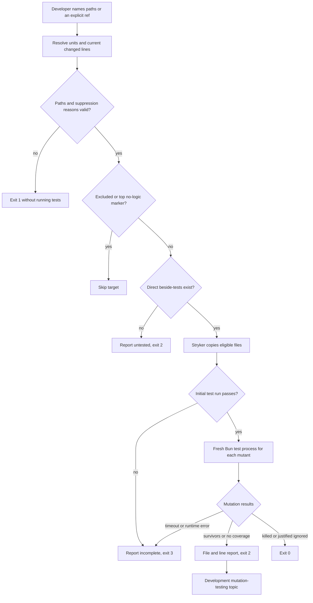

# Local mutation testing, issue 238

This slice adds repository development tooling under ADR-0016.
It adds no consumer command and does not change the ordinary quality or CI gates.
The normal tests run small controlled mutation fixtures to prove the tool's contract.
They do not run mutation analysis on repository code as a gate.

## Ownership and execution

`scripts/mutate.ts` owns the command runner, disposable Stryker copies, result output, and exit status.
`scripts/mutation-selection.ts` owns explicit targets, longest-stem beside-test matching, Git changed-line selection, and preflight checks.
`scripts/mutation-policy.ts` owns exclusions, parsed suppression comments, and the summary's guidance path.
Each logic file has its own direct beside-tests.
The tool uses exact development pins for `@stryker-mutator/core` and `@babel/parser`.
The parser distinguishes real comments from strings, regular expressions, and interpolated template text.
No private Jarvis source or skill text is an input.

Each unit runs only its same-folder `stem.test.ts` and `stem.<scenario>.test.ts` tests.
Private units cannot borrow `main.test.ts`.
Stryker's command runner calls the repository test script in a new Bun process for each mutant.
Coverage analysis and incremental mode are off.
Stryker does not rewrite the copied TypeScript configuration because its rewrite API is absent in TypeScript 7.
Bun reads the unchanged configuration instead.
The tool uses a separate temporary directory per unit and removes it on success or failure.
It excludes `.operator` before Stryker reads or copies that directory.
It excludes host skill links while retaining the local mutation topic for its reference check.

## Development guidance

`.agents/skills/unit-testing/` is a router with `writing-tests.md` and `mutation-testing.md`.
`.claude/skills/unit-testing` links to that directory.
It does not appear under bundled `skills/`.
The bundled `deep-modules/module-tests.md` agrees on direct private-file and lib beside-tests.
The README shows only the available local script.

## Verification

Verified with Bun 1.4.4 on Linux.

| Command                                                       | Result                                                                                                                                |
| ------------------------------------------------------------- | ------------------------------------------------------------------------------------------------------------------------------------- |
| `bun run test ./scripts/mutate.test.ts` before implementation | Red. The script did not exist.                                                                                                        |
| Targeted mutation command tests during implementation         | Red, then green for weak assertions, missing direct tests, invalid suppression reasons, scenario mapping, and changed-line selection. |
| `bun install --frozen-lockfile`                               | Passed with no dependency changes.                                                                                                    |
| `bun run quality`                                             | Passed all static checks, all 17 deliberate module-boundary violations, and 198 tests.                                                |
| `bun run mutate lib/sha256.ts`                                | Exit 0. Three killed mutants, no survivors, untested units, or incomplete results.                                                    |

`bun run mutate lib/sha256.test.ts` also exited 0 with the same three killed mutants.
`bun run test --rerun-each=3` passed 594 executions with no observed flake.
`bun run test:timings` passed 198 tests and recorded the new test-file timings.
The skill-shape checker passed against an isolated directory containing only the new development skill.
Verified the Claude Code link target and the absence of a bundled `skills/unit-testing` directory.

The weak-assertion fixture reports the arithmetic survivor at its correct file and line and exits 2.
It records distinct process IDs for the initial and mutant test runs.
The missing-test fixture exits 2 without borrowing a module interface test.
The invalid-reason fixture exits 1 before any target's tests run.
The guidance proof first runs the real reference test successfully in an isolated copy.
It deletes only that copy's topic and verifies that the same check fails.
The real Git scenario leaves an old weakly tested line unchanged and changes a separate tested line.
Changed-line analysis exits 0, while the explicit whole-unit run reports the old survivor and exits 2.
This also proves exact filename handling with spaces, brackets, and an apostrophe.
Other checks cover untracked additions, deletions, bad refs, symlink refusal, failed initial tests, cleanup, and source preservation.

The first full run found a lint violation in a test fixture.
The first repository mutation run also found Stryker's TypeScript 7 configuration incompatibility and its attempted copy of directory skill links.
The slice fixes these problems and adds a command scenario that covers both compatibility cases without real host or legacy state.

No real legacy state was inspected or changed.
No release was published and no PR was merged.
The complete changed-line survivor cleanup remains #260.
