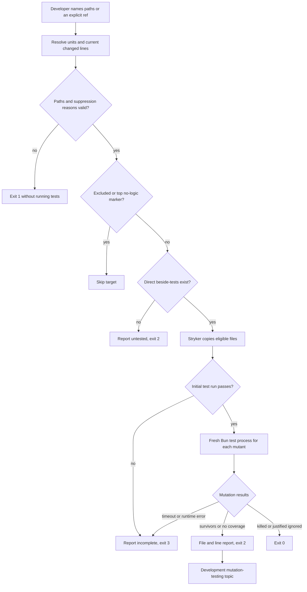

# Local mutation testing, issue 238

This slice adds repository development tooling under ADR-0016.
It adds no consumer command and does not change the ordinary quality or CI gates.
The normal tests run small controlled mutation fixtures to prove the tool's contract.
They do not run mutation analysis on repository code as a gate.

## Ownership and execution

`scripts/mutate.ts` owns the command runner, disposable Stryker copies, result output, and exit status.
`scripts/mutation-selection.ts` owns explicit targets, longest-stem beside-test matching, Git changed-line selection, and preflight checks.
`scripts/mutation-policy.ts` owns exclusions, parsed suppression comments, and the summary's guidance path.
Each logic file has its own direct beside-tests.
The tool uses exact development pins for `@stryker-mutator/core` and `@babel/parser`.
The parser distinguishes real comments from strings, regular expressions, and interpolated template text.
No private Jarvis source or skill text is an input.

Each unit runs only its same-folder `stem.test.ts` and `stem.<scenario>.test.ts` tests.
Private units cannot borrow `main.test.ts`.
Stryker's command runner starts a new Bun process for each mutant, with the sandbox as the working folder.
That process runs the checkout's own `scripts/test-watchdog.ts` by absolute path, so a mutant in the test runner never judges itself.
A project without that file runs its `test` script instead.
The command adds `--bail`, so the first failed test kills the mutant and the rest of a slow suite does not run.
Coverage analysis is off.
Incremental mode is on, with one result file per unit under the ignored `.mutation-incremental/` folder.
The file name holds a hash of the mutated ranges, the unit's beside-tests, and the runner.
A changed beside-test or runner, or a changed `--since` range, starts a new file, so every mutant runs again.
Without coverage, Stryker reuses each stored result whose code did not change.
Before a run, the tool keeps only killed and survived results in that file.
A timeout, a runtime error, or a mutant that a new suppression ignores runs again.
A stored result does not see a change in an imported file. Remove `.mutation-incremental/` before a final full run.
`timeoutFactor` is 1.5 and `timeoutMS` is 2000, so a hanging mutant stops 2 seconds after one and a half times the clean run.
Stryker does not rewrite the copied TypeScript configuration because its rewrite API is absent in TypeScript 7.
Bun reads the unchanged configuration instead.
The tool uses a separate temporary directory per unit and removes it on success or failure.
It excludes `.operator` before Stryker reads or copies that directory.
It excludes host skill links while retaining the local mutation topic for its reference check.



## Development guidance

`.agents/skills/unit-testing/` is a router with `writing-tests.md` and `mutation-testing.md`.
`.claude/skills/unit-testing` links to that directory.
It does not appear under bundled `skills/`.
The bundled `deep-modules/module-tests.md` agrees on direct private-file and lib beside-tests.
The README shows only the available local script.

## Verification

Verified with Bun 1.4.4 and CI's Bun 1.4.2 on Linux.

| Command                                                       | Result                                                                                                                                |
| ------------------------------------------------------------- | ------------------------------------------------------------------------------------------------------------------------------------- |
| `bun run test ./scripts/mutate.test.ts` before implementation | Red. The script did not exist.                                                                                                        |
| Targeted mutation command tests during implementation         | Red, then green for weak assertions, missing direct tests, invalid suppression reasons, scenario mapping, and changed-line selection. |
| `bun install --frozen-lockfile`                               | Passed with no dependency changes.                                                                                                    |
| `bun run quality`                                             | Passed all static checks, all 17 deliberate module-boundary violations, and 202 tests after CI corrections.                           |
| `bun run mutate lib/sha256.ts`                                | Exit 0. Three killed mutants, no survivors, untested units, or incomplete results.                                                    |

`bun run mutate lib/sha256.test.ts` also exited 0 with the same three killed mutants.
`TMPDIR=/tmp/opencode bun run test --rerun-each=3` passed 606 executions with no observed flake after CI corrections.
`TMPDIR=/tmp/opencode bun run test:timings` passed 202 tests and recorded the new test-file timings.
`bun run test modules/operator-release` passed all 28 installed-delivery and release tests.
`bun run mutate --since HEAD` exited 0 on the clean committed checkout without selecting unrelated units.
The skill-shape checker passed against an isolated directory containing only the new development skill.
Verified the Claude Code link target and the absence of a bundled `skills/unit-testing` directory.

The weak-assertion fixture reports the arithmetic survivor at its correct file and line and exits 2.
It records distinct process IDs for the initial and mutant test runs.
The missing-test fixture exits 2 without borrowing a module interface test.
The invalid-reason fixture exits 1 before any target's tests run.
The guidance proof first runs the real reference test successfully in an isolated copy.
It deletes only that copy's topic and verifies that the same check fails.
The real Git scenario leaves an old weakly tested line unchanged and changes a separate tested line.
Changed-line analysis exits 0, while the explicit whole-unit run reports the old survivor and exits 2.
This also proves exact filename handling with spaces, brackets, and an apostrophe.
Other checks cover untracked additions, deletions, bad refs, symlink refusal, failed initial tests, cleanup, and source preservation.

The first full run found a lint violation in a test fixture.
The first repository mutation run also found Stryker's TypeScript 7 configuration incompatibility and its attempted copy of directory skill links.
The slice fixes these problems and adds a command scenario that covers both compatibility cases without real host or legacy state.

The Standards review found a missing changeset for bundled guidance and a guidance test outside its unit's filename mapping.
Added the patch changeset and renamed the test to `mutation-policy.guidance.test.ts` so a policy mutation run includes it.
The Spec review found that uppercase `ALL` bypassed the wildcard-suppression guard.
Reproduced its false exit 0 through the command, rejected wildcard names without case sensitivity, and added direct and command regressions.

The first pushed run exposed two CI-only test setup problems in run `40237284401`.
Mutation and lint tests assumed the OpenCode scratch directory existed on every host.
They now use the platform temporary root and honor a supplied `TMPDIR`.
`tools/oxlint/check.test.ts` reproduces the bad directory choice through a real child test and lint command, then verifies the corrected location.
The CLI effect tests also inherited a runtime transpiler cache location on the development host.
On CI, Bun wrote that cache into their isolated home and broke the no-write assertions.
The tests now disable that unrelated runtime cache and clear the inherited cache root.
They retain all no-write assertions and change no production behavior.

Downloaded the official Bun 1.4.2 executable into an isolated scratch directory to use CI's runtime without changing the person's installation.
This command reproduced all 29 CLI test failures before the cache correction, then passed after it:

```sh
env -u XDG_CACHE_HOME PATH="/tmp/opencode/operator-bun142/bun-linux-x64:$PATH" TMPDIR=/tmp/opencode /tmp/opencode/operator-bun142/bun-linux-x64/bun run test ./modules/operator-cli/run.test.ts
```

The same environment with `bun run quality` passed all static checks and 202 tests.
With `bun run test --rerun-each=3`, it passed 606 executions without an observed flake.

No real legacy state was inspected or changed.
No release was published and no PR was merged.
The complete changed-line survivor cleanup remains #260.
