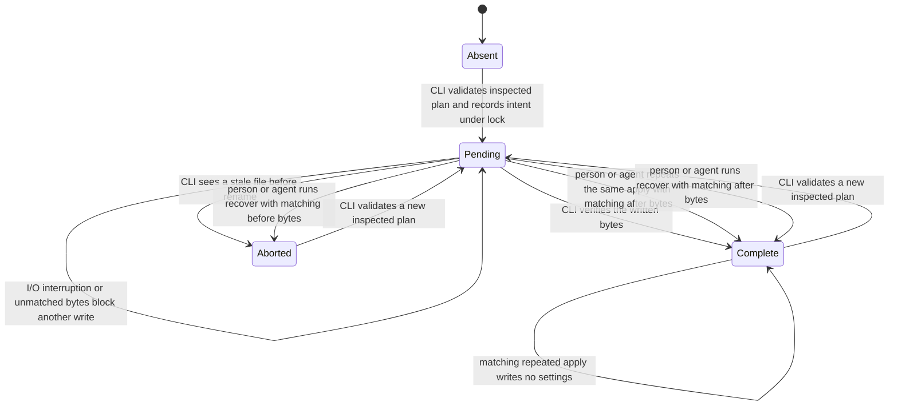

# Device settings and environment ownership

Issue #239 implements the settings and path portion of ADR-0004.
Project registration and the initial database are recorded in `240-project-registration.md`.
Host metadata and launch profiles are recorded in `241-host-profiles.md`.
Automatic migration upgrades are recorded in `245-automatic-compatibility.md`.
The settings lock is the retained dedicated SQLite lock, not the future project database.
No real legacy state is read or changed.

## Ownership

- `modules/environment/main.ts` validates supported environment values once per process.
  Its raw snapshot also preserves unrelated variables for child tools without exposing them as application settings.
  Removed probe and upstream-installer variables have no supported application fields.
- `modules/operator-home/main.ts` resolves all settings, receipt, lock, and temporary paths.
  Linux and macOS use the same two XDG roots.
  No settings path depends on the current directory.
- `modules/device-settings/main.ts` owns inspection, edit plans, protected apply, and receipt recovery.
  Operational failures use unthrown results, while unexpected defects remain separate until the CLI formats them.

`operator/env-through-schema` implements the approved environment-owner policy locally.
It uses no private plugin code.
The only exemptions are the environment owner and the exact `gh-fixture.ts` and `jsr-client-fixture.ts` files used by release tests.
The rule rejects direct reads, bracket access, destructuring, process imports, aliases, and parent mutations.
Its message points to the checked `deep-modules/server-state.md` topic.
Other rule-topic coverage remains #219 and does not decide its human parser policy.

## Settings write states

An unreadable receipt blocks apply and recovery without changing that receipt.
Planning binds the settings path, receipt path, prior file bytes, receipt generation, and exact edits.
It creates no file.
Apply requires that plan ID and the same edits.
Under a real SQLite writer lock, it checks current settings and the receipt, records pending intent, writes an exclusive temporary file, rechecks the file identity and external ownership, then renames and verifies the result.
Receipt and settings temporary files are synchronized before rename.
An existing temporary file is preserved rather than overwritten or deleted.
Apply never replaces a linked or read-only settings file.
Editor support is optional for linked or read-only destinations.

The lock serializes Operator writers that use the same device roots.
It is not an endpoint-specific compare-and-swap against arbitrary external editors.
The final pre-rename check narrows that race but cannot eliminate it.
Receipts retain the before and after identities for recovery.

## Tests and deliberate refusals

The public CLI is the primary test entry point.
Scenarios use real Git and SQLite and child environments with isolated device roots.
They cover settings outside the checkout, concurrent applies, lock contention and release, stale plans, unconfirmed writes, recovery, external links, read-only files, and optional schema destinations.
Refusals assert that settings, receipts, links, and project files did not receive prohibited changes.
Source-package and registry-artifact tests run the settings examples through their installed public entry points.
Nix installation remains #257 and #259, not a claim of this slice.

Direct beside-tests cover the environment, path resolution, edit parsing, schema, receipt state decisions, storage, change operations, and module results.
Lint tests introduce invalid environment access into disposable checkout copies and run the real lint command.
The environment-owner exemption tests restore any replaced fixture source between cases.
The test preload requires Bun test mode.
The path owner rejects the account's real default roots before opening their contents, including a fake `HOME` that points back through a link.

Use `TMPDIR=/tmp/opencode` in the OpenCode environment.
For CI parity, prepend `/tmp/opencode/operator-bun142/bun-linux-x64` to `PATH` before a local `bun run`.
No test mutates the parent environment to select tools.

## Verification

Final commands and outcomes are recorded on #239 and PR #222 after local checks and the pushed-head CI run.
The required checks are `bun run quality` and `bun run test --rerun-each=3`.
The existing 17 deliberate module-boundary violations remain part of quality.
Mutation testing remains local, and the final changed-line survivor cleanup remains #260.
