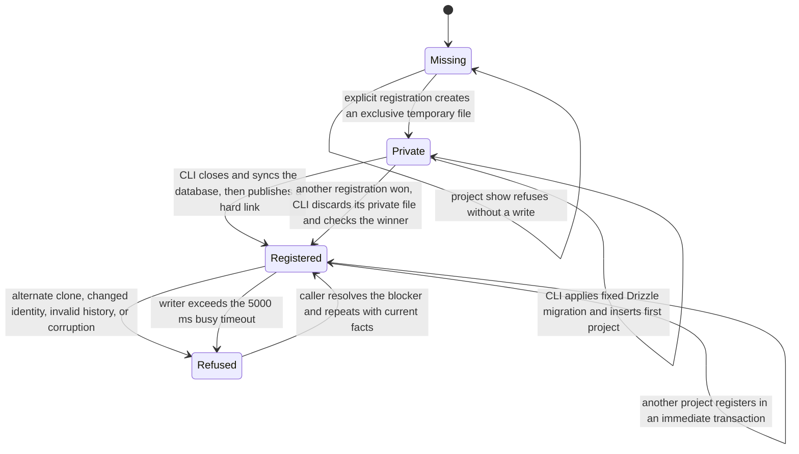

# Project registration

Issue #240 implements explicit project registration and controlling-checkout lookup from ADR-0005 and the database foundation from ADR-0006.
It uses the running release's shipped Drizzle migration history.
Automatic upgrades and verified backups remain #245.
Project listing, move, and removal remain #246.
Recorded worker-worktree lookup arrives with the assignment workflow.
No real legacy Operator state is inspected or changed.

## Commands and ownership

```sh
operator project register --json
operator project register --repository owner/repository --json
operator project show --json
```

`Projects` resolves the real Git top level before it calls `DeviceState`.
Subdirectories and symlink paths resolve to the same controller.
Registration accepts a main non-bare checkout and a canonical lowercase GitHub identity.
An explicit choice must match a checkout remote.
Several distinct GitHub identities require that choice, regardless of remote names.
Repeated URLs for one identity do not create another project.
The commands make no network request.

`project show` is the read-only project-resolution command for this slice.
It refuses an unregistered clone and names the recorded controller.
Missing controllers and changed remote identities do not cause adoption or record changes.
The presence of `.operator`, including a dangling link, refuses project commands without opening its contents.
The person must finish old work with the old release before they remove that folder.
Operator does not remove it.

`OperatorHome` owns the database, project directories, and private registration paths.
The database is `$XDG_STATE_HOME/operator/operator.sqlite`, with the same home fallback as settings state.
Registration also creates `projects/<owner>/<repository>/` under that state root.
It writes no instructions, ignore rules, local coordination records, or release selection into a checkout.
The settings lock remains separate from workflow state.

## Database creation and transactions



Only registration may create the database.
A complete private database becomes visible through a same-directory hard link that cannot replace an existing destination.
A concurrent loser opens the winner without a create flag and checks its history and controller guards again.
Private files from the current attempt are removed on exit.
An abrupt process termination can leave an unpublished private file, which no ordinary command adopts or repairs.

Database connections use explicit full synchronization, foreign keys, and a 5000 ms busy timeout.
Write transactions begin with `BEGIN IMMEDIATE`.
Read transactions retain one snapshot across history and project queries.
Transactions are synchronous and run no external tool or network call.
Only an `Ok` result commits.
Refusals, defects, and thrown failures roll back before the connection closes.

`schema.ts` defines the Drizzle project table.
The shipped SQL and Drizzle journal define compatibility, without a separate integer state version.
Generate future migrations from that schema during development, never from a live device.
For this first-history slice, an existing database must exactly match every shipped hash and migration timestamp.
Missing, newer, or conflicting history refuses without repair.
SQLite integrity failures preserve the file.
There is no verified migration backup to report before #245 implements that workflow.

The project-directory creation follows the committed registration.
If directory creation fails, the command reports an I/O failure and retains the registration.
Repeating explicit registration can create that directory without changing the original registration time.

## Evidence and checks

The primary tests invoke the public CLI with real Git, SQLite, and isolated device roots.
They cover simultaneous first registrations, repeat registration, cross-project isolation, subdirectories, aliases, alternate clones, missing controllers, legacy state, invalid history, corruption, and definite lock timeout.
A controlled Git executable acquires the database write lock at each observation to prove the CLI holds no such lock during external tools.
Refusals check unchanged database bytes, checkout contents, or absent state as applicable.
Direct beside-tests cover each private logic file, module interface, path owner, transaction rollback, and snapshot reads.
Installed source and registry-artifact commands prove that the fixed migrations ship and that unrelated global Bun lock changes do not change release identity.
An installed copy under a directory with spaces and a hash character verifies decoded filesystem paths for release metadata and migrations.
Nix delivery remains #257 and installed release acceptance remains #259.

Use `TMPDIR=/tmp/opencode` in this environment.
For CI parity, prepend `/tmp/opencode/operator-bun142/bun-linux-x64` to `PATH` before `bun run`.
Required final checks are `bun run quality` and `bun run test --rerun-each=3`, followed by pushed-head CI.
Final changed-line mutation cleanup remains #260, not an ordinary quality gate.
Exact commands and outcomes are recorded on #240 and PR #222 after verification.
