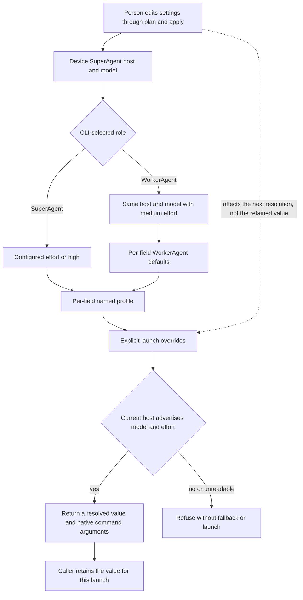

# Hosts and start profiles

Issue #241 implements profile settings and effective selections from ADR-0014.
It adds no dispatch command, readiness report, worker record, or permission policy.
Dispatch and durable launch snapshots remain #247, and static readiness remains #243.

## Ownership and selection

`DeviceSettings` owns the settings schema, profile edits, inheritance, and settings-write protection.
`AgentHosts` owns host model metadata, supported efforts, refusal reasons, and native launch command arguments.
The CLI owns argument parsing and exit codes.

`config resolve` defaults to `workerAgent`.
An absent host or model refuses rather than guessing a host default.
Profiles are optional names, not worker roles or a fixed task list.
Removing one field restores inheritance, while removing the whole profile makes a request for that name refuse.
The schema rejects permission fields and prototype-related names.
Effort fields accept non-empty names, including custom OpenCode variants.
Current host metadata, not a fixed schema enum, decides which names are supported.

Settings plan and apply validate all complete default and profile selections.
Host-only and effort-only partial settings can be stored before configuration is complete.
An explicit model without a resolved host refuses.
Metadata reads finish before the settings writer lock starts.
Apply repeats the metadata check, then its existing plan identity checks prevent a stale settings write.
Read-only and linked settings still refuse before apply makes external requests or writes a receipt.

## Host metadata and commands

OpenCode V2 uses `opencode api get` with the directory encoded as the `location[directory]` query parameter.
The response must name that directory.
Only enabled advertised models and their current variant IDs are accepted.
The resulting command is `opencode mini --model provider/model#effort`.
The full-screen CLI does not expose a model flag, so using Mini preserves the selected model and variant without writing host configuration.

Claude Code metadata uses the exact runtime dependency `@anthropic-ai/claude-agent-sdk` at 0.3.310.
The SDK runs only the installed `claude` found on the child's PATH.
It never substitutes the SDK's bundled binary.
Initialization returns supported models and effort levels without receiving a user message.
Operator closes the process after the metadata read and disables session persistence.
Host initialization can still execute the person's configured startup hooks and load their host configuration.
It is not a synthetic work assignment, a generation request, or a readiness proof.
An advertised alias's concrete model is retained with its requested name.
The resulting command is `claude --model model --effort effort`.
`default` and `opusplan` cannot define one fixed launch selection.

Both metadata paths have a ten-second timeout.
Missing executables, missing effort metadata, malformed responses, wrong directory scope, and unsupported explicit choices refuse.
No example model list, configuration regex, or fallback model proves availability.
Metadata is a current host advertisement, not proof of account access or future provider success.
Settings and permissions that the person manages remain unchanged.

The returned value has host, resolved model, requested model, effort, role, profile, and command arguments.
It has no live connection back to settings.
The future dispatch owner must record it together with the running release and skill identities.
It must resolve again for replacement workers rather than change the prior launch snapshot.

## Verification

Public CLI tests use isolated supplied roots and `Environment.child(overrides)`.
They cover both native command formats, inheritance, named profiles, explicit overrides, unsupported choices, changing metadata between plan and apply, external settings, and unchanged prior values.
A scenario uses real Git and project registration with SQLite and proves that profile edits leave the workflow database unchanged.
Installed source and registry-artifact tests exercise both hosts through controlled executables.
Direct beside-tests cover catalog parsing, selection, validation, edits, schema, and CLI parsing.
Regression tests preserve unexpected programming defects as unthrown Defect results and permit advertised custom efforts in both defaults and profiles.
Claude metadata timeouts use the pinned SDK's abort class to remain operational failures.
Settings inspection and launch resolution share failure qualification and exit codes.
Deliberate guard breaks run in a disposable checkout copy, not in the implementation checkout.

Live OpenCode metadata confirmed that the bracketed location query selects the requested directory.
Installed OpenCode help confirmed Mini's model flag, and the V2 model guide documents its variant syntax.
Claude Code is not installed on this device.
Its SDK protocol and command contract have deterministic controlled-tool coverage here, not a live provider claim.
Real worker startup and provider integration remain requirements of their owning workflow tickets.

Use `TMPDIR=/tmp/opencode` for local checks.
Prepend `/tmp/opencode/operator-bun142/bun-linux-x64` to PATH for CI's Bun 1.4.2.
Final commands and outcomes are recorded on #241 and PR #222 after remote CI.
Final changed-line mutation cleanup remains #260, not an ordinary quality or CI gate.
