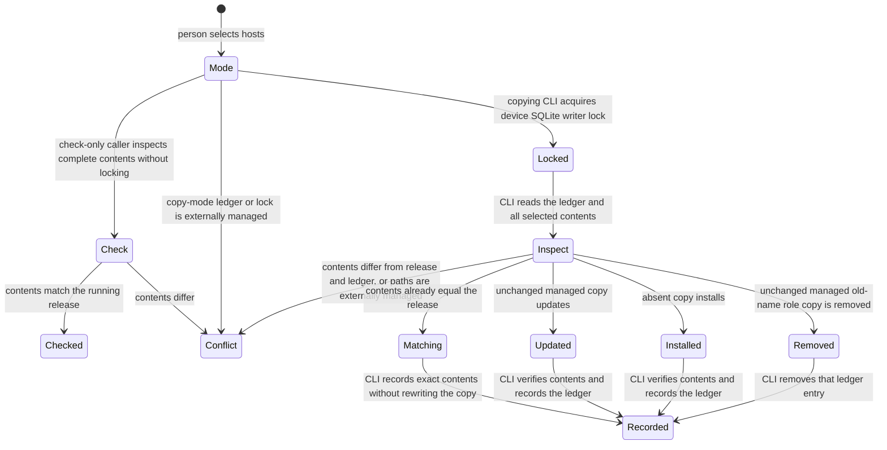

# Personal owned skills

Issue #242 implements personal owned-skill installation from ADR-0008 and the role-skill names from ADR-0017.
The public entry point is `operator install --opencode --claude [--check] [--json]`.
At least one host is required.
The running installation supplies complete skill directories, not the caller's checkout.
`OwnedSkills` owns content comparison, managed updates, and the device ledger.
`OperatorHome` owns personal host locations and the ledger and lock paths.

## Content decisions

OpenCode uses its XDG config folder's `opencode/skills/`.
Claude Code uses `$HOME/.claude/skills/`.
The ledger is `$XDG_STATE_HOME/operator/owned-skills.json`, with the approved home fallback.
A separate SQLite lock serializes participating installers and has a 5000 ms busy timeout.
It is not the workflow database, and installation never creates a project record.

Identities include hidden files, binary supporting assets, and empty directories.
Prototype-named files such as `__proto__` remain own entries in identities and the ledger.
Copies are real directories, not links to a cache.
Copy mode refuses links and read-only folders from a destination up to its host skill folder, and up to the state folder for the ledger and lock.
Links above that folder, such as the macOS `/var` link, are system wiring. When that folder is absent, its nearest existing parent must be writable, so a read-only Nix store link still refuses.
A writable link above the skill folder is accepted. Only a link at or below the skill folder, or a read-only target, refuses.
Content-matching files stay unwritten.
Retired `operator` and `operative` directories are removed only when this device ledger proves exact unchanged contents.
No old project-local state or ledger is inspected or adopted.
Changed and unrelated old names remain conflicts.

Nix detection uses the real running skill directory under `/nix/store/`.
It forces check-only behavior, including when the caller did not supply `--check`.
Checks follow host links and compare all required contents without writing host folders, links, or device state.
This is a filesystem-content check, not evidence that a host loaded the skills.
Consumers own their wiring, and Nix packaging verification remains #257 and #259.

## Failure limits

The copying installer checks all selected contents and the ledger under the writer lock before content writes.
It waits for a participating installer instead of judging that installer's partial copy as a conflict.
Check-only mode inspects without a writer lock and remains a current observation, not a concurrent-install guarantee.
File replacement uses an exclusive same-directory temporary file and rename after synchronization.
The ledger is replaced only after verified content changes.
Installers hold no workflow database transaction and call no external tool or network service.

The lock protects participating installers, not arbitrary external editors.
Content updates are not one atomic transaction across all files and the ledger.
An interruption can leave a partial update or unpublished temporary file.
A complete matching copy can be recorded on the next explicit install without a content rewrite.
A partial or externally modified copy conflicts rather than being silently repaired or deleted.
The person must preserve and resolve that content before a new install.

## Tests and delivery

Public CLI scenarios reuse the earlier install content and conflict cases with isolated personal roots.
They cover both hosts, complete supporting assets, matching and conflicting copies, links, read-only paths, and simultaneous installs.
Real Git and SQLite delivery scenarios exercise installed source and registry packages.
Direct beside-tests cover content decisions, updates, retired-name proof, module results, and parsing.
Deliberate guard breaks run in a disposable checkout copy.
Test host roots must stay under the platform temporary root and honor `TMPDIR`.

Use `TMPDIR=/tmp/opencode` and prepend `/tmp/opencode/operator-bun142/bun-linux-x64` to PATH here.
Final checks are `bun run quality` and `bun run test --rerun-each=3`, then pushed-head CI.
Exact outcomes are recorded on #242 and PR #222.
Final changed-line mutation cleanup remains #260.
Static readiness and upstream installation remain #243, and dispatch remains #247.
