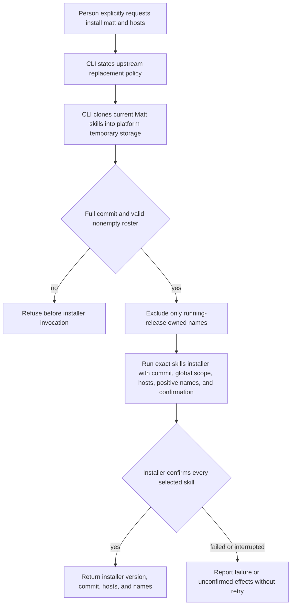

# Upstream installation and static readiness

Issue #243 implements the upstream installation contract in ADR-0008 and the static checks in ADR-0009.
Owned copies and their device ledger remain owned by `OwnedSkills`.
Host metadata and launch resolution remain owned by `AgentHosts` and `DeviceSettings`.
Readiness does not call host metadata or resolve a model.
Dispatch remains #247, and assignment plans and next actions remain #244.

## Ownership and commands

```sh
operator install matt --opencode --json
operator install matt --claude --json
operator install matt --opencode --claude --json
operator ready --json
```

`UpstreamSkills` owns the delegated installer call and required upstream presence checks.
`Readiness` combines current executable, authentication, settings, and skill observations.
`OperatorHome` owns personal host paths and the temporary-directory prefix.
The CLI owns syntax and exit codes.
There is no new workflow database table, upstream-content ledger, or readiness record.
The old custom upstream plan/apply flow was removed in #235 and is not restored.
The repository's development `skills-lock.json` belongs to its upstream development installation, not a runtime Operator ledger.

## Upstream installation



The installer pin is `skills@1.7.4`.
The source is `mattpocock/skills#<full-commit>`.
One temporary shallow Git clone resolves both the commit and its roster before the installer runs.
The installer then fetches that exact source commit through its own mechanism.
The positive list excludes the running release's owned skill names, with no separate `unslop` or `cursor` exclusion.
Malformed names and an empty selected roster refuse rather than become wildcard installation.

The call uses `bun x --bun`, explicit `--global`, `--agent`, `--skill`, `--yes`, and the pinned installer's `--json` result.
It runs outside the project checkout.
The upstream tool owns replacement, shared copies, host links, and its lock record.
An explicit install permits its replacement policy, which can overwrite edits without an Operator preview.
Nix check-only policy applies only to owned skills and does not block upstream installation.
Operator removes only its own temporary clone after the call.
It never adopts project-local legacy state.

An installer failure can leave partial upstream changes.
A timeout, interruption, malformed answer, or missing confirmation remains unconfirmed and exits 5.
There is no automatic retry or claim that the failed call made no changes.

## Static readiness

`ready` observes `gh` and `herdr` availability and runs only `gh auth status --hostname github.com`.
It reads device settings and checks the `opencode` or `claude` executable selected by `superAgent.host`.
An absent or invalid host setting blocks readiness.
Model and effort validation remain separate launch-selection operations.

Owned contents must match the running release, including supporting assets and extra files.
The existing read-only check follows links and writes neither copies nor a ledger.
Upstream `code-review` requires a nonempty regular `SKILL.md`, following links.
Its revision is independent of Operator.
OpenCode uses the upstream shared personal folder, and Claude Code uses its personal skill folder.
No precedence analysis, host initialization, provider request, Slack tool check, or probe takes place.

The result is a current static observation, not a saved ready flag.
All observed ordinary blockers are returned together.
An ordinary blocker exits 3, a ready result exits 0, and an unexpected defect exits 1 without a readiness claim.
Database compatibility and integrity remain separate storage and startup duties.

## Tests and evidence

Public CLI scenarios use isolated child environments and controlled external executables.
Installed source and registry-artifact scenarios use real Git registration and SQLite, exercise both hosts, and verify unchanged checkout and database contents.
They cover missing executables, authentication refusal, complete and modified owned contents, linked independently revised upstream skills, exact installer arguments, invalid revisions and rosters, partial answers, and removed plan/apply commands.
Direct beside-tests cover parsing, module results, path ownership, and defect preservation.
Deliberate breaks prove the new guards in a disposable checkout copy.
The readiness failure contract is a closed union of local blockers and the relevant collaborator failures.
A compile-time test rejects widening its reasons to `string`.
Direct readiness tests replace `ToolInvocation.run` at its public interface and restore it after the tests.
A subprocess sentinel proves that those tests cannot request ambient GitHub authentication.

An isolated live public `install matt` invocation ran with official Bun 1.4.2 and `skills@1.7.4`.
It resolved Matt commit `5beb35b040e3de97e54fa9e386d7e42d15c295c2` and confirmed 38 non-owned skills.
Inspection verified 38 shared copies, 38 Claude links, and the upstream lock under the isolated XDG state root.
No real host folders, settings, or legacy Operator state were used.
This verifies the real installer invocation and filesystem destinations, not live host loading or provider access.
Claude Code remains absent on this device.
Nix packaging and installed acceptance remain #257 and #259.

Use `TMPDIR=/tmp/opencode` and prepend `/tmp/opencode/operator-bun142/bun-linux-x64` to PATH here.
Required final commands are `bun run quality` and `bun run test --rerun-each=3`, followed by CI at the pushed head.
Final commands and outcomes are recorded on #243 and PR #222 after verification.
Final changed-line mutation cleanup remains #260, not an ordinary quality gate.
