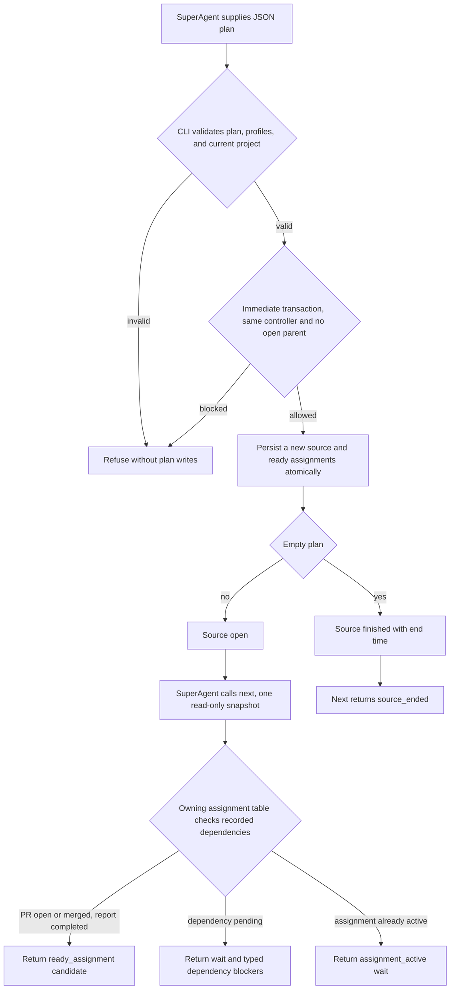

# Supplied assignment plans and next actions

Issue #244 implements work-source registration and the first next-actions read from ADR-0001, ADR-0003, ADR-0010, and ADR-0013.
The SuperAgent supplies tracker data.
Operator performs no tracker read or mutation.
Dispatch remains #247, report submission and acceptance remain #248, and PR operations remain #249 through #251.
Reset and prune remain #252.

## Commands and plan

Run from a registered controlling checkout or one of its subdirectories.
Use `bun cli.ts` instead of `operator` in a source checkout.

```sh
operator source register --file /absolute/path/assignments.json --json
operator source show --source <source-id> --json
operator next --json
operator next --source <source-id> --json
```

The file can also have a path relative to the caller's directory.
The plan is a strict JSON object.
This example needs no named profile or configured host because registration launches nothing.

```json
{
  "trackerKey": "github:example/project#10",
  "assignments": [
    {
      "key": "investigate",
      "trackerKey": "github:example/project#11",
      "instructions": "Read and report. Ask the person when authority is unclear.",
      "completion": "report",
      "resources": "pane",
      "dependencies": []
    },
    {
      "key": "implement",
      "trackerKey": "github:example/project#12",
      "instructions": "Implement the accepted report.",
      "completion": "pr",
      "resources": "worktree",
      "branch": "task/12-implement",
      "dependencies": ["investigate"]
    }
  ]
}
```

Tracker keys are opaque nonempty strings, not GitHub-only identifiers.
Assignment keys are unique within their source.
Dependencies name keys in that same supplied plan, regardless of declaration order.
Duplicate, missing, self, and cyclic dependencies refuse before writes.
PR assignments require `worktree` and a valid Git `branch` input.
A report can select `pane` for read-only work, or `worktree` with a branch when it changes project files.
An optional `profile` names an existing device start profile.
Registration retains that name without resolving host metadata or recording a launch snapshot.
Launch-time validation belongs to dispatch, so a later settings edit affects a future launch.
Task instructions carry delegated decision authority.
Registration does not infer a human answer from them.

## Ownership and storage

`WorkSources` owns plan validation, source decisions, assignment decisions, and next actions.
Its ordered private tables use supplied state and dependency facts only.
`DeviceState` owns SQLite connections, immediate writes, consistent reads, and compatibility checks.
The new fixed migration adds source and assignment records.
The immutable source plan stores instructions, dependencies, and resource selections together.
Assignment rows store the completion type and current lifecycle state.
There is no second persisted schedule, approval plan, tracker ledger, or cross-project dependency engine.

Each successful registration creates a new UUID scoped to the registered project.
A second open source for the same tracker parent refuses, including concurrent registrations.
The transaction checks the controller again and inserts the source and assignments together.
An empty plan finishes immediately and records the registration time as its end time.
The same parent can register again after an earlier source ends, with a new identity.
Neither registration nor reads create missing project state or write checkout files.
Source selectors cannot read another project's records.
Malformed stored plans and inconsistent assignment rows refuse without repair.
Reads also refuse a source whose state or end time disagrees with its assignments.
They never report an unpersisted transition as completed.
The later completion operation must record the source state and end time with its assignment transition.
Existing older migration history still refuses until automatic compatibility lands in #245.

## Decisions and blockers



PR states are `ready`, `running`, `pr-open`, `merged`, and `abandoned`.
Report states are `ready`, `running`, `reported`, `completed`, and `abandoned`.
Only `pr-open` or `merged` satisfies a PR dependency.
Only accepted `completed` satisfies a report dependency.
Host activity is not an input or completion proof.
Finished or reset sources return `source_ended` and no ready work.
An empty project returns an empty `sources` list.
Source ordering is registration time followed by identity, and assignment ordering follows the supplied plan.

`ready_assignment` is a candidate, not an executed launch or a command that is available in this slice.
Active assignments receive a generic wait until their owning workflow adds its actions to this same read.
The read changes no state and calls no host, Herdr, tracker, or provider.
Later workflow operations must persist their transitions, rather than use this read as a write-path scheduler.

## Evidence and checks

Public CLI scenarios use real Git and SQLite under isolated child environments.
They cover mixed plans, concurrent registration, no-write refusals, project isolation, new identities, empty and ended sources, profiles, dependency states, and corrupt records.
Dependency-state fixtures use isolated SQL to represent transitions that later tickets will expose.
They do not claim working dispatch, report acceptance, PR merge, or reset commands.
Source and registry-artifact scenarios run the public commands against installed copies and shipped migrations.
Nix packaging and final installed acceptance remain #257 and #259.
Direct beside-tests cover each private logic file and public interface.
Disposable-copy deliberate breaks prove the guards.
The repeated suite exposed a concurrent owned-install preflight race.
A deterministic public CLI test reproduced it with a held SQLite writer and partial content.
Copy-mode content inspection now runs under the owned installer lock, and a deliberate break proves that regression guard.
This correction changes no tracker completion history for #242 or #243.

Use `TMPDIR=/tmp/opencode` and prepend `/tmp/opencode/operator-bun142/bun-linux-x64` to PATH here.
Required final commands are `bun run quality` and `bun run test --rerun-each=3`, followed by CI at the pushed head.
Exact final outcomes are recorded on #244 and PR #222.
Final changed-line mutation cleanup remains #260, not an ordinary quality gate.
