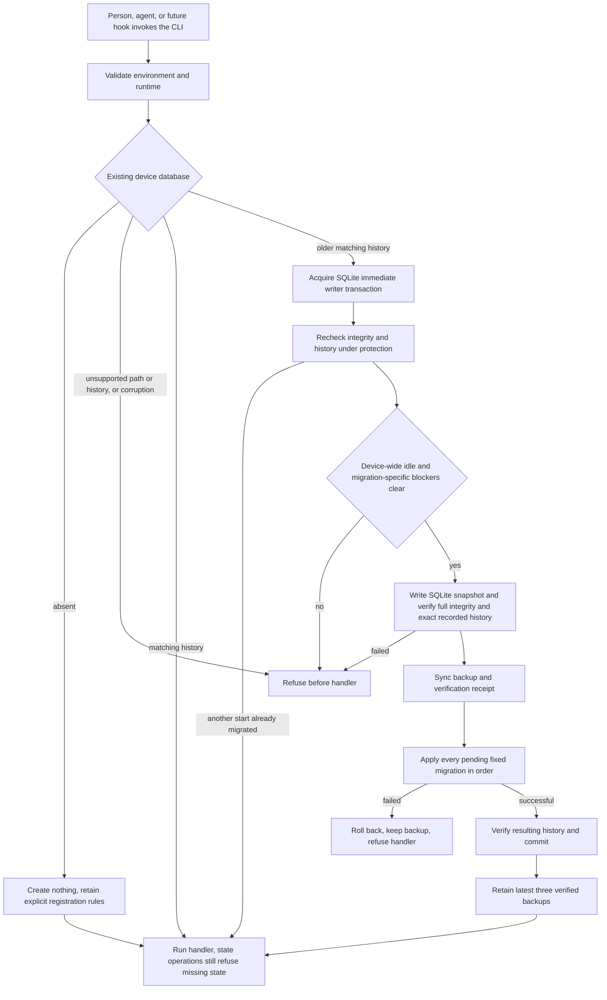

# Automatic compatibility and verified migration backups

Issue #245 implements the startup and migration contract from ADR-0006 and ADR-0007.
`DeviceState.checkCompatibility` owns the shared path before every CLI handler, including help and version.
Future hooks and waits must use that same CLI path.
They are not implemented by this slice.

## Startup decisions

Startup reads existing state even for commands that do not use workflow records.
An absent database does not make setup, help, or version create one.
Project and source operations retain their missing-state refusals, except explicit first registration.
A directory or link at the database path refuses without opening its target.
No existing empty database, missing history, foreign history, newer history, or corrupt database is adopted.
No command repairs or replaces damaged state.
The running release's fixed SQL, hashes, and timestamps are the only migration authority.
No migration is generated from device contents, and no separate migration command exists.

## Protection and blockers

The normal compatible path uses one consistent read transaction and performs no migration write.
An upgrade reopens for writing and begins an immediate transaction before its second compatibility read.
That writer reservation remains held through snapshot creation, verification, all pending SQL, history checks, and commit or rollback.
It blocks SQLite writers from other processes, including writers that do not use Operator.
Concurrent starts recheck the history after they acquire that reservation.
The busy timeout remains 5000 ms and returns a definite `state_busy` failure.
No external tool or network call occurs while that transaction holds the writer reservation.

The current idle guard covers `running`, `pr-open`, and `reported` assignments across all projects.
Ready or ended assignments alone do not block an upgrade.
Each fixed migration also declares its held-record query policy.
The first two migrations have no extra held-record blockers.
An undeclared migration policy refuses.
Later owners must extend `migration-policy.ts` when they add launches, waits, review requests, cleanup, or other active records.
A blocker returns `state_migration_blocked` without running the handler.
The caller resolves the blocker and repeats the original command, rather than running migration SQL.

## Backups and failures

`OperatorHome` owns `backups/<update-id>/operator.sqlite` and its `verified.json` receipt.
The snapshot uses SQLite serialization on the reserved connection, not copies of a database and its WAL or shared-memory side files.
The serialized image temporarily occupies memory proportional to the database size.
The backup must pass `integrity_check` and match the exact locked migration history before migration starts.
The receipt records that history, the content hash, identity, and verification time.
Backup files and directories are synchronized before migration.

Only successful migration permits removal of older verified backups.
Failed migration retains its verified snapshot and rolls back all pending schema and history changes.
Unverified or modified backup folders remain untouched.
On corruption, startup rechecks backup bytes, receipt, full integrity, and recorded history before it names the latest valid copy.
It does not restore that copy automatically.
If no copy verifies, it reports that no verified backup is available.
These receipts are local evidence, not authentication against arbitrary external editors.
There is no periodic backup service.
The last backup can be as old as the last schema migration.
Source retention and project removal must not delete the device backup folder.

## Verification and limits

Public CLI tests use isolated roots, real SQLite, and real Git where project lookup is needed.
They cover matching and older histories, skipped-release catch-up, unsupported histories and paths, failed backup and migration, handler refusal, retention, and corruption fallback.
Process tests coordinate simultaneous starts and hold the snapshot interval while another process attempts a SQLite writer transaction.
Both rollback-journal and WAL modes are covered.
Controlled runtime preloads only coordinate those process tests.
They are not production hooks or migration options.
Direct beside-tests cover history, backup verification, blocker policy, the path owner, and the public state interface.
Disposable-copy deliberate breaks prove each new guard.
Installed source and registry-artifact tests verify automatic migration through their public entry points and shipped SQL.
Nix packaging and final installed acceptance remain #257 and #259.
No real legacy state, host folder, or database is used.

Use `TMPDIR=/tmp/opencode` and prepend `/tmp/opencode/operator-bun142/bun-linux-x64` to PATH here.
Required final commands are `bun run quality` and `bun run test --rerun-each=3`, then remote CI at the pushed head.
Exact outcomes are recorded on #245 and PR #222 after verification.
Final changed-line mutation cleanup remains #260, not an ordinary quality gate.
