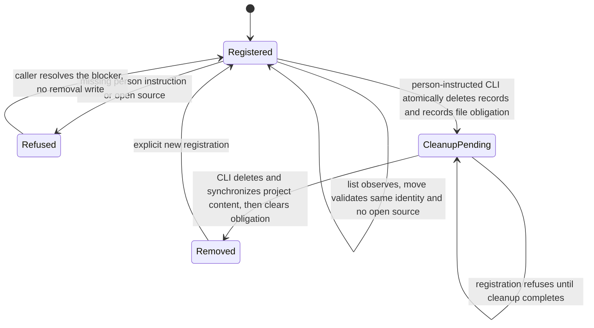

# Project listing, moves, and removal

Issue #246 implements the remaining project operations from ADR-0005.
`Projects` owns Git observations and removal authority checks.
`DeviceState` owns consistent reads, atomic record changes, and durable file-cleanup obligations.
`OperatorHome` still owns every project path.
There is no tracker integration or repository rename operation.

## Commands

```sh
operator project list --json
operator project move --json
operator project move --repository owner/repository --json
operator project remove owner/repository --person-instructed --json
```

Use `bun cli.ts` in place of `operator` from a source checkout.
List and removal run from any directory, including when a controller is missing or has changed identity.
List reports the registered identity, real controller path, registration time, number of open sources, and current controller status.
`available` means that the main checkout still resolves to the recorded path and has the recorded remote identity.
`missing`, `mismatched`, and `blocked` report unusable controllers without adopting another clone.
Blocked status includes the Git or legacy-state refusal.
Expected filesystem failures also return one blocked controller, without hiding other registrations or pending removals.
The database fields come from one read snapshot.
Git status observations follow that snapshot and are not an atomic filesystem observation.

Move runs from the destination main checkout, including its subdirectories or symlink aliases.
It requires the same canonical remote identity and no open source.
Several remote identities require an explicit matching choice.
It preserves registration time and project state files.
A changed remote does not rename or transfer a registration.
Remove the old registration on the person's instruction, then explicitly register the new identity when old work has ended.

The removal identity is mandatory.
`--person-instructed` attests an explicit instruction from the person, not an approval grant or proof of who typed the command.
The SuperAgent must not infer that instruction from a plan or from permission to perform other work.
No open source may remain.
Unknown source lifecycle values or absent end times also prevent move and removal.
Removal destroys local Operator history, not repository work.

## Removal and recovery



The fixed third migration creates `project_removals` with no project foreign key.
An immediate transaction checks source state, deletes assignments and sources, records the cleanup obligation, and deletes the registration together.
The obligation survives that record deletion and any process interruption.
The CLI then uses another immediate transaction to recheck the obligation, delete the project directory, synchronize its parent, and clear the obligation.
That writer reservation prevents another participating cleaner or registration from racing deletion.
A stale cleaner sees no obligation and touches no new directory.
No external tool or network call runs under either writer reservation.
Filesystem deletion can hold the writer reservation longer for large project content, so another writer can reach the existing 5000 ms busy timeout.

File cleanup refuses linked ancestors and non-directory project paths.
Links within a real project directory are removed as links without traversing their targets.
These checks protect normal participating operations, not arbitrary concurrent filesystem replacement by an external process.
Removal touches no checkout, branch, worktree, tracker content, settings, skills, or migration backups.
Unknown content outside the exact project directory remains untouched.

An expected I/O failure exits 1 as `project_cleanup_pending`, without false success.
An unexpected programming defect stays a defect, while the already committed obligation remains visible.
Use `project list` to inspect pending removals after restart.
After resolving the reported filesystem problem, repeat the same person-instructed removal to finish it.
Do not restore deleted project records or register the same identity while its old files remain.
Pending cleanup also blocks future compatibility upgrades through the shared device-wide idle guard.

Registration now rechecks its record under a writer reservation before creating its state directory.
It cannot recreate an orphan directory after a concurrent removal.

## Verification and limits

Public CLI scenarios use real Git and SQLite under isolated roots and `Environment.child`.
They cover alternate clones, subdirectories, symlinks, missing or changed controllers, invalid destinations, open-source refusals, person-instruction refusals, permission failures, durable recovery, competing cleaners, and writer reservation.
No-write assertions compare database bytes and preserve checkout content and Git resources.
Direct beside-tests cover state records, project files, migration policy, schema, and module interfaces.
The independent Spec review found that an inaccessible controller hid the complete list.
A public CLI red reproduction now guards per-controller filesystem failures, unchanged database bytes, and visible pending cleanup.
The independent Standards review's duplicated open-source predicate now has one private implementation for move and removal.
Disposable-copy deliberate breaks prove the new guards.
Installed source and registry-artifact examples exercise the new commands and shipped history.
Nix packaging and final installed acceptance remain #257 and #259.
No real legacy Operator state or host folder is inspected or changed.

Use `TMPDIR=/tmp/opencode` and prepend `/tmp/opencode/operator-bun142/bun-linux-x64` to PATH here.
Required final checks are `bun run quality` and `bun run test --rerun-each=3`, then CI at the pushed head.
Exact outcomes are recorded on #246 and PR #222 after verification.
Final changed-line mutation cleanup remains #260, not an ordinary quality or CI gate.
