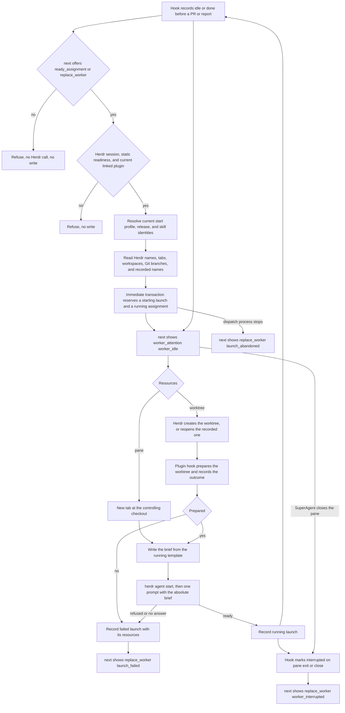

# Worker dispatch through Herdr

Issue #247 implements dispatch and the stable Herdr plugin from ADR-0011 and ADR-0014.
Report submission and acceptance are in `248-report-assignments.md`.
PR operations remain #249 through #251, and reset and prune are in `252-source-reset-prune.md`.

## Commands

Run dispatch from the registered controlling checkout, inside the Herdr session that holds the project workspace.
Use `bun cli.ts` instead of `operator` in a source checkout.

```sh
operator herdr install --json
operator dispatch --source <source-id> --assignment <key> --json
operator herdr event --json
```

The manifest is `modules/worker-dispatch/herdr-plugin.toml`.
The release build ships it at the same path, and it is a required part of every artifact.
`herdr install` copies the running release's file to `herdr-plugin/herdr-plugin.toml` under the device state root and links it with `herdr plugin link`.
The manifest has no startup hook and no release path.
Its `worktree.created`, `pane.exited`, `pane.closed`, and `pane.agent_status_changed` hooks call `operator herdr event --json`.
A changed manifest is linked again, because Herdr reads the hooks when it links a plugin.
Another plugin with the id `operator` refuses as `herdr_plugin_conflict` and stays linked.
The conflict check runs before Operator writes its manifest.
`herdr event` is the hook entry point, and it reads only the Herdr event variables.
On a device with no state database, it returns `herdr_event_ignored` with exit 0 and creates nothing.

## Dispatch



The decision source is the same `next` read.
A ready assignment, or the latest launch in `failed` or `interrupted` state or abandoned while `starting`, is dispatchable.
Dispatch needs `HERDR_SOCKET_PATH`, because hooks match launches by the socket of their server. Outside a Herdr pane it refuses with `herdr_session_required`.
Static readiness from #243 and the linked plugin are checked before any write.
The linked device-state manifest must be byte-equal to the running release's manifest, or dispatch refuses with `herdr_plugin_outdated`.
The assignment's profile resolves through current device settings and host metadata, so a replacement uses the settings at its own launch.
Each launch row records the resolved host, model, requested model, effort, profile, release version, commit, artifact identity, skill content identities, the Herdr socket, and every returned resource.
Running launches keep that row.
`source show` lists every launch of the source in attempt order.

The reservation transaction checks the controller, the open source, the assignment state, and the name before any external effect.
Herdr and Git calls run with no transaction open.
Each returned resource is recorded in its own short transaction as soon as it exists.
Any failure after the reservation records the launch as `failed` with its reason and the resources it has.
`SIGINT`, `SIGTERM`, and `SIGHUP` record `launch_stopped` before the process exits.
The assignment stays `running`, and `next` returns `replace_worker` with the failure.

A process that cannot handle its stop, for example after `SIGKILL`, cannot record an outcome.
So each `starting` launch records its owner process id and a lease that the dispatch renews every 15 seconds.
When the owner process no longer exists, or the lease is older than five minutes, the start is abandoned.
`next` returns `replace_worker` with `launch_abandoned`.
The replacement's reservation records the abandoned launch as `failed` with `launch_abandoned` in the same transaction.
A late write from the stopped process then finds no `starting` launch and changes nothing.
The migration idle guard covers `running` launches, live `starting` launches, and live `running` worktree preparations. An abandoned start or preparation does not block an upgrade.

Names are `<completion>-<tracker tail>-<assignment key>`, limited to 28 characters for Herdr agent names.
A name taken by a Herdr agent, tab, or workspace label, or by an earlier launch, gets the next numbered suffix.
A worktree branch taken locally or on `origin` gets the same suffix.
Operator never adopts, overwrites, or deletes the colliding resource.
A replacement reopens the recorded worktree and branch with `herdr worktree open` when that path still exists.

The brief is `projects/<owner>/<repository>/sources/<source>/assignments/<key>/brief.md` under the state root.
The assignment key is one encoded path segment.
Each start rewrites the brief from the running release's template.
A replacement reuses the recorded worktree only when both its path and its branch are recorded and the path exists.
When that worktree has no finished `prepared` record, dispatch prepares it again before the brief. Preparation keeps existing files, so a second run is safe.
It lists every file in the sibling `reports` and `follow-ups` folders, which #248 populates.
It names no agent, pane, or host.
Nothing is written into the checkout or the worktree, except prepared project inputs.

## Worktree preparation

The `worktree.created` hook finds the registered project whose Git common directory matches the new worktree.
A worktree of an unregistered repository, or the controlling checkout itself, is not prepared.
Git lists ignored files that match `**/.env*.local` in the controlling checkout, outside `node_modules` folders.
Each name must also match `.env.local` or `.env.<name>.local` with no empty, `.`, or `..` segment.
A source link, a source under a linked folder, and a destination under a linked or non-folder path are refused.
An existing destination is preserved, including one created during the copy.
Then `bun install --frozen-lockfile` runs with the Bun that runs Operator when `bun.lock` or `bun.lockb` exists.
Another lockfile is not installed, and the recorded detail says so.
The outcome is recorded in `worktree_preparations` by real path. An exception in the preparation is recorded as failed.
A killed hook cannot record its outcome, so the preparation also has an owner process id and a lease. A preparation whose owner stopped is abandoned: a new preparation of the path can start, and the dispatch wait fails with `worktree_setup_failed`.
Dispatch waits up to ten minutes for an outcome that started after its reservation.

## Herdr observations

`pane.exited` and `pane.closed` mark the matching `starting` or `running` launch `interrupted`.
A pane that ends during the start, for example after the host takes the prompt, interrupts the launch. Dispatch then returns `launch_interrupted` and does not record the launch as running.
A pane event that matches no launch opens no write transaction.
The match requires the same pane and the same `HERDR_SOCKET_PATH`, because another Herdr server can reuse a pane identifier.
`pane.agent_status_changed` stores the latest `agent_status` as an observation.
`next` shows it as `observedActivity`.
A `running` assignment with a `running` launch that Herdr last reported `idle` or `done` shows `worker_attention` with `worker_idle`.
That worker ended its turn, lost its context, or stopped at a question, and it has no associated PR and no submitted report.
The SuperAgent asks the worker for its status through Herdr.
A worker that cannot continue is ended with `herdr pane close`, which marks the launch `interrupted` and permits a replacement.
Attention changes no record, and dispatch still refuses while the launch is `running`, so a stopped worker is never treated as a running one or replaced while it lives.
A later `working` observation removes the attention.
Herdr reports `blocked` while a host waits at a permission prompt, and that stays `assignment_active`.
No Herdr event submits, accepts, or completes an assignment.
`next` stays a read, so it does not ask Herdr about panes.
A pane that ends while the plugin is not linked stays `running` until a later workflow observes it.

## Verification

Public CLI scenarios in `run.dispatch.test.ts` use real Git and SQLite, isolated roots, and the controlled `herdr-fixture.ts` executable.
The fake keeps topology in one file, creates real Git worktrees, and runs the linked manifest's hook command as Herdr does.
They cover plugin install and conflict, pane and worktree dispatch, preparation, collisions, refusals with unchanged database bytes and no Herdr effect, failed launch and replacement with changed settings, activity, idle-worker attention, foreign-server events, and pane exit.
Direct beside-tests cover names, the brief, the manifest, environment files, launch records, decisions, migration policy, assignment paths, and skill identities.
They also cover a killed dispatch, a stop signal, a pane that ends during the start, a reopened worktree whose preparation failed, a dispatch outside a Herdr session, a stale linked manifest, and an event on a device without state.
`run.dispatch-guards.test.ts` proves 22 guards with deliberate breaks in a disposable copy, including the shipped manifest.

The live check used Herdr 0.9.3 on macOS with an isolated Herdr server and isolated device roots.
The Herdr server had its own `XDG_CONFIG_HOME`, `XDG_STATE_HOME`, and HOME.
Credentials came from the person's keychain through a link to the real `~/Library`, and from a copy of the Claude Code settings file.
A shim put the source `cli.ts` first as `operator` in that check, because the installed global release predates this command.

| Live step | Observed result |
| --- | --- |
| `herdr install` | Herdr linked the manifest from device state with the four hooks. |
| Worktree dispatch, Claude Code, `sonnet`, effort `low` | Herdr created project workspace `live` and worktree `~/.herdr/worktrees/repo/task-3-change` on `task/3-change`. |
| Hook | `worktree_prepared`: two `.env*.local` files copied, `.env` not copied, `bun install --frozen-lockfile` ran. |
| Agent start | Pane ran `claude --model claude-sonnet-5-5 --effort low`, and Herdr named the agent `pr-live-3-change`. |
| Pane dispatch into an untrusted folder | Herdr refused with `agent_not_ready` at the Claude trust prompt, and Operator recorded `launch_failed`. |
| Replacement after the folder was trusted in the settings copy | Attempt 2, `report-live-2-read-2`, new tab, agent took the prompt and started work. |
| Activity | Real payload `data.agent_status`, stored as `blocked` when Claude asked to read the brief outside its working folder. |
| Manifest change | A second `herdr install` returned `herdr_plugin_updated` and linked the new hooks. |
| `herdr pane close` | `pane.closed` marked the launch `interrupted`, and `next` returned `replace_worker`. |

A second live check proved the hook through an installed global command after #256.
It ran `bun add -g git+file://<staging clone>#<full commit>` in isolated Bun install, global, bin, and cache folders, then removed the staging clone and the cache.
The Herdr server's `PATH` held only Bun's global bin folder, links to `bun`, `git`, and `herdr`, `/usr/bin`, and `/bin`.

| Installed-command step | Observed result |
| --- | --- |
| `operator --version --json` | Reported the installed full commit from Bun's `.bun-tag`. |
| `operator herdr install` | Linked the device-state manifest, byte-equal to the installed package's `herdr-plugin.toml`. |
| `herdr worktree create` | Herdr ran `operator herdr event --json` through the global link, exit 0, `worktree_prepared` with one environment file copied and dependencies installed. |
| `herdr pane close` | Herdr ran the same global command for `pane.closed`, exit 0. |

Live findings and limits:

- Without Claude Code settings, Herdr reported the agent ready at the Claude login screen, so the prompt reached that screen. Operator cannot detect this. The person's host must be signed in.
- Claude Code asks before it reads the brief, because device state is outside the worker's folder. Operator does not install permission rules. The person can allow the Operator state folder in host configuration.
- The installed OpenCode 1.18.34 has no `api` or `mini` command, so the #241 OpenCode metadata and launch contract could not run live. OpenCode launches are proven only through the controlled tool.
- `herdr pane close` emits `pane.closed`, not `pane.exited`. Both hooks are installed.
- Installed-release acceptance remains #259. No live Herdr check ran the Nix package's command (#257).

## Gate commands and outcomes

All commands ran in the #247 worktree on macOS with Bun 1.4.4.

| Command | Outcome |
| --- | --- |
| `bun run quality` through the shared gate script, rebased on #256 `efd8a55` with #262 and #220 | Format, lint, typecheck, module shape, skill shape, and module boundaries pass. 823 tests: 823 pass, 0 fail. |
| `bun test --timeout=60000 modules/operator-cli/run.dispatch.test.ts` | 16 pass, 0 fail. |
| `bun test --timeout=120000 modules/operator-cli/run.dispatch-guards.test.ts` | 22 pass, 0 fail. Each deliberate break makes its behavior test fail. |
| `bun test modules/device-state modules/work-sources modules/worker-dispatch modules/worktree-preparation` | 87 pass, 0 fail. |

The live checks above used these Herdr commands on an isolated server: `herdr --session <name> server`, `herdr plugin link`, `herdr worktree create`, `herdr agent start`, `herdr agent prompt`, `herdr pane close`, and `herdr plugin log list`.
The lease, the signal handling, the start-window interruption, and the stale manifest check came after the live checks. Public CLI tests prove them with the controlled Herdr.
