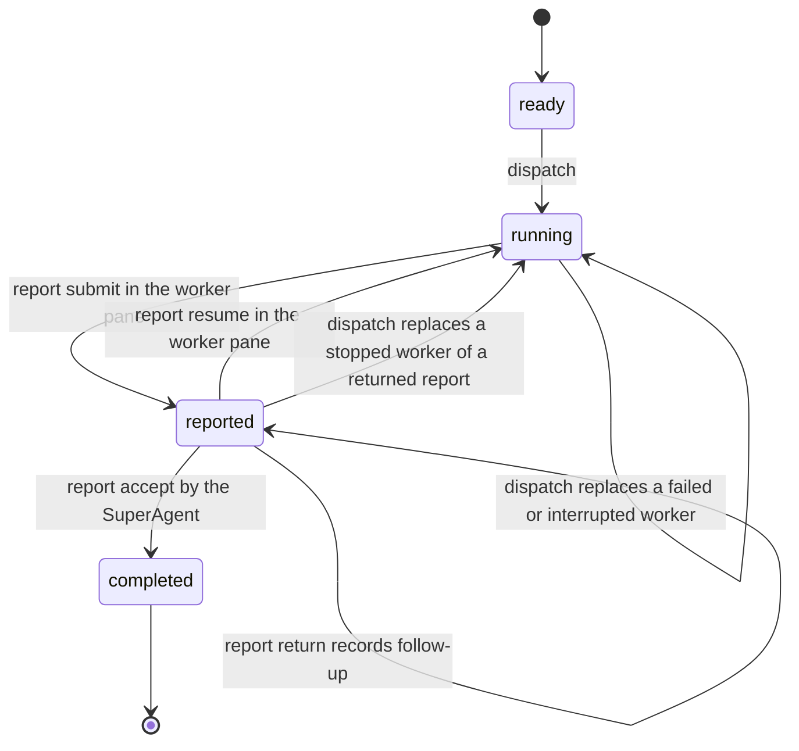

# Report assignments through SuperAgent acceptance

Issue #248 implements report submission, return, resume, and acceptance from ADR-0013.
It uses the launches, briefs, and Herdr plugin from #247.
The PR feedback loop is #249. PR merge and parent-merge relay remain #250 and #251, and reset and prune remain #252.

## Commands

Use `bun cli.ts` instead of `operator` in a source checkout.

```sh
# The WorkerAgent, in the Herdr pane that Operator dispatched for it.
operator report submit --file <report.json> --json
operator report resume --json

# The SuperAgent, from the registered controlling checkout.
operator report accept --source <source-id> --assignment <key> --json
operator report return --source <source-id> --assignment <key> --file <follow-up.md> --json
```

A worker command takes no assignment selector.
It finds the running launch whose recorded pane and Herdr socket match `HERDR_PANE_ID` and `HERDR_SOCKET_PATH`.
Another pane, another Herdr server, or a shell outside Herdr refuses with `worker_launch_not_found` or `worker_pane_required`.
A native host subagent runs in its parent's pane, so its work stays in the parent's assignment.
No command adds an assignment to a registered source, so independent work needs a separate assignment in a new plan.

`report accept` and `report return` refuse with `self_decision_refused` when they run in the worker's own pane on the same Herdr server.
This refusal reads the Herdr environment values, so it prevents a mistake and does not prove authority.
A worker that removes `HERDR_PANE_ID` can still accept its own report.

## Report file

```json
{
  "conclusion": "The module has two gaps.",
  "evidence": ["modules/a.ts:10 reads no state."],
  "unresolved": ["Whether the scope includes b.ts."],
  "decisions": [
    { "question": "Which name?", "answer": "Use reader.", "by": "super-agent" },
    { "question": "Is b.ts in scope?", "answer": "No.", "by": "person" }
  ],
  "files": ["/absolute/path/notes.md"]
}
```

`conclusion` and at least one `evidence` entry are required.
`decisions` and `files` are optional.
`by` is `person` only for an answer that the person gave. Any other answer is a `super-agent` decision.
The stored report keeps human answers and SuperAgent decisions in separate sections, and acceptance never changes them.
Supporting files must be regular files with unique names. Operator copies them, so a later change to a draft does not change the report.

Each report is stored in the database and as files under the assignment folder of device state:

- `reports/<number>/report.md` and `reports/<number>/files/<name>`.
- `follow-ups/<number>.md` for a returned report.

The brief lists every file in both folders, so a replacement reads all earlier reports and follow-up instructions.
A command first writes its files into the assignment's private `pending/` folder, which no brief lists.
It moves them to the numbered place only after its database record succeeds, so a refused concurrent submission or return never changes a recorded file.
When the move fails after the record, the command returns `report_io_failed`, and the staged files stay in `pending/` for inspection.

## Lifecycle



Host activity and Herdr events submit, return, and accept nothing.
A dependent of a report waits for `completed`, so submission alone does not unblock it.
The rules are one table in `modules/work-sources/report-machine.ts`.
Device state applies each rule inside the immediate transaction that read its facts.
A command that writes files first reads the same facts, so a refusal writes no file.

`next` shows these report actions:

| Action | Reason | Meaning |
| --- | --- | --- |
| `review_report` | `report_submitted` | A report awaits the SuperAgent's decision. A pane that ended does not hide it. |
| `resume_worker` | `follow_up_returned` | The live worker must read the follow-up and run `report resume`. |
| `replace_worker` | `worker_interrupted`, `launch_failed`, `launch_abandoned` | The worker of a running or returned assignment stopped. |
| `retry_cleanup` | `cleanup_failed`, `cleanup_unfinished` | Cleanup after acceptance did not finish. It stays after the source ends. |

Each report row in `next` shows its number, conclusion, report file, decision, follow-up file, and cleanup.
`source show` lists every report with its follow-up text, and every launch with its id.

## Acceptance and cleanup

Acceptance moves the assignment to `completed`, finishes a source whose assignments are all complete, and marks a running launch `finished`.
A `finished` launch ignores the later `pane.closed` event, so the pane closure is not an interruption.
Then cleanup runs with no transaction open:

1. The pane closes only when the SuperAgent runs on the launch's Herdr server and Herdr still lists the unique launch name.
   Herdr's `pane_not_found` counts as closed.
2. A recorded worktree is inspected with Git.
   Untracked or changed files, ignored files other than `node_modules` and environment files equal to the controlling checkout's, and commits that no other branch or remote branch holds are unlanded work.
   Git inspects the commits of the worktree's `HEAD` and of the recorded branch, because `HEAD` can leave that branch.
3. A worktree with unlanded work stays, and the detail names the reason. Only the person can authorize its deletion.
4. A worktree with no unlanded work is removed with the non-forcing `git worktree remove`, then its local branch is deleted.

A Herdr or Git failure records `failed` with its detail, and `next` shows `retry_cleanup`.
Run `report accept` again to retry. It returns `report_cleanup_retried`.
A cleanup has no lease. A retry while the first acceptance still cleans up runs a second cleanup, and the later outcome wins.
When that outcome is `failed`, `next` shows `retry_cleanup` again, and one more retry records the current state.
Operator installs no host permission rules for any of these steps.

## Cross-project content

The acceptance result has a `reference` of the form `operator:<owner>/<repository>/sources/<source>/assignments/<key>/reports/<number>`.
A SuperAgent that coordinates another project copies the content that it needs, with this reference, into the consumer plan's instructions.
The consumer brief then holds that content in the consumer's own device-state folder.
Removing or pruning the producer cannot remove it.
There is no cross-project dependency engine and no indefinite retention.

## Migration

`0005_report_submissions.sql` adds the `reports` table, after the #249 `pull_requests` migration.
Its migration policy declares no extra held-record query.
A `reported` assignment already blocks an upgrade through the device-wide idle guard.
A cleanup that a stopped process left `pending` does not block an upgrade, because `next` shows it and a retry repeats it safely.
Project removal deletes reports with the other source records.

## Verification

`run.reports.test.ts` drives the public CLI with real Git and SQLite, isolated device roots, the controlled `fake-herdr.ts`, and controlled OpenCode and Claude Code hosts.
It covers submission versus acceptance on both hosts, activity that completes nothing, foreign panes and servers, self-acceptance, dependents that wait for acceptance, return and resume, a replacement with changed settings that reads every report and follow-up, copied supporting files, kept and removed worktrees, failed and retried cleanup on an ended source, refusals with unchanged database bytes, a consumer brief that outlives the removed producer, and the absence of host permission files.
Beside-tests cover the report table, the next rules, stored report decoding, report content, worktree inspection with real Git, the report transaction, the returned-report reservation, argument parsing, the brief, and the migration policy.
`run.report-guards.test.ts` proves 11 guards with deliberate breaks in a disposable copy.
A concurrent public CLI test runs two submissions and two returns at once and checks that the published files match the recorded rows. Its interleaving is not deterministic, so it is not a deliberate-break guard.

No live Herdr check ran for this slice.
The pane closure uses `herdr pane close <pane_id>`, and Herdr 0.9.3 answered a missing pane with exit 1 and error code `pane_not_found` on this device.

## Gate commands and outcomes

All commands ran in the #248 worktree on macOS with Bun 1.4.4, rebased on `8b83778` with #249.

| Command | Outcome |
| --- | --- |
| `bun run quality` through the shared gate script | Format, lint, typecheck, module shape, skill shape, and module boundaries pass. 919 tests: 919 pass, 0 fail. |
| `bun test --timeout=60000 modules/operator-cli/run.reports.test.ts` | 6 pass, 0 fail. |
| `bun test --timeout=200000 modules/operator-cli/run.report-guards.test.ts` | 11 pass, 0 fail. Each deliberate break makes its behavior test fail. |
| `bun test modules/work-sources modules/report-assignments modules/device-state modules/worker-dispatch` | Pass. |

The first guard run showed that a break of the supporting-file list alone did not fail any test, because the copies still existed. The guard now removes the copy itself.
Review of #248 found that a worker could move `HEAD` off the recorded branch, so acceptance deleted that branch with its unlanded commits. A worktree beside-test reproduced it red before the fix, and a guard break proves the fix.
A worktree beside-test also found that Git ignores an `--exclude=refs/heads/<branch>` pattern before `--branches`. The inspection now passes the branch name without the prefix.
