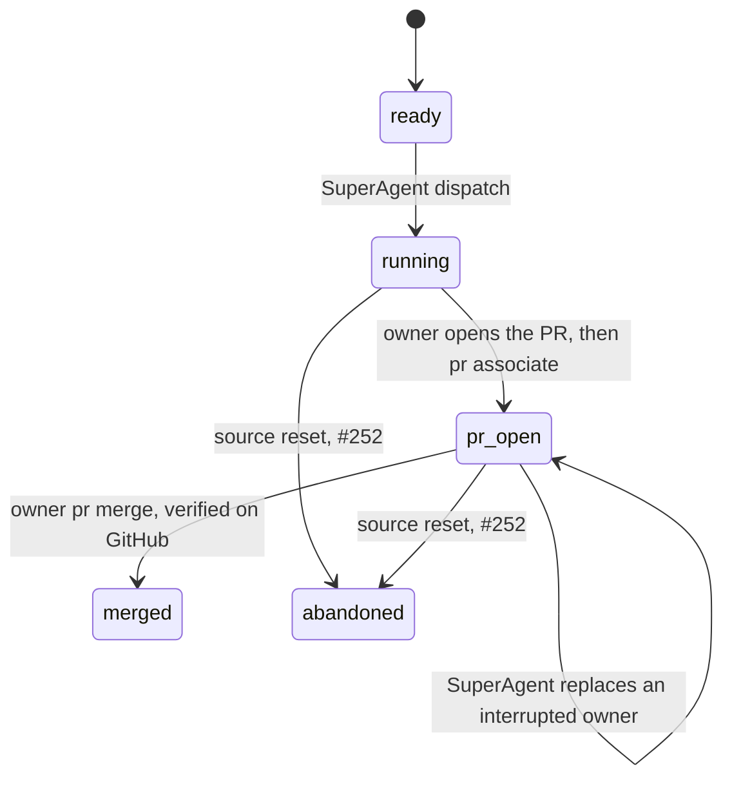
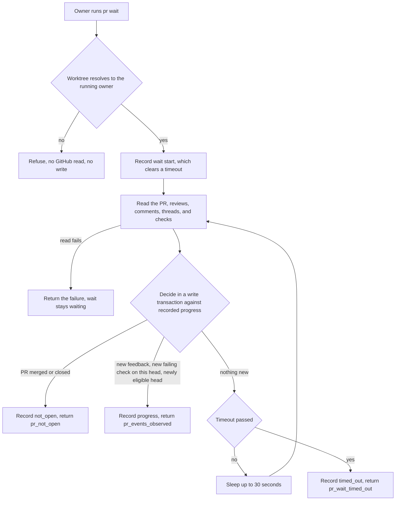

# PR feedback loop

Issue #249 implements PR association, the owner's wait loop, and owner attention from ADR-0010, ADR-0011, ADR-0001, and ADR-0003.
Parent-merge relay and rebase remain #250.
The guarded merge, merge verification, and cleanup are in `docs/implementation/251-merge-cleanup.md`.

## Commands

The owner WorkerAgent runs both commands inside its recorded worktree.
Use `bun cli.ts` instead of `operator` in a source checkout.

```sh
operator pr associate --json
operator pr wait --json
operator pr wait --timeout 600 --json
```

No flag selects a source, an assignment, or a PR.
The caller's real Git top level is the only selector.
It must be the recorded worktree of the latest launch of an open PR assignment, and that launch must be running.
The worktree must share the Git repository of the registered controlling checkout, that checkout must still have the recorded GitHub identity, and the worktree must be on the recorded branch.
A subdirectory or a linked path resolves to the same real top level.
A refusal reads nothing from GitHub and writes nothing.

| Refusal | Exit | Cause |
| --- | --- | --- |
| `pr_worktree_unrecorded` | 4 | The caller is not in a recorded worktree, for example the controlling checkout or another clone. |
| `pr_owner_inactive` | 4 | The worktree belongs to a launch that is not the running latest owner, or to ended or report work. |
| `pr_repository_mismatch` | 4 | The worktree is another repository, or the controlling checkout lost its recorded identity. |
| `pr_branch_mismatch` | 4 | The worktree is not on the recorded branch, or a wait runs from a launch whose branch is not the PR's branch. |
| `pr_owned_elsewhere`, `pr_already_associated` | 4 | Another open assignment owns the PR, or this assignment owns another PR. |
| `pr_not_found`, `pr_ambiguous` | 3 | No open PR, or more than one, has the recorded branch as its head in the project repository. |
| `pr_not_associated` | 3 | A wait ran before association. |
| `github_failed`, `github_uncertain`, `github_invalid_response` | 1 | GitHub refused, did not answer, or answered in an unknown form. Nothing is recorded as a wait result. |

## Lifecycle



The owner opens the PR with its own tools and closing keywords.
The CLI performs no issue operation and does not create the PR.
`pr associate` finds the one open PR whose head is the recorded branch in the project repository itself, not a fork.
In one immediate transaction, it checks the owner again, records the PR, and moves the assignment from `running` to `pr-open`.
A repeated association of the same PR returns `pr_unchanged`.



While a wait runs, its process holds a lease that it renews every 15 seconds, as dispatch does for a start.
A result or a timeout releases the lease.
A wait whose process is gone, or whose lease is older than five minutes, reads as `stopped`.

The default timeout is 300 seconds.
Set the host's command timeout above the wait timeout.
A wait reads GitHub with no transaction open.
The decision then runs inside an immediate write transaction on the progress that it reads there, so two simultaneous waits never report the same item.
A restarted wait continues from the recorded progress, not from conversation history.

Each result has the PR, the observed head, the four merge conditions, and its events:

- `feedback`: new reviews with a body or a verdict, PR comments, and review-thread comments, each with its author, `fromViewer`, path, and thread resolution. An item from the owner's own GitHub account has `fromViewer: true` and never ends a wait alone, so the owner's replies do not cost a round. It is reported once with the next other event. The accepted cost: a comment that the person writes from that same account also waits for the next other event.
- `checks_failed`: check runs or status contexts that fail on the current head. The same check failing on a new head is reported again.
- `merge_eligible`: approval, at least one reported check and all checks passing, no unresolved thread, and the default branch as base, reported once per head. Just after a push GitHub can report no checks yet, so no checks is not passing checks. `pr merge` checks these conditions again before it merges.
- `pr_merged` or `pr_closed`: the PR is no longer open. This is not a verified completion, so the assignment stays `pr-open` until the owner runs `pr merge`.

Each read takes the newest 100 reviews, 100 comments, 100 threads with their newest 50 comments, and 100 check contexts.
More than that number of new items between two waits is not reported.

## Next actions and attention

`next` adds these PR rows, each with a `pullRequest` summary of number, URL, branch, wait state, and wait time:

| Facts | Action | Reason |
| --- | --- | --- |
| `pr-open`, latest launch failed, interrupted, or abandoned | `replace_worker` | `launch_failed`, `worker_interrupted`, `launch_abandoned` |
| `pr-open`, the last wait timed out | `owner_attention` | `pr_wait_timed_out` |
| `pr-open`, the last wait saw a merged or closed PR | `owner_attention` | `pr_not_open` |
| `pr-open`, a wait is recorded as running but its process or lease is gone | `owner_attention` | `pr_wait_stopped` |
| `pr-open`, no wait runs, and Herdr last reported the owner `idle` or `done` | `owner_attention` | `pr_owner_idle` |
| `pr-open` otherwise | `wait` | `pr_feedback_loop` |

A replacement rule comes before the wait facts, so a stopped owner always gets a replacement.
A new wait clears a timeout, so the SuperAgent sees it only while the owner does not wait again.
Herdr activity is an input only to `pr_owner_idle`, the attention that ADR-0001 names for idle PR owners.
It never proves a result, and it does not raise attention while a wait runs, because the host can report idle during a long command.

A replacement of a `pr-open` owner keeps the assignment `pr-open`, its PR, and its recorded progress.
Dispatch reopens the worktree of the latest launch that recorded a worktree on the PR's branch, so a failed replacement start with no worktree does not hide it.
When that worktree is missing, dispatch refuses with `pr_worktree_missing` before any write or Herdr effect, rather than start a new branch that the PR does not use.
The person decides how to recover a missing PR worktree.
The brief names the open PR and tells the replacement to read the reviews, comments, unresolved threads, and checks before it waits.
A PR closed outside the CLI keeps its assignment `pr-open` with `pr_not_open` attention, and a new PR for that assignment refuses with `pr_already_associated`.
A PR merged outside the CLI completes when the owner runs `pr merge`. For a closed PR, the SuperAgent asks the person.
The replaced launch can no longer associate or wait, because only the running latest launch is the owner.

## Storage and compatibility

Migration `0004_pull_requests` adds `pull_requests`, keyed by source and assignment.
It records the repository, number, URL, branch, association time, progress, wait state, wait time, and the running wait's owner process and lease.
Progress holds the reported item ids, the reported `head:check` failures, and the last eligible head.
Source reads refuse a `pr-open` assignment without a PR, and a PR for an assignment that is not past `running`, as `state_corrupt`.
Project removal deletes PR records with the other source records.

The device-wide idle guard from #244 already blocks migration while an assignment is `pr-open`, including an owner whose launch was interrupted.
That guard covers this workflow's active work, including a running wait, so the wait lease is not another migration blocker.
The new migration declares no migration-specific held-record query.

## Verification

Public CLI scenarios in `run.pull-requests.test.ts` use real Git and SQLite, isolated device roots, the controlled `fake-herdr.ts`, and the controlled `fake-github.ts`.
They cover:

- Both hosts, OpenCode and Claude Code, through association, feedback, restart without repeats, timeout attention, CI failure and a failure on a new head, eligibility, and a merged PR that stays `pr-open` with attention.
- Polling until feedback arrives, and two simultaneous waits that report one new item once.
- Worktree scoping: the controlling checkout, the device root, another clone on the same branch, selector flags, a wrong branch, a changed remote identity, a subdirectory, a linked path, a PR owned by another assignment, a fork head, two candidate PRs, and another repository at the recorded path. Refusals leave the database bytes unchanged and make no GitHub read.
- An interrupted owner, whose commands refuse without effects, and its replacement, which keeps the PR, the unlanded file, the progress, and both launch records.
- A replacement after a failed replacement start, which reopens the PR worktree on the PR branch, and a missing PR worktree, which refuses dispatch with unchanged database bytes and no new branch.
- A killed wait, which `next` shows as `pr_wait_stopped`, and an owner that Herdr reports idle or done between waits, which `next` shows as `pr_owner_idle`.
- An unanswered GitHub read, which ends the wait and shows it as stopped.

Direct beside-tests cover the wait table, the GitHub answer mapping, the assignment table with PR facts, the snapshot invariants, and the device-state writes.
`run.pull-request-guards.test.ts` proves 23 guards with deliberate breaks in a disposable copy.

The controlled GitHub tool proves the command contract.
A read-only live check ran the module's two GraphQL reads through the authenticated `gh` on macOS on 2026-10-27:

| Live read | Observed result |
| --- | --- |
| PR read of fveracoechea/operator#222 | GitHub accepted the whole query, including review threads, and the answer parsed: open, base `main`, 13 comments, 8 checks, 7 passing and 1 pending. |
| PR read of fveracoechea/operator#225 | Merged, approved, one review, and no checks parsed. |
| Association read for head `global-operator-home` | One open PR, #222. |

No PR in the last 100 of that repository had a review thread, so the thread answer shape was proved only by the accepted query and the controlled tool.
No live Herdr check ran for this slice, because PR commands make no Herdr call.
