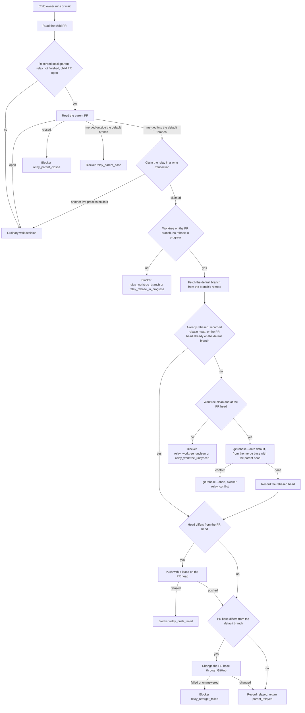

# Stacked PRs and the parent-merge relay

Issue #250 implements stacked starts and the parent-merge relay from ADR-0010, ADR-0001, and ADR-0003.
It extends the PR feedback loop of `249-pr-feedback.md`.
The guarded merge, merge verification, and cleanup are in `251-merge-cleanup.md`.

## Commands

No command is new. The relay runs inside the owner's wait.
Use `bun cli.ts` instead of `operator` in a source checkout.

```sh
# The SuperAgent, from the controlling checkout.
operator dispatch --source <source-id> --assignment <child> --json

# The child owner, in its recorded worktree.
git push -u origin <child-branch>
operator pr associate --json
operator pr wait --json
```

## Start on an open parent

A PR dependency permits start at `pr-open` or `merged`. A report dependency requires `completed`.
A PR assignment stacks on one parent branch.
When more than one PR dependency is `pr-open`, `next` returns `wait` with `dependencies_pending`, and each open parent is a blocker with `required: "merged"`.
A report assignment reads no branch, so several open parents do not hold it.

When exactly one PR dependency is `pr-open`, dispatch of a new worktree:

1. Reads the remote of the parent branch from Git, which the parent owner's `git push -u` recorded.
2. Fetches `refs/heads/<parent branch>` from that remote into a private `refs/operator/parents/<uuid>` ref with `--no-write-fetch-head`, reads its commit, and deletes the ref. Two simultaneous starts never read each other's parent, and the controlling checkout's `FETCH_HEAD` is not changed.
3. Passes that commit to `herdr worktree create --base`. The child branch starts at the parent's pushed head and tracks no parent branch.

When the parent branch has no remote, or the fetch fails, dispatch refuses with `parent_branch_unavailable` before any write or Herdr effect.
A replacement reopens the recorded worktree and does not change its base.
The brief names the parent branch, its PR, and its assignment, and tells the owner to target that branch.

`pr associate` reads the PR's base and the repository's default branch.
The base must be the default branch, or the branch of a recorded PR of one of the assignment's dependencies.
Any other base, for example a source-wide integration branch, refuses with `pr_base_invalid` and exit 4, and changes nothing.
A base on a dependency's branch records that dependency as the stack parent.

## Relay



The commits that the child shares with the parent's head landed with the parent, so the rebase replays only the commits after their merge base.
This works for squash, rebase, and merge commits.
The parent head comes from GitHub. It is local when the parent owner pushed from the same repository. Otherwise the relay fetches it by commit.
The relay changes only the owner's worktree and its branch, and pushes only `refs/heads/<child branch>`.
It refuses a worktree on another branch or with a detached `HEAD`, and a rebase in progress, for example one that a stopped relay left. It never aborts a rebase that it did not start.
The lease protects a newer push to the child branch.
The parent branch, the controlling checkout, and other worktrees are not changed.

A successful relay returns `pr_events_observed` with one event:

```json
{ "kind": "parent_relayed", "parent": { "assignment": "parent", "number": 6, "branch": "task/21-parent" }, "base": "main", "head": "<sha>" }
```

A blocker returns a refusal with the blocker as its reason.
Conflicts, unclean or unsynced worktrees, and parent problems exit 3.
Failed fetches, pushes, and base changes exit 1, and the next wait retries them.
A blocker never reports a completed relay.

## Progress, repeats, and restarts

Migration `0007_pr_relay` adds the nullable `relay` JSON column to `pull_requests`.
It holds the stack parent, the state `stacked`, `blocked`, or `relayed`, the recorded rebase head, the blocker, and the claim's owner process and lease time.
The migration declares no held-record query, because the idle guard already blocks migration while an assignment is `pr-open`.

- Each step checks whether it already happened. A recorded rebase head, or a PR head that already contains the default branch, skips the rebase. Any other head that differs from the PR head is `relay_worktree_unsynced`, so a half-done rebase is never pushed. A head equal to the PR head skips the push. A base equal to the default branch skips the base change.
- The rebased head is recorded before the push, so a restarted relay pushes the same commits rather than rebasing again.
- One process at a time holds the claim. It renews the claim every 15 seconds while its Git and GitHub steps run. Another live wait observes only. A claim whose process is gone, or whose lease is older than five minutes, is free.
- Two simultaneous waits report one `parent_relayed`, with one push and one base change.
- A `relayed` record ends the relay. A later wait reads no parent.

## Next actions and merge

`next` shows the PR's `stack` with its parent, relay state, and blocker.
A `blocked` relay shows `owner_attention` with `pr_relay_blocked`, after the replacement rules and before the wait facts.
A later successful wait clears it.
A stacked PR has `defaultBase: false` while it targets its parent.
The fifth merge condition, `stackRelayed`, is false until the relay is `relayed`, also when the owner changes the base to the default branch by hand while the parent is open.
So the wait reports no `merge_eligible` before the relay, and `pr merge` refuses with `pr_merge_blocked` and "a finished parent-merge relay".
The relay adds no integration-branch publication and no source-wide stack lifecycle.

## Verification

Public CLI scenarios in `run.pr-relay.test.ts` use real Git with a bare `origin` remote, real SQLite, isolated device roots, the controlled `fake-herdr.ts`, and the controlled `fake-github.ts`.
A second `github` remote names the GitHub identity.
The controlled GitHub reports an open PR's head from the bare remote, as GitHub reports a push.
They cover:

- An open-parent start on the parent's pushed head, the brief, the stacked association, no eligibility while stacked, a squash merge with later main work, the relay, unchanged parent worktree and controlling checkout, and a repeated wait that relays nothing and then reports eligibility.
- A conflict that aborts the rebase and keeps the branch, `pr_relay_blocked` in `next`, and the owner's own resolution, after which the relay only changes the base.
- A failed base change after the push, and a later wait that changes the base without a second push.
- A stacked PR moved to the default branch by hand, which stays ineligible until the relay, and a relay that then needs no base change.
- A live claim that holds a wait, a stopped claim that a wait takes over, and two simultaneous waits that relay once.
- A PR base that is neither the default branch nor a dependency's branch.
- A submitted but unaccepted report dependency that blocks start and dispatch with no Herdr worktree, and its acceptance.

Direct beside-tests cover the relay decision, the Git steps on a real repository including a rebase that a stopped relay left and another checked-out branch, the relay claim and its renewal in device state, the fifth merge condition, the open-parent rule and the attention rule, and the brief.
`run.pull-request-guards.test.ts` proves 19 new relay guards with deliberate breaks in a disposable copy.

No live GitHub or Herdr check ran for this slice.
`herdr worktree create --base` is in the Herdr 0.9.3 help output, but its start-point behavior is proven only through the controlled Herdr.
The base change uses `gh api -X PATCH repos/<owner>/<repository>/pulls/<number> -f base=<branch>`, proven only through the controlled GitHub.

## Gate commands and outcomes

All commands ran in the #250 worktree on macOS with Bun 1.4.4.

| Command | Outcome |
| --- | --- |
| `bun run quality` through the shared gate script, on #251 `33eab2b` | Format, lint, typecheck, module shape, skill shape, and module boundaries pass. 1015 tests: 1015 pass, 0 fail. |
| `bun test --timeout=120000 --rerun-each=3 modules/operator-cli/run.pr-relay.test.ts` | 21 pass, 0 fail. |
| `bun test --timeout=200000 modules/operator-cli/run.pull-request-guards.test.ts` | 42 pass, 0 fail. Each deliberate break makes its behavior test fail. |
| `bun test modules/pull-requests modules/device-state modules/work-sources modules/worker-dispatch` | All pass, 0 fail. |
