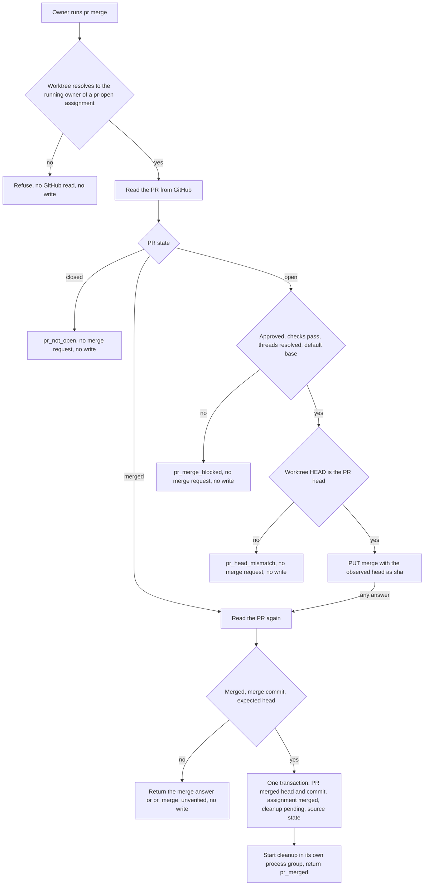
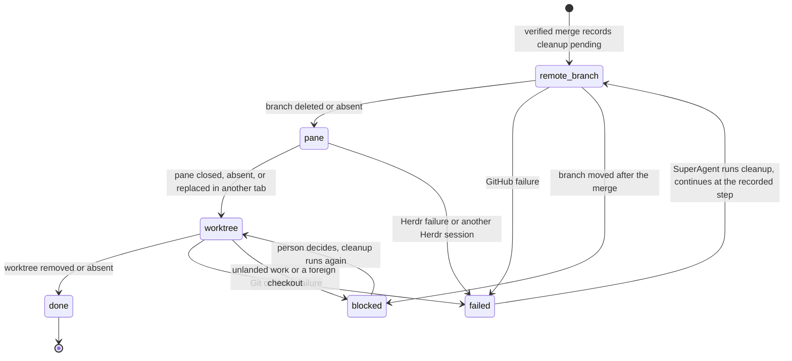

# Guarded merge and cleanup

Issue #251 implements the owner's guarded merge, merge verification, and the ordered cleanup after a verified merge from ADR-0010, ADR-0011, ADR-0001, and ADR-0003.
It also covers the still-valid parts of #215: cleanup treats preparation output as disposable and still refuses unrecorded work.
Parent-merge relay is in `250-pr-relay.md`.
Report pane closure after acceptance remains #248, and reviewer worktree cleanup remains #254.

## Commands

Use `bun cli.ts` instead of `operator` in a source checkout.

```sh
operator pr merge --json
operator cleanup --source <source-id> --assignment <key> --json
operator cleanup --source <source-id> --assignment <key> --person-instructed --json
```

The owner WorkerAgent runs `pr merge` in its recorded worktree, with the same owner resolution as `pr associate` and `pr wait`.
No flag selects an assignment or a PR.
The SuperAgent runs `cleanup` from the controlling checkout to repeat a failed or stopped cleanup.
`--person-instructed` is only for the person's explicit instruction to delete unlanded work.

## Merge



The gate reads a fresh observation every time.
A `merge_eligible` wait result, an older observation, or a supervisor's message is never an input.
The merge request sends the observed head as `sha`, so GitHub refuses when the head moved after the check.
The merge method is GitHub's `viewerDefaultMergeMethod` for the repository.

A lost answer, a refused answer, and a concurrent second merge are reconciled by reading the PR again.
When GitHub reports the PR merged at the guarded head with a merge commit, the merge is recorded once.
A second record of the same merge returns `pr_merge_unchanged` and starts the cleanup again.
The cleanup claim lets only one process run it, so the restart only recovers a cleanup that no live process claimed, for example after a crash.
A PR that the person merged on GitHub is verified the same way without a merge request, which is the recovery for the `pr_not_open` attention from #249.

| Refusal | Exit | Effect |
| --- | --- | --- |
| `pr_worktree_unrecorded`, `pr_owner_inactive`, `pr_repository_mismatch`, `pr_branch_mismatch` | 4 | No GitHub read, no write. |
| `pr_not_associated` | 3 | No GitHub read, no write. |
| `pr_not_open`, `pr_merge_blocked`, `pr_head_mismatch` | 3 | One PR read, no merge request, no write. |
| `pr_merge_refused`, `pr_merge_unverified`, `github_failed`, `github_uncertain`, `github_invalid_response` | 1 | Nothing recorded. The owner repeats the command. |

## Cleanup



The merge starts `operator cleanup` in its own process group from the controlling checkout, because the pane close ends the owner's process.
The merge records that process and a fresh lease, so `next` shows `cleanup_running` before the process takes its claim. A beside-test proves this record. No deliberate break proves it, because a public scenario cannot hold that window open.
The cleanup process claims the record with its process and a lease that it renews every 15 seconds.
A second cleanup refuses with `cleanup_running` while the lease holds.
A killed cleanup leaves a stale lease, and `next` shows `retry_cleanup` with `cleanup_stopped`.
Each step observes its resource before and after its effect, records its outcome, and the next run continues at the recorded step.
A failed step stops the order, so the pane and the worktree stay while the remote branch is not proven gone.

| Step | Identity and inspection | Effect |
| --- | --- | --- |
| `remote_branch` | The branch must still be at the merged head. A missing branch is done. | `DELETE git/refs/heads/<branch>`, then a second read proves it gone. |
| `pane` | The recorded pane on the recorded Herdr socket. A missing pane, or a pane identifier in another tab, is done without a close. | `herdr pane close`. Herdr closes the worktree's workspace with its last pane. |
| `worktree` | A missing path is done after `git worktree remove` drops its stale registration and `git update-ref -d` deletes the local branch while it is landed. Otherwise the path must be its own Git top level in the controlling checkout's repository, on the recorded branch. The head is the merged head or its ancestor. `git status --ignored=matching --untracked-files=all` shows no change, no untracked file, and only preparation output. | `herdr worktree remove` when its workspace is still open, otherwise `git worktree remove`. Then `git update-ref -d` deletes the local branch only while it still names the inspected head. |

Preparation output is only:

- a `node_modules/` folder beside a tracked `package.json`, or any entry inside it, when the worktree tracks `bun.lock` or `bun.lockb` and its preparation finished. Git lists the children one by one for a pattern such as `node_modules/*`.
- an approved `.env*.local` file whose bytes equal the controlling checkout's file at the same path.

Every other ignored entry is unknown and can be unlanded work, so the step blocks with `cleanup_unlanded_work`.
A changed copy of `.env.local` also blocks.
Neither Git nor Herdr gets `--force` unless the person instructed the cleanup.
The instruction covers only the step that is blocked when the cleanup starts. A later step that finds other unlanded work blocks again with its own detail, so the person sees each deletion before authorizing it.
A foreign checkout at the recorded path blocks with `cleanup_resource_mismatch` and is never removed, even with `--person-instructed`.
When the person moves it away, the next run observes the path as absent and finishes.

| Cleanup result | Exit | `next` row |
| --- | --- | --- |
| `cleanup_finished`, `cleanup_unchanged` | 0 | None. The merged assignment ends. |
| `cleanup_running` | 3 | `wait` with `cleanup_running`. |
| `cleanup_failed` | 1 | `retry_cleanup` with `cleanup_failed` and the step, reason, and detail. |
| `cleanup_unlanded_work` | 3 | `person_decision` with `cleanup_unlanded_work`. |
| `cleanup_resource_mismatch` | 3 | `person_decision` with `cleanup_resource_mismatch`. |
| `cleanup_not_found`, `source_not_found` | 3 | No cleanup is recorded for that assignment. |

A finished source keeps its cleanup rows in `next` next to `source_ended`.
Project removal and project move refuse with `project_cleanup_open` while a cleanup is not done, so an obligation cannot be hidden by removing its records.
They refuse the same way with `project_review_open`, exit 3, while a review request or its reviewer cleanup is unfinished.

## Storage and compatibility

Migration `0005_merge_cleanup` adds `merged_head`, `merge_commit`, and `merged_at` to `pull_requests` and a `cleanups` table keyed by source and assignment.
A cleanup row records its launch, the next step, its state (`pending`, `failed`, `blocked`, or `done`), the last failure, and the running process and lease.
Source reads refuse as `state_corrupt` when a merged PR assignment has no verified merge or no cleanup, when another assignment has either, when a cleanup is not for a merged PR assignment, or when only a finished cleanup lacks a step.
A running cleanup blocks migration, because its process holds a lease. A failed, blocked, or stopped cleanup does not.

## #215 coverage

The #215 reproduction ran through the public CLI with a real Git worktree, a tracked `bun.lock` with a local `file:` dependency, and the real `bun install --frozen-lockfile` of worktree preparation.
Before this change, the base had no `pr merge` or `cleanup` command, so the scenario failed with `invalid_arguments`.
The guard break `lockfile dependency folders are preparation output` proves the current fix: when the classification treats `node_modules/` as unknown, the main scenario fails with `cleanup_unlanded_work`.

Obsolete parts of #215:

- The `operator.wake` plugin, `wake arm`, and its open-action condition are removed. No wake machine exists.
- `cleanup remove --attempt` and its approval grant are removed. Cleanup runs after a verified merge, and only `--person-instructed` deletes unlanded work.
- `crew next` and `remove_worktree` with `approval_required` are replaced by `next` with `retry_cleanup` and `person_decision`.

Deferred parts of #215: report pane closure and report worktree rules need report acceptance from #248, and reviewer worktree cleanup needs #254.

## Verification

Public CLI scenarios in `run.pr-merge.test.ts` use real Git, real SQLite, real `bun install`, isolated device roots, the controlled `herdr-fixture.ts`, and the controlled `github-fixture.ts`:

- Both hosts, OpenCode and Claude Code: a verified merge, then the remote branch, the pane, the prepared worktree with `node_modules` and a copied `.env.local`, and the local branch are gone, and the other assignment stays ready.
- Every merge refusal, including an earlier `merge_eligible` wait result followed by a lost approval, sends no merge request and leaves the database bytes unchanged.
- A lost merge answer and two simultaneous merges record one merge and one cleanup.
- A PR merged by the person on GitHub is verified without a merge request and finishes its source.
- A lost branch deletion stops before the pane, a refused pane close stops before the worktree, a finished source still shows `retry_cleanup`, project removal refuses, and a new process continues at the recorded step without a second deletion.
- Untracked files, unknown ignored files, a changed `.env.local`, and a commit after the merge block the worktree until the person instructs deletion.
- A moved remote branch and a foreign repository at the worktree path are kept, also with `--person-instructed`.
- A worktree whose workspace stays open is removed through Herdr.
- A person instruction for a moved remote branch deletes that branch and closes the pane, but the worktree with an untracked file blocks again and keeps the file.
- A `node_modules/*` ignore pattern, which makes Git list each dependency, still finishes the cleanup.
- A worktree folder that the person removed leaves no Git registration and no landed local branch.

Beside-tests cover the merge table, merge verification, the step decisions, the classification of ignored entries, the cleanup claim and lease, the merge transaction, the snapshot invariants, the assignment table, and the migration guard.
`run.pr-merge-guards.test.ts` proves 21 guards with deliberate breaks in a disposable copy.

The live checks ran on macOS on 2026-10-27:

| Live check | Observed result |
| --- | --- |
| Herdr 0.9.3, isolated server, `herdr pane close` of a worktree's root pane | The pane and its worktree workspace closed. `herdr pane get` then answered `pane_not_found`. |
| `herdr worktree remove --workspace` of that closed workspace | `workspace_not_found`. This is why cleanup falls back to `git worktree remove`. |
| `git worktree remove` of a worktree with only an ignored `node_modules/` | Removed without `--force`. The branch stayed. |
| `herdr worktree remove` of an open workspace with an untracked file | `dirty_worktree_requires_force`. After the file was removed, `worktree_removed` with `forced: false`, and the workspace closed. |
| GitHub PR read of fveracoechea/operator#222 with the new fields | Parsed: open, merge method `merge`, no merge commit. |
| GitHub PR read of fveracoechea/operator#225 | Parsed: merged with a merge commit. |
| Branch read of `global-operator-home` and of a missing branch | The commit, and null for the missing branch. |

No live merge request and no live branch deletion ran, because both are irreversible effects on the person's repository.
The merge and deletion contracts are proven only by the controlled GitHub tool.
