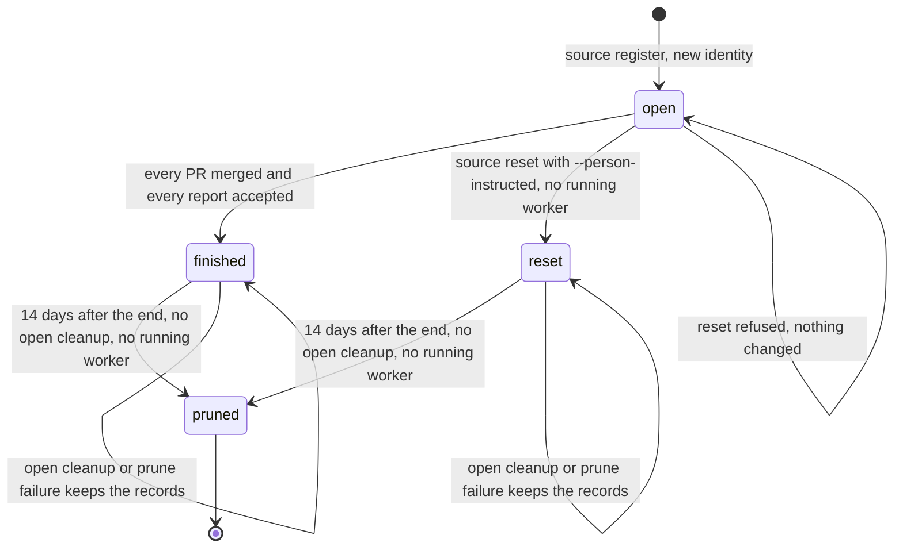

# Source reset and prune after retention

Issue #252 implements source reset and source prune from ADR-0012, with the report retention of ADR-0013 and the cleanup visibility of ADR-0010.
It adds no migration. The `reset` state, `ended_at`, and the index that permits one open source for each parent already exist.

## Commands

Use `bun cli.ts` instead of `operator` in a source checkout.

```sh
operator source reset --source <source-id> --person-instructed --json
operator source prune --json
```

Both commands run from the registered controlling checkout and act only on that project's sources.
`--person-instructed` attests the person's explicit instruction, as for `project remove`. It does not grant authority, and a SuperAgent must not infer it.
Prune takes no flag. The 14-day retention is the person's accepted policy, so `next` offers prune when it applies.

## Source lifecycle



`pruned` is not a stored state. The records no longer exist.
A new registration of the same tracker parent is permitted once the earlier source is `finished` or `reset`. It gets a new identity and starts with no launches, PRs, reports, or cleanups.
A second open source for that parent still refuses with `source_parent_open`.

## Reset

One immediate transaction reads the source, its assignments, and its launches, applies the reset rule, and writes the result.
A concurrent dispatch therefore cannot start a worker under the reset.

| Assignment state | After reset |
| --- | --- |
| PR `merged` | Kept. Its cleanup row stays and `next` still shows it. |
| Report `completed` | Kept. A failed or pending acceptance cleanup stays in `next`. |
| PR `ready`, `running`, `pr-open` | `abandoned` |
| Report `ready`, `running`, `reported` | `abandoned`. A submitted report keeps its record but no longer awaits a decision. |

The source becomes `reset` with `endedAt` set to the reset time.
The result lists the `preserved` and newly `abandoned` keys in plan order and reports `prunableAt`.
An assignment that was already `abandoned` is in neither list.
`retained` lists the work that the abandoned assignments leave: each recorded worktree that still exists at its path, with its branch, and each PR that has no verified merge, with its URL.
The SuperAgent tells the person about them, because no `next` action shows them after the reset.
Reset writes nothing outside the database. It closes no pane, removes no worktree or branch, sends no GitHub request, and changes no tracker content.
An abandoned assignment is not dispatchable, its old owner cannot associate or merge a PR, and its report cannot be accepted.

| Refusal | Exit | Meaning |
| --- | --- | --- |
| `person_instruction_required` | 3 | The flag is missing. Nothing changed. |
| `source_worker_running` | 3 | A launch of the source is `running`, or `starting` with a live owner. The detail names each assignment and pane. Close the pane in Herdr so that the plugin records its end, then reset again. |
| `source_ended` | 3 | The source is already `finished` or `reset`. |
| `source_not_found` | 3 | No source with that identity in this project, including a source of another project. |
| `controller_mismatch` | 4 | The controlling checkout changed during the command. |

A `starting` launch whose dispatching process stopped is abandoned and does not block reset.
A running cleanup is not a worker, so it does not block reset. Its merged assignment stays as it is.
When the Herdr plugin is missing or an event is lost, a launch stays `running`, and reset and prune keep refusing for that source. This slice adds no recovery command for that case.

## Prune

`next` shows each ended source as `source_ended` with `endedAt` and `prunableAt`.
When the source is eligible, it also shows `prune_source` with `retention_elapsed`.
`next` and `prune` use the same rule in `modules/work-sources/source-machine.ts`:

1. An open source is not a candidate.
2. A source whose `endedAt` is not a valid time stays with `end_time_invalid`.
3. A source stays with `retention_pending` until `now >= endedAt + 14 days`.
4. A source with a PR cleanup that is not `done`, or a report cleanup that is `pending` or `failed`, stays with `cleanup_open`. Those records are the only home of the obligation.
5. A source with a running or live starting launch stays with `worker_running`.
6. Otherwise it is pruned.

For each eligible source, one immediate transaction checks the rule again, deletes `projects/<owner>/<repository>/sources/<source>/` with every brief, report, follow-up, and supporting file, synchronizes the parent folder, and then deletes the source's reports, cleanups, PRs, launches, assignments, and source row.
The writer reservation stops a concurrent dispatch, acceptance, or second prune from racing the deletion.
The result lists `pruned` sources with their `retained` work, by the same rule as reset, and `kept` sources with their reason.
A worktree that a merge or acceptance cleanup removed is not listed.

Prune deletes only that source folder.
It touches no worktree, branch, pane, tracker, other source, other project, settings, skills, or migration backup.
A linked or non-directory path in the source folder's ancestry refuses, and the external content stays.
There is no archive and no archive reader.
A review request from #253 is not an assignment. Prune keeps its record and its files under `reviews/`, and the request keeps the pruned source identity only as a reference.

### Failed file cleanup

A filesystem failure returns `source_prune_failed` with exit 1, and the transaction rolls back the records.
The deletion can stop part way, so some files can already be gone.
The records stay as the recovery obligation, so `source show` still reads the source and `next` still shows `prune_source` after a restart.
Resolve the reported path or I/O problem, then run `source prune` again. Sources that were pruned earlier in the same run stay pruned, and the detail names them.
Prune stops at the failed source, so later eligible sources wait for the next run. This keeps one failure report for each run.

## Cross-project content

A report reference such as `operator:<owner>/<repository>/sources/<source>/assignments/<key>/reports/<number>` expires with its source.
A consumer project keeps the content only when its SuperAgent copied it into the consumer plan, as `248-report-assignments.md` describes.
The consumer brief lives in the consumer's own source folder, so producer prune does not change it.
Prune from the consumer's checkout does not touch the producer's sources.

## Verification

`run.source-reset.test.ts` drives the public CLI with real Git and SQLite, isolated device roots, the controlled `fake-herdr.ts`, the controlled `fake-github.ts`, and the controlled OpenCode host:

- A mixed source with a verified PR merge, an accepted report, an associated PR with a stopped owner, a submitted report with a stopped worker, a running report worker, and a ready dependent. Reset without the flag and reset with a running worker refuse with unchanged database bytes. After the worker stops, reset keeps the merged and completed work, abandons the rest, and lists the open PR with its worktree as retained. A later prune lists the same work and not the worktree that merge cleanup removed. Branches, worktrees, Herdr calls, and GitHub calls stay the same. Dispatch, PR association, report acceptance, and a second reset then refuse with unchanged bytes.
- A finished source, a missing source, and another project's source refuse with unchanged bytes.
- The same parent refuses while open, registers again after reset with a new identity, refuses a second open source, and the new source adopts neither the old launch nor the old PR.
- An end 60 seconds before the 14-day boundary keeps every file and record. An end 60 seconds after it shows `prune_source`, and prune deletes the records and files, keeps the worktree with an untracked file, its branch, a migration backup, and another open source, and leaves no file named for the source.
- A locked assignments folder makes prune fail with exit 1. The records stay, `next` shows `prune_source`, and a new process prunes after the lock is removed.
- A failed acceptance cleanup keeps its finished source with `cleanup_open` and unchanged bytes until a retry finishes the cleanup.
- A consumer brief in another project keeps the copied conclusion and reference after the producer is pruned.

The 14-day boundary is set by writing `ended_at` in the isolated SQLite file, because the CLI reads the real clock.
The exact boundary, one millisecond before, at, and after, is proven by beside-tests of the pure rule.
Beside-tests also cover the reset rule for both completion types, every refusal, the reset and prune transactions with controller, scope, and linked-path refusals, the source folder path, and argument parsing.
`run.source-reset-guards.test.ts` proves 14 guards with deliberate breaks in a disposable copy.

## Gate commands and outcomes

All commands ran in the #252 worktree on macOS with Bun 1.4.4.

| Command | Outcome |
| --- | --- |
| `bun run quality` through the shared gate script | Format, lint, typecheck, module shape, skill shape, and module boundaries pass. 1118 tests: 1118 pass, 0 fail, after the rebase onto #250 and #253. |
| `bun test --timeout=120000 modules/operator-cli/run.source-reset.test.ts` | 7 pass, 0 fail. |
| `bun test --timeout=200000 modules/operator-cli/run.source-reset-guards.test.ts` | 14 pass, 0 fail. Each deliberate break makes its behavior test fail. |
| `bun test modules/work-sources modules/device-state modules/operator-home modules/operator-cli/sources.test.ts` | Pass. |

The first gate run found that the project guard `actual file deletion` still named `finishProjectRemoval`. The deletion now lives in the shared `removeStateDirectory`, and the guard names that function.
