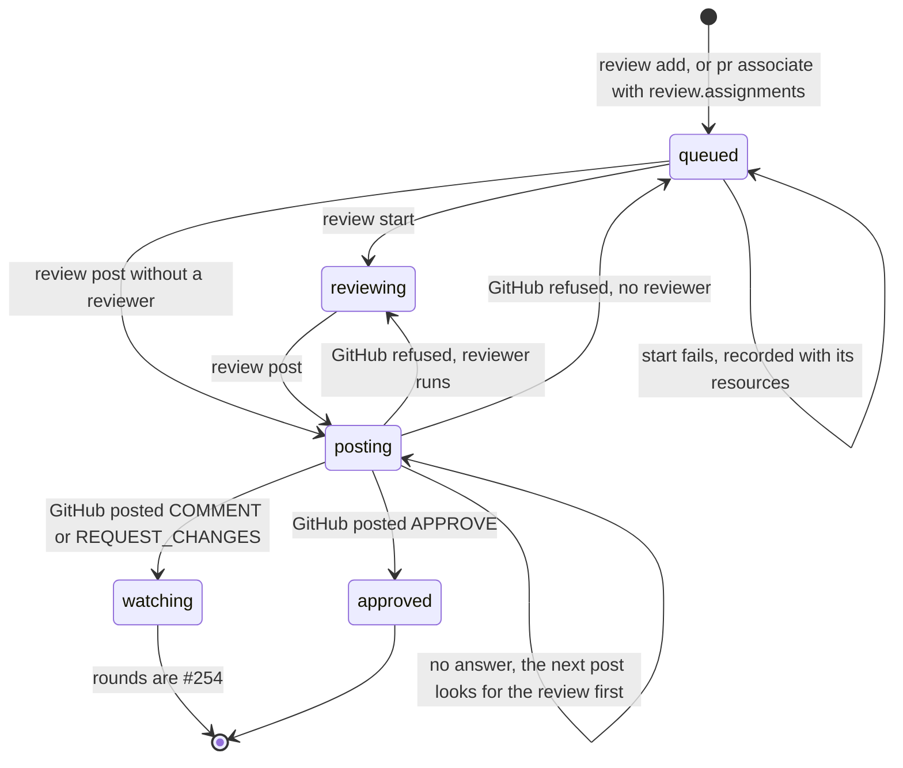
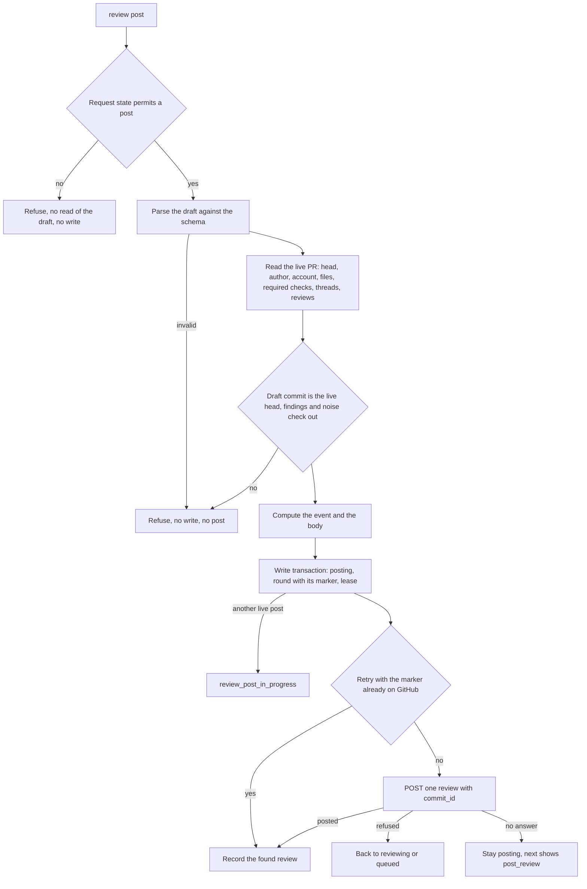

# Review requests and the review post

Issue #253 implements the core of ADR-0015: review requests separate from assignments, the reviewer launch, the draft-only review skill, and one guarded CLI post path on both hosts without Slack tools.
Later rounds, head moves, thread replies, the stale flag, reviewer cleanup, and the end states `closed` and `skipped` remain #254.
Slack ingestion and Slack effects remain #255.

## Commands

Use `bun cli.ts` instead of `operator` in a source checkout.

```sh
operator review add <pr-url> --json
operator review start <pr-url> [--profile name] --json
operator review post <pr-url> --json
operator review next --json
```

The PR URL is the only selector, so each command runs from any folder.
The URL gives the repository, and that repository must be a registered project.
An unregistered repository refuses with `review_repository_unregistered`, also when the caller is inside another registered checkout.
The CLI never reviews from the caller's checkout instead.

`add` reads the PR, refuses a PR that is not open, and records a `queued` request with the `slack` origin.
That origin also covers a manual addition, and it needs no Slack transport.
A repeated `add` of a PR with an active request returns `review_unchanged`.

| Refusal | Exit | Cause |
| --- | --- | --- |
| `review_url_invalid` | 2 | The argument is not `https://github.com/<owner>/<repository>/pull/<number>`. |
| `review_repository_unregistered`, `review_request_missing`, `review_pr_not_open` | 3 | The repository is not registered, no request was added, or the PR is merged or closed. |
| `review_draft_missing`, `review_draft_invalid` | 3 | The draft file is absent, is not JSON, or breaks the draft rules. |
| `review_noise_changed_file`, `review_noise_unknown_check`, `review_noise_unverifiable` | 3 | A noise claim cites a changed file, names no failing required check, or the read did not return every changed file. |
| `review_thread_unknown`, `review_thread_replies_unsupported` | 3 | A reply names a thread that this account did not start, or a valid reply waits for #254. |
| `review_head_moved` | 4 | The draft reviews another commit than the live PR head. |
| `review_start_in_progress`, `review_post_in_progress` | 4 | Another live process starts this reviewer or posts this review. |
| `review_reviewer_started`, `review_already_posted` | 4 | The request already has its reviewer, or its review is posted. |
| `review_approval_blocked` | 4 | A computed approval has an open blocker. |
| `review_ci_pending` | 4 | A computed approval while a required check runs, or while the PR has more check contexts than one read returns. |
| `review_worktree_changed` | 4 | A retried start found its recorded worktree changed and not at the PR head. |
| `launch_failed`, `review_post_failed`, `github_failed`, `github_uncertain` | 1 | Herdr, Git, or GitHub failed, or GitHub did not confirm a post. |

## Lifecycle in this slice



The table in `modules/review-requests/review-machine.ts` decides each transition from the recorded request, the registration, and the owner lease.
It reads no database, network, Git repository, or clock.
`modules/device-state/review-requests.ts` runs that decision inside one immediate write transaction, so two commands never act on the same state.
One PR has at most one active request, by a partial unique index.

## Reviewer launch

`start` reads the PR, records `launchState: starting` with a lease, and runs the launch with no transaction open.

1. The worker-dispatch checks run: the Herdr session, static readiness, the linked plugin, the resolved start profile, the release, and the owned skills.
2. Git fetches `refs/pull/<n>/head` from the checkout's remote whose configured URL has the project's GitHub identity, whatever its name, into `refs/remotes/<remote>/pr/<n>`. A head that moved since the read refuses with `review_head_moved`.
3. The names follow dispatch rules: agent `<repo>-pr<n>-review`, branch `review/<repo>-pr-<n>`, and a collision suffix, never adoption.
4. The CLI selects the unlinked Herdr workspace of the controlling checkout, or creates it, and runs `herdr worktree create --workspace <id> --branch <branch> --base <head>`.
5. The plugin hook prepares the worktree, the brief is written to device state, and the host starts with `Read <brief> and follow it.`

Each resource is recorded as Herdr returns it.
A failed start stays `queued` with `launchState: failed`, its failure, and its resources, and `next` shows `start_reviewer`.
A retry reopens the recorded worktree. A clean one on an older head moves to the new PR head, and a changed one refuses with `review_worktree_changed`.
The reviewer branch is local, and no Operator command pushes it.
The brief and the draft live in `$XDG_STATE_HOME/operator/projects/<owner>/<repository>/reviews/<request-id>/`.

## Draft and post

The `pr-review` skill is now an owned skill and the one home of the review rules.
It writes a draft and never posts.
`skills/pr-review/draft.md` documents the draft fields.



The CLI adds each failing required CI check as a blocker fact.
Reported local tests and guard breaks stay reviewer claims, and the CLI does not run them again.
A guard break that exited 0 is refused, because it did not prove its guard.
A repository with no required CI gets only the reported checks.
A noise claim names a failing required check and cites files. It is refused when a cited file is changed by the PR.
The draft schema gives each path one spelling, without a leading `./`, and refuses an absolute path or `..`.

The event rule is an ordered table in `review-body.ts`:

1. The PR author is the posting account, or the request has the assignment origin: `COMMENT`.
2. A draft blocker names a strong breach of the opinions, a project skill, or the architecture: `REQUEST_CHANGES`, and the body names the breach.
3. A draft blocker or a failing required check remains: `COMMENT`.
4. No blocker: `APPROVE`.

An approval also waits for CI: a pending required check, or more check contexts than one read returns, refuses with `review_ci_pending`.
A comment or a request for changes can post while CI runs.
A required check that GitHub has not reported at all is not visible in the PR read, so it cannot block an approval.

A separate check refuses an `APPROVE` with an open blocker, so a later rule change cannot approve it.
A comment with no blocker shows `No blockers` in its status line and its body, so the PR owner sees a clear result.

Each post has a round record with a marker `<!-- operator-review <request-id> round <n> -->` in the body.
When a post gets no answer, the request stays `posting` and the lease ends.
The next post ignores the current draft and works from the recorded round.
It reads the PR reviews first and records a review from this account that holds the marker, with the event that GitHub holds, without a second POST.
Only when GitHub has no such review does it resend the recorded round, and only while the PR is open at the reviewed commit.
Otherwise the request returns to its reviewer with `review_head_moved`, so no stale review is posted.
Every recorded event is the state that GitHub answered, not the computed one.

## Assignment reviewer

`operator config apply --set review.assignments=true` turns the reviewer on for every device project. It is off when the field is absent.
`pr associate` then queues an `assignment` request in the same write that records the PR.
That review is always a comment, because the owner's account cannot approve its own PR.
It never supplies the approval that the merge gate needs.
The comment reaching the owner's `pr wait` is #254, because the wait treats the owner's own account as `fromViewer`.

## Next actions

`review next` reads every active request on the device:

| State and facts | Row |
| --- | --- |
| `queued`, no start, a failed start, or an abandoned start | action `start_reviewer` with `review_queued`, `launch_failed`, or `launch_abandoned` |
| `queued`, a live start | wait `reviewer_starting` |
| `reviewing` | wait `review_draft` |
| `posting`, a live post | wait `review_posting` |
| `posting`, the post process is gone | action `post_review` with `review_post_uncertain` |
| `watching` | wait `review_watching` |

An approved request leaves the list.
Each action row gives the command to run, and there is no second post path.

## Storage and compatibility

Migration `0006_review_requests` adds `review_requests` and `review_rounds`.
Both cascade from project removal.
Reviewer names join the launch name space, so dispatch and reviewers never reuse each other's Herdr names.
The device-wide idle guard blocks a migration while a request is `reviewing`, while a reviewer start is live, or while a post is live.
A post whose process stopped does not block, because its retry needs no running process.

## Verification

Public CLI scenarios in `modules/operator-cli/run.reviews.test.ts` use real Git with a local bare origin that holds only `refs/pull/7/head`, real SQLite, isolated device roots, and the controlled `fake-herdr.ts` and `fake-github.ts`.
They cover both hosts from add to an approved post, the workspace and base of the reviewer worktree, no reviewer branch on the remote, the event policy with blockers, breaches, and the posting account's own PR, required CI blockers and noise claims, a repository without required CI, twelve draft refusals with unchanged database bytes and no post, two simultaneous posts with one GitHub write, a lost answer found by its marker, a refused post, unregistered and closed PRs, a failed start and its retry, and the assignment reviewer off and on.
They also cover a lost answer followed by an edited draft, a lost answer followed by a head move, path spellings in noise claims and findings, pending and incomplete required CI, a GitHub remote named `upstream` beside a fork `origin`, and a retried start after the PR head moved.

Direct beside-tests cover the draft schema and checks, the event table and body, the lifecycle table and next rows, the brief, the GitHub answer mapping, the device-state writes, the migration guard, and the settings edit.
`modules/operator-cli/run.review-guards.test.ts` proves 21 guards with deliberate breaks in a disposable copy.

A read-only live check ran the review read through the authenticated `gh` on macOS on 2026-10-27:

| Live read | Observed result |
| --- | --- |
| fveracoechea/operator#222 | GitHub accepted the query, including `isRequired(pullRequestNumber:)`. Open, more than 100 changed files, so `filesComplete` is false. No required checks. |
| fveracoechea/operator#225 | Merged, 4 files, 1 review, no required checks. |

No live review was posted, and no live `herdr worktree create --base` ran in this slice.
The REST review post and the `--base` option of Herdr are proved only by the controlled tools.
