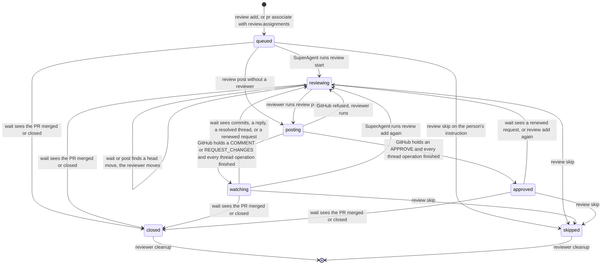
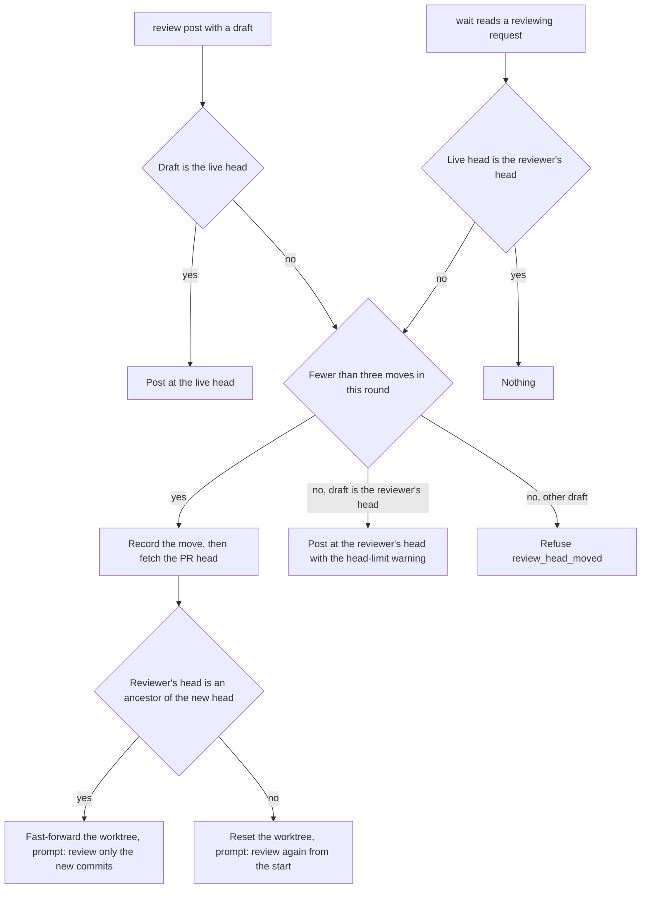
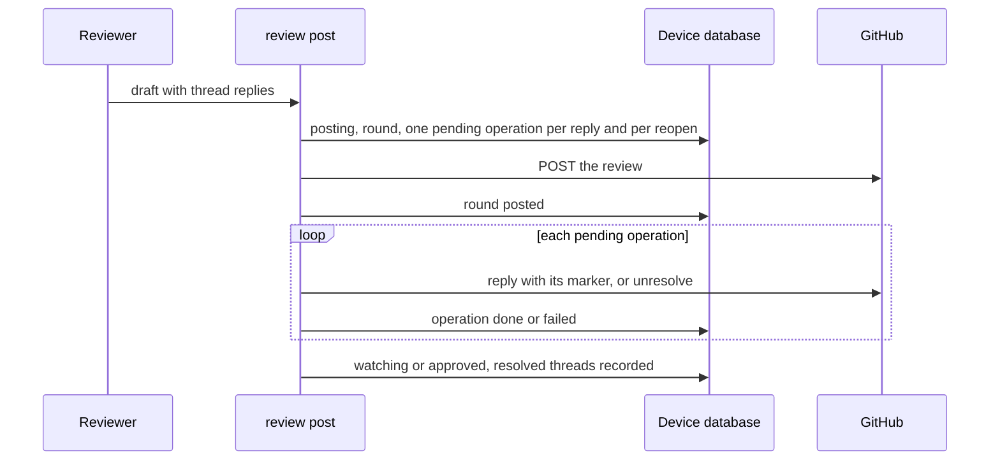

# Review rounds

Issue #254 completes the review-request lifecycle of ADR-0015 on top of the core post path in `253-review-requests.md`.
One reviewer and one worktree serve every round of a request.
New commits, author replies, author-resolved threads, and renewed review requests start rounds.
Head moves, thread operations, the stale flag, reviewer replacement, and reviewer cleanup are in this slice.
Slack ingestion and Slack effects are in `255-slack-transport.md`.

## Commands

Use `bun cli.ts` instead of `operator` in a source checkout.

```sh
operator review wait [--timeout seconds] --json
operator review skip <pr-url> --json
operator review cleanup <pr-url> --json
```

`add`, `start`, `post`, and `next` keep their contracts from #253, with these additions:

- `add` of a watching or approved request is a renewed request. It starts a `re-request` round and returns `review_round_started`.
- `start` of a request whose reviewer stopped starts a replacement and returns `reviewer_replaced`.
- `post` moves the reviewer when the PR moved, posts at the last reviewed commit after the head-move limit, and runs the thread replies.

`wait` is a device command. It reads every open request, so it needs no PR URL.
It returns when an event happened, when its first pass finds a row with an action for the SuperAgent, or when the timeout passes. The default timeout is 300 seconds.
A row that waits for the person, such as `reviewer_work_kept`, and the `wait_reviews` row that the wait itself handles do not end a wait, so repeated waits do not spin.

| Result | Meaning |
| --- | --- |
| `review_events_observed` | `data.events` lists what this wait changed: `round_started`, `head_moved`, `review_stale`, `review_closed`, `reviewer_interrupted`, `reviewer_synced`, `reviewer_cleaned`, or `read_failed`. |
| `review_actions_ready` | No event, but on its first pass a row of `data.requests` has an action for the SuperAgent. |
| `review_wait_timed_out` | Nothing changed, and no row needs the SuperAgent. |

| Refusal | Exit | Cause |
| --- | --- | --- |
| `review_request_missing` | 3 | `skip` found no open request for the PR. |
| `review_cleanup_unchanged` | 3 | `cleanup` found no closed or skipped request with a cleanup left. |
| `review_request_open` | 4 | `cleanup` named a PR whose request is still open. |
| `review_reviewer_moving` | 4 | `post` ran while a wait moves the reviewer to the new head. |
| `review_cleanup_in_progress` | 4 | Another live process cleans up the reviewer. |
| `review_head_moved` | 4 | The PR moved past the reviewer's head. Below the limit, the reviewer moved and got the new commits. Nothing was posted. |
| `review_post_in_progress`, `review_start_in_progress` | 4 | `skip` ran while a live process posts the review or starts the reviewer. |
| `review_reviewer_moving` | 4 | `skip` ran while a wait moves or prompts the reviewer. The pane and the worktree stay. |

## Lifecycle



A round with a reviewer that stopped goes to `reviewing` without a prompt, and `next` offers `replace_reviewer`.
A round of a request that never had a reviewer goes to `queued`.
An approved request stays open: it ignores later commits, and a renewed request reopens it with the same reviewer.
Only `closed` and `skipped` end a request, so one PR has at most one open request, by the partial unique index `one_open_review`.

The tables in `modules/review-requests/review-machine.ts` decide each transition from the recorded request and the owner lease.
`modules/review-requests/rounds.ts` decides what one GitHub read means for one request.
Neither reads a database, the network, Git, or the clock.

## Rounds

`wait` reads each open request's PR with no transaction open, then applies the decision in one immediate write transaction.
Two simultaneous waits that read the same change apply it once, and only the process that applied it prompts the reviewer.

| Trigger | Observed fact |
| --- | --- |
| `commits` | The live head is not the reviewer's head. |
| `reply` | After the round started, the PR author replied in a review thread of the posting account, or wrote a conversation comment that mentions the posting account as `@login`. |
| `resolved` | Someone other than the posting account resolved a thread of the posting account that was not resolved at the last post. |
| `re-request` | GitHub has a review request for the posting account after the round started and after the last post, or `review add` ran again. |

A watching request checks the triggers in that order. An approved request checks only `re-request`.
The posting account's own replies never count, so on the person's own PR only commits and renewed requests start rounds.
Other conversation comments, such as a bot command or a reply to another reviewer, start no round. This narrows the conversation trigger to the decision in #228, which names author replies to the reviewer.
GitHub answers a review request with any later review, so a request made during a round does not reopen the request after its post.
A round that a wait sees during a live reviewer start waits, and the next wait after the start applies it.
A round records its trigger, restarts the head-move count, clears the stale flag, writes the brief again with the round history, and prompts the reviewer.
When the PR moved, the round first moves the worktree, as a head move does.

## Head moves



The move needs a clean worktree at the reviewer's head or the new head. Otherwise it records `review_worktree_changed` as the reviewer failure, keeps the move pending, and `next` offers `wait_reviews`.
Every later wait tries the move again and reports only a new failure. After the person cleans the worktree, the next wait reports `reviewer_synced` and clears the failure.
A move whose process stopped is finished by the next wait.
While a move or a prompt runs, `skip` and `close` refuse, and only the process that holds the lease records the move as finished.
After three moves in one round, the reviewer keeps its head.
The post then reviews that head and states the limit: the status line ends with `· reviewed at <short sha>`, and the body names the reviewed commit, the current head, and the move count.
The round records these facts as `warning`, and the post result returns them as `headLimit`. The Slack reply of `255-slack-transport.md` shows the same suffix.

## Threads

The draft's `threadReplies` give each thread `acknowledge` or `explain`.
A fixed defect needs no entry.
An `explain` reply keeps a blocker open, so the event is a comment and an approval is refused.



An `explain` reply in a thread that the author resolved also reopens it, after the reply.
A refused operation is recorded as `failed` with its detail, and the round still finishes.
A lost answer stops the run, and the request stays `posting`.
The retry reads the PR once, marks each reply whose marker GitHub holds and each reopen that took effect, and sends only the rest.

## Stale flag

A watching request gets `staleAt` after seven days without author activity since its round started and since its last post.
`next` and `wait` show `stale: true`. It is not a state.
One wait reports `review_stale` once. A round start clears the flag.

## Replacement

A pane exit that the Herdr plugin reports marks the running reviewer `interrupted`.
`wait` also marks a running reviewer `interrupted` when Herdr in the same server no longer lists its agent name.
A watching or approved request with a stopped reviewer waits. A round in `reviewing` then offers `replace_reviewer`.
`review start` launches a replacement with a new agent name in the recorded worktree.
A replacement keeps the recorded head, so commits since then still start a round.
Its brief names each earlier round with its trigger, event, review URL, and the posted draft, written to `rounds/<n>.json` beside the brief.

## Cleanup

A merged or closed PR, observed by `wait`, ends the request `closed`. `review skip` ends it `skipped`.
The same command then cleans up the reviewer:

1. It closes the reviewer pane, only from the recorded Herdr server and only while Herdr lists the reviewer's name.
2. It removes the worktree and the local reviewer branch with the non-forcing Git commands, only when Git shows no change, no unknown ignored content, and no commit that another branch or remote-tracking ref does not hold.

Unlanded work is kept.
A worktree folder that is already gone leaves the local reviewer branch in place. The request shows the attention `reviewer_work_kept` with the kept paths.
Only the person removes that work, and `review cleanup` then finishes.
A failed step shows `clean_reviewer` with its detail until a repeated `review cleanup` finishes.
The worktree check is the one that report acceptance uses, moved from `report-assignments` into `worker-dispatch` as `WorkerDispatch.cleanWorktree`.

## The owner's PR wait

An assignment reviewer posts with the owner's own account.
`pr wait` marks a review whose body starts with the Operator review marker as `operatorReview: true`.
Such a review ends the owner's wait alone, also a no-blocker comment, while the owner's other own items still wait for another event.

## Storage and compatibility

Migration `0009_review_rounds` adds to `review_requests` the round trigger, the head-move count, the activity time, the stale time, the resolved threads at the last post, the pending reviewer move, and the cleanup state and detail.
It adds `warning` to `review_rounds` and the table `review_thread_operations`.
It replaces `one_active_review` with `one_open_review`, which counts approved requests as open.
Before that, it closes an approved request that a newer open request of the same PR replaced, clears the end time of approved requests, and sets their activity time from their last post.
The device-wide idle guard also blocks a migration while a live process holds a review request lease, for a reviewer move or a cleanup.

## Verification

Public CLI scenarios in `modules/operator-cli/run.review-rounds.test.ts` use `review-fixture.ts`: real Git with a local bare origin that holds only `refs/pull/7/head`, real SQLite, isolated device roots, and the controlled `herdr-fixture.ts` and `github-fixture.ts`.
They cover:

- Both hosts through every trigger with one reviewer and one worktree: an author reply, an approval that ignores later commits, a renewed request on a moved PR, a resolved thread, a fast-forward commits round, and a repeated `review add`.
- A fast-forward found by the post, a force push found by the wait, a third move, and a fourth move that posts at the third head with the warning in the body and the result.
- Two simultaneous waits that start one round and prompt once, and two that set the stale flag once.
- The stale flag after eight quiet days, no second report, and its clearing by an author reply.
- A pane exit, a round that waits for a replacement, the replacement in the same worktree with the round history, and a replacement of a watching reviewer that keeps the reviewed head.
- An acknowledgement, an explanation that reopens a resolved thread, a fixed thread with no write, a lost reply answer, and a retry that does not reply twice.
- A merged PR with unlanded work kept and visible, a wait that does not end early for that row, then the cleanup. A skip with full cleanup, refusals that change nothing, and a new request after the skip.
- A failed move reported once and finished by a later wait, a renewed request answered by the next post, conversation comments with and without a mention, and a skip refused while a wait prompts the reviewer.
- `run.reviews.test.ts` for #253 now uses the same `review-fixture.ts`.

`run.reviews.test.ts` also proves that the owner's `pr wait` reports an assignment reviewer's no-blocker comment.
Direct beside-tests cover the round decisions, the machine rows, the commit choice, the thread plan and reconciliation, the event and body rules, the brief history, the GitHub mapping, the device-state writes, and the migration guard.
`run.review-round-guards.test.ts` proves 18 new guards with deliberate breaks in a disposable copy.

No live GitHub thread write, no live `herdr agent prompt` to a reviewer, and no live worktree move ran in this slice.
The GraphQL thread mutations, the `ReviewRequestedEvent` timeline read, and the Herdr prompt are proved only by the controlled tools.
