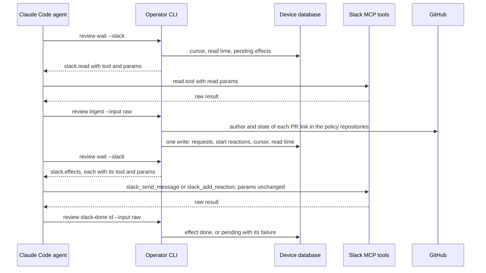
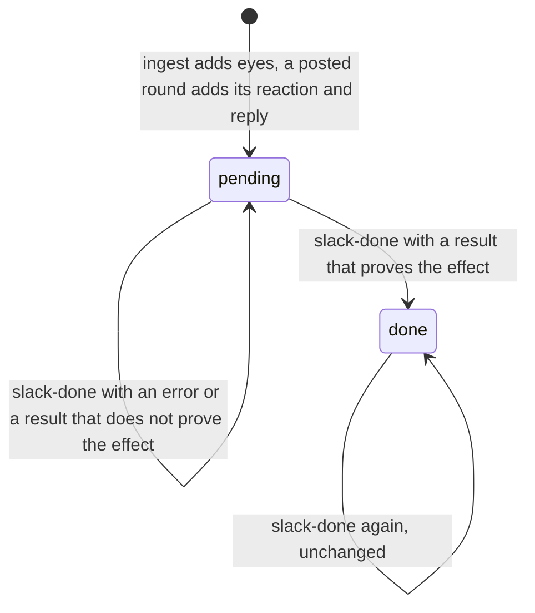

# Slack review transport

Issue #255 completes the Slack part of ADR-0015 on top of `253-review-requests.md` and `254-review-rounds.md`.
The CLI schedules channel reads, keeps the channel cursor, applies the author policy, and generates every Slack reply and reaction.
A Claude Code agent carries each read and each effect through the Slack MCP tools and gives the raw tool result back to the CLI.
Operator holds no Slack token or credential.

## Live contract

Two live checks on 2026-10-28, in a Claude Code session with the Slack MCP tools, in the thread `1793195970.359959` of the person's DM `D0BF4TK0336`, verified these facts. The raw results are the fixtures of `slack-input.test.ts`.

| Tool | Parameters | Result |
| --- | --- | --- |
| `slack_read_channel` | `channel_id`, `oldest`, `latest` (also `cursor`, `limit`) | JSON with prose values: `messages` holds a `Channel:` line, then one block for each top-level message, `=== Message from <name> (<user>) at <time> ===`, a `Message TS: <ts>` line, and the text. `pagination_info` says `There are more messages available.` with a cursor, or `There are no more messages available.` |
| `slack_send_message` | `channel_id`, `thread_ts`, `message`. There is no `text`. | `{"message_link": ..., "message_context": {"message_ts": ..., "channel_id": ...}}` |
| `slack_add_reaction` | `channel_id`, `message_ts`, `emoji` (name without colons) | `{"result": "Successfully added :<emoji>: reaction to the message."}`, also for a reaction that is already there |

- `eyes`, `white_check_mark`, `speech_balloon`, and the custom `request-changes` exist in the workspace.
- A reply posts as the person, not as a bot, and Slack adds a `*Sent using* <@...|Claude>` footer.
- Channel history holds only top-level messages. A PR link that is only in a thread reply is not seen. `slack_read_thread` exists, but the CLI does not schedule thread reads.
- There is no `has_more` field and no `already_reacted` answer.

The second check ran the final parser on live results and passed every step:

- `parseChannelRead` read a live channel read and a paged read, with `hasMore` matching the `pagination_info` prose.
- Two generated replies, a first round with two blockers and a later approval, posted in the thread. `parseAcknowledgement` gave `done` with each reply's `message_context.message_ts`.
- `slack_add_reaction` added `speech_balloon`, `request-changes`, and `white_check_mark`. Each result gave `done` for its own emoji and `unrecognized` for another emoji. A repeated reaction gave `done`, and the count stayed 1.
- `slack_read_thread` showed that the tool converts `[review](url)` to the Slack link `<url|review>`, and each bullet stays on its own line.

Not observed live: whether `latest` is inclusive, and the page order of a paged read with both `oldest` and `latest`. `advanceWatch` filters `ts < latest` itself, so an inclusive bound is safe. If the tool gives the oldest page first, the next normal read covers the rest.

## Commands

Use `bun cli.ts` instead of `operator` in a source checkout.

```sh
operator config plan --set review.channel=C0123ABCD --set review.repos=owner/one,owner/two --set review.authors=alice,bob --json
operator config apply <the same --set arguments> --plan <plan-id> --json
operator review wait [--timeout seconds] [--slack] --json
operator review ingest --input <file|-> --json
operator review slack-done <effect-id> --input <file|-> --json
```

`review.channel` is a Slack conversation id. `review.repos` holds lowercase `owner/repository` identities, and `review.authors` holds GitHub logins, never Slack names.
`--unset review.channel` turns the Slack read off. Without a channel, `wait` and `next` return `slack: null`, and `ingest` refuses with `slack_not_configured`.

| Result or refusal | Exit | Meaning |
| --- | --- | --- |
| `review_slack_ready` | 0 | `wait --slack` found a due read or a pending effect, and no review event. |
| `slack_ingested` | 0 | `ingest` recorded the eligible PRs and moved the cursor. |
| `slack_ingested_page` | 0 | `ingest` recorded the eligible PRs of one page. The cursor stays, and the next read for older messages is due at once. |
| `slack_effect_done`, `slack_effect_unchanged` | 0 | `slack-done` marked the effect done, or it was done already. |
| `slack_not_configured`, `slack_input_unrecognized`, `slack_input_missing`, `slack_effect_missing` | 3 | No channel, an input that is not a channel read, an absent input file or a folder, or an unknown effect id. Nothing changed. |
| `slack_ack_unrecognized` | 3 | The send result does not prove this effect. The effect stays pending with the result as its failure. |
| `slack_cursor_moved` | 4 | Another ingest moved the cursor first. Nothing was recorded. |
| `slack_effect_failed`, `slack_input_unreadable`, `github_failed` | 1 | Slack refused the send, and the effect stays pending. Or the input file could not be read, or a GitHub read failed during an ingest, and nothing was recorded. |

## The loop



A read is due when the channel has no ingest yet, and five minutes after the last ingest.
The first `wait --slack` or `ingest` of a channel records its start cursor at that moment, so the watch starts there.
A new session resumes with `operator review wait --slack` alone.

Only `wait --slack`, the loop of the `slack-pr-review-workflow` skill, ends for Slack: it returns `review_slack_ready` when a read is due or an effect is pending, also on a later pass of the same wait.
An effect whose send was refused ends only the first pass, so waits do not spin on it.
A plain `wait`, for example on OpenCode, and `next` only report `data.slack`, so a host without Slack tools never waits on Slack.
`next` reads the database read-only and records no cursor. Before the first Slack loop, its read params name no `oldest`, because the tool takes no null.
Review events keep precedence, and every wait and `next` result carries `data.slack`.

## Ingest

1. The input is the unchanged tool result, the JSON of the live contract, directly or inside the text content of an MCP result that is not an error. Each message block must start with its `Message TS` line. Any other shape, or a `Message TS` line before the first header, refuses, and the cursor stays.
   Slack does not escape a header line in a message body. A header-like block without its own `Message TS` line stays in the body of the message before it, so it cannot block the channel.
   A ts later than the ingest moment plus one minute is dropped, so a forged message cannot move the cursor past real messages.
2. Only messages after the cursor count, and while paging only messages before `latest`. Each GitHub PR link in the text of a message counts once. Each message is its own thread, because the history holds only top-level messages.
3. The author policy screens each PR in order: the repository is in `review.repos`, it is a registered project, the GitHub author is in `review.authors`, and the PR is open. An excluded PR is listed under `ignored` with its reason and gets no reaction.
4. A GitHub read that fails stops the ingest with no write, so the next read of the same messages tries again.
5. One write transaction records each eligible PR, adds its `eyes` reaction, and moves the cursor. It refuses when another ingest changed the cursor state first.

| Recorded outcome | When |
| --- | --- |
| `recorded` | No request, or the last one closed. A new `slack` request is `queued` with this thread. |
| `attached` | An open, not approved, Slack-origin request without a thread, for example from `review add`, gets this thread and the start reaction. |
| `open` | The open request already has its thread. Nothing changes. A repeated link does not start a round. |
| `approved` | An approved request without a thread gets none, because it posts no reply until a renewed request. |
| `assignment` | An assignment review reports to its PR owner, not to Slack. |
| `skipped` | The last request of the PR was skipped. Nothing changes. Only `review add` reviews it again. |
| `unregistered` | The repository lost its registration during the ingest. |

Slack gives the newest page first. When `pagination_info` says that more messages are available, the cursor stays, the newest ts seen is kept as `pending`, and the next read is due at once with `latest` set to the oldest message of the page.
The CLI pages with `latest`, which the live check verified, not with the prose cursor.
The last page moves the cursor to the newest message of all pages.
A page with no new message ends the paging, so a wrong page note cannot loop.

## Effects



`modules/review-requests/slack-effects.ts` builds every effect from recorded rounds.
The write that ends a posted round also records its effects, so a crash between the GitHub post and the Slack send leaves a pending effect, and a lost GitHub answer records them when the retry finds the review.
Each effect has a key, unique for its request: `reaction:<name>` once per request, and `reply:<round>` once per round. A retry adds nothing.
Each effect row in `wait` and `next` gives the exact call: `tool` and `params`, which the agent passes unchanged.
A reaction goes on the message that posted the PR, and a reply goes into its thread.

| Event | Reaction |
| --- | --- |
| Request recorded from Slack | `eyes` |
| `APPROVE` | `white_check_mark` |
| `REQUEST_CHANGES` | `request-changes` |
| `COMMENT` | `speech_balloon` |

Reactions only add, so earlier reactions stay. The status is also in the reply text, because a notification does not show a reaction.

A reply is one line, then at most three blocker bullets:

```
Needs changes · 2 blockers, 1 nice to have · [review](<review url>)
• Guard has no test
• Cursor moves before the write
```

- The status words and counts come from `review-body.ts`, the same rendering as the GitHub review: `Approved`, `Changes requested`, `Needs changes`, or `No blockers` for a comment without blockers.
- Counts list blockers, then nice to haves, and leave out a zero.
- Each bullet is a blocker's `short` field, a failing required check as `<name> fails`, or the count of explained threads. The round records these as `blockers` at post time.
- A later round adds `· <n> of <m> fixed` after the counts, where `m` is the blocker count of the previous posted round and `n` is how many fewer blockers this round has. The count does not match blockers by text.
- After the head-move limit, the line ends with `· reviewed at <short sha>`.
- There is no title, description, greeting, or mention.

`slack-done` reads the raw send result against the recorded effect and needs positive evidence for that exact effect.
A reply needs `message_context.message_ts` in the Slack ts form, `message_context.channel_id` equal to the effect's channel, and, when `message_link` is present, its `thread_ts` equal to the effect's thread. The ts is recorded. So two pending replies cannot take each other's result. A reaction needs `Successfully added :<emoji>: reaction` for its own emoji, which a repeated reaction also returns.
An `error` field, `ok: false`, or an MCP error result refuses with `slack_effect_failed`. Any other result, also plain text, an empty result, or the answer for another effect, refuses with `slack_ack_unrecognized`.
Both keep the effect pending with its failure.
An acknowledgement is the agent's claim. The CLI does not claim exactly-once delivery.

## Hosts

Slack transport is for Claude Code only.
Operator adds no OpenCode Slack setup, credentials, or Slack acceptance tests.
Both hosts keep setup, assignments, and every non-Slack review command, and a device without `review.channel` reads no Slack.
The `slack-pr-review-workflow` skill replaces `parallel-pr-review`. It routes reads, effects, and blocked reviewers, and it holds no review rules.
Owned skills install whole into each host, so OpenCode also gets this skill. Its `compatibility` field names Claude Code, and it adds no Slack setup or credential to OpenCode.

## Storage and compatibility

Migration `0010_slack_effects` adds `slack_watches` with the cursor, the read time, and the paging bound and newest ts for each channel, and `slack_effects` with one row for each effect.
It adds the Slack channel and message ts to `review_requests`, and the recorded blocker texts to `review_rounds`.
Effects cascade from their request, and so from project removal.
No new idle guard blocks the migration, because a pending effect needs no running process.

## Verification

Public CLI scenarios in `modules/operator-cli/run.review-slack.test.ts` use `review-fixture.ts`: real Git and SQLite, isolated device roots, the controlled `herdr-fixture.ts` and `github-fixture.ts`, and controlled raw Slack tool results in files. They cover:

- A plain `wait` on a device with a channel that times out with no Slack stop, and a `next` that records no cursor.
- A paged read that keeps the cursor, a due read with `latest`, and a last page that moves the cursor past every page.
- A channel read in the live prose form with eligible, unregistered, out-of-policy, other-author, and closed PRs, and a message at the cursor that is not read again.
- Start reactions only for eligible PRs, in the right threads, a repeated ingest that records nothing, and pending effects that each new process reads again.
- Live-form acknowledgements, a repeated one, a result that shows no success, a refused send that stays pending, and a repeated reaction that succeeds.
- The next read from the recorded cursor after five minutes, and a skip of one PR while a new PR of the same author is recorded.
- Refusals: a plain-text read, a GitHub read that fails, an absent input file, a folder, and an unreadable file, with no record and no cursor move.
- Both hosts without a channel: no Slack data, no effects, and a full review to approval.
- A lost GitHub answer with no effect until the retry, the first-round reply and reaction, and an approving second round with `2 of 2 fixed`.

Direct beside-tests cover the input parser and the acknowledgement rules against the unchanged live results, the reply builder, the device-state writes, and the settings edits.
`modules/operator-cli/run.review-slack-guards.test.ts` proves 30 guards with deliberate breaks in a disposable copy.
