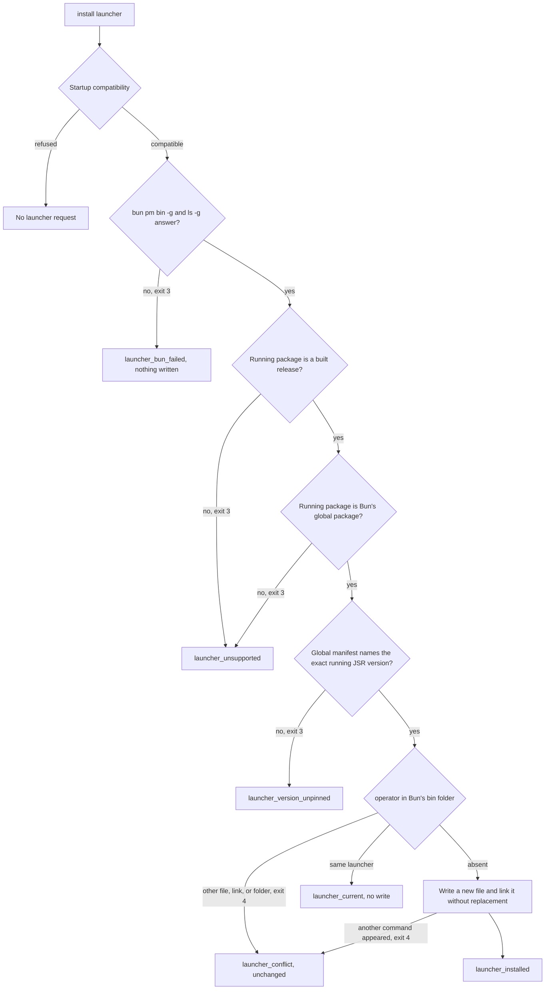

# Global JSR and full-commit source installation

Issue #256 delivers one device release through a global Bun JSR install or a global Bun source install at a full commit.
ADR-0007 is the decision source.
The running installation is the release authority for every registered project.
There is no project release selection, adoption step, copied Operator lock, or shared global-lock fingerprint.
Nix packaging is #257, and the Herdr plugin manifest and its hooks are #247.

## Ownership

| Owner | Responsibility |
| --- | --- |
| `GlobalLauncher` | Owns the global command. It gathers Bun's global folders and manifest, writes the launcher without replacing an existing command, and reports static command and pin blockers. |
| `global-launcher/plan.ts` | Pure launcher decision and launcher text, with beside-tests for every rule. |
| `OperatorRelease` | Builds the common artifact and reads the running release, including the full commit Bun records for a source install. |
| `DeviceSettings` | Owns the one rendering of the settings editor schema that the artifact ships and settings edits write. |
| `Readiness` | Adds the global command blockers from `GlobalLauncher.check` to the other static blockers. |
| `OperatorHome` | Refuses non-temporary install roots, including Bun's global bin folder, in tests. |

## Delivery paths

JSR global installation uses one exact version:

```sh
bun add -g "@fveracoechea/operator@npm:@jsr/fveracoechea__operator@<exact-version>"
```

The JSR registry generates the npm manifest and drops the `bin` field, so Bun links no command.
The person registers the project with the global package's `cli.js`, then runs `install launcher --json` once.
Every command, including `install launcher`, passes the startup compatibility check first, so registration comes first.
The launcher is a small `sh` script in the folder that `bun pm bin -g` reports.
It runs `bun <Bun's global folder>/node_modules/@fveracoechea/operator/cli.js` through `PATH`, so it names no version, registry, cache, or staging folder.
A later exact `bun add -g` replaces the package in that same folder, and the unchanged launcher runs the new release.

Source installation uses a Git URL at a full commit:

```sh
bun add -g "git+https://github.com/fveracoechea/operator.git#<full-commit>"
```

Bun links `operator` to `cli.ts` in its global folder and records the resolved commit in the package's `.bun-tag` file.
Version JSON reports that commit only when it is 40 lowercase hexadecimal characters.
A source install has no artifact identity, because it runs the source, not the built artifact.
ADR-0007 records this as an amendment.
Bun blocks the package's preinstall script, and startup checks the Bun version instead.

## Launcher decision



The person runs the installation commands.
Operator decides and writes only the launcher.
Bun owns the global folders, the global manifest, and the global lock.
Operator reads the global manifest only to check the exact JSR specifier, never as a release fingerprint.

## Global command discovery

Herdr hooks, agents, and shells find Operator through `PATH`.
Both delivery paths put `operator` in Bun's global bin folder, and neither command names a release-specific path.
`operator ready --json` reports these static blockers for `operator`, without running it:

- `executable_missing` when no `operator` is on `PATH`.
- `executable_mismatch` when the command on `PATH` is neither a link to the running package's entry point nor the exact launcher text for the running global package.
  An old launcher, another source install, a project-local `.bin/operator`, or an unrelated tool all match this case.
- `installation_unpinned` when the manifest beside the running package names something other than the exact running JSR version or a Git source with a 40-character lowercase commit.
  A source install from a branch name reports the resolved commit, but Bun keeps the branch name, so a later Bun update can move it.

The launcher and the source command run `bun` through `PATH`, so `bun` must be on the same `PATH`.
Readiness does not check `bun`, because the running CLI already runs under Bun.
That does not prove a hook environment has it, so the README states the rule.
The tests prove discovery through a child environment whose `PATH` holds only Bun's global bin folder and a `bun` and `git` link, the same way a hook command environment reaches the command.
`docs/implementation/247-dispatch.md` records the live proof that a real Herdr hook runs the installed global command.

## Release artifact

The artifact holds runnable ESM, declarations, complete owned skills, `schemas/config.schema.json`, the fixed migrations, documentation, `package.json`, `jsr.json`, and the content-identified `release.json`.
The settings schema is byte-equal to what a settings edit writes.
#247 adds the Herdr plugin manifest at `modules/worker-dispatch/herdr-plugin.toml` to the build and the required parts.

## Tests and evidence limits

The public CLI is the primary seam.
`modules/operator-release/global-delivery.test.ts` runs real `bun add -g` installs in isolated `BUN_INSTALL`, bin, global, cache, settings, and state roots.
The registry is a local fake that rewrites the manifest the way JSR does.
It is a deterministic contract test, not evidence about the live JSR service.
The source path installs from a local Git repository at a full commit, not from GitHub.

Separate live service evidence, read on 2026-10-26 with `curl -s https://npm.jsr.io/@jsr/fveracoechea__operator`:
the latest published version was 0.9.0, an older release.
Its version listing had only `dependencies`, `description`, `dist`, `name`, `repository`, and `version`, with no `bin` or `engines` field.
This confirms the manifest rewrite that the fake copies, for that published version only.
It is not evidence that this unpublished candidate installs from the live registry.
#259 owns real-service verification of the candidate.
No release was published and no installation of the person was changed.

The global tests prove these facts:

- A source install runs through Bun's link after the source repository and the Bun cache are removed, and reports its full commit.
- A JSR install has no command before the launcher, refuses a launcher from a copied package, and writes a launcher with no version, registry, cache, or copy path.
- The same launcher runs an exact update to a second release after both registries and the cache are removed.
- An unrelated global package changes Bun's global lock but not the version output on either path.
- An existing other command refuses with exit 4 and stays unchanged.
- The README installation blocks run as written for both paths.

- A source install from a branch name reports `installation_unpinned`, and the pinned installs report no command blocker.

`modules/operator-cli/run.launcher.test.ts` proves the source-checkout refusal, a failed Bun answer, an invalid global manifest, and argument parsing with a controlled `bun`.
`modules/operator-cli/run.readiness.test.ts` proves that a foreign command and a launcher for another global package are mismatches.
The `EEXIST` race after the launcher decision has no deterministic test, because it needs another writer between the decision and the link.
The no-replace hard link is the guard, and the decision tests cover every existing destination that is present before the write.
The test guard on temporary roots runs as soon as Bun reports its global folders, before Operator reads the global manifest.
`modules/operator-cli/run.launcher-guards.test.ts` proves each launcher guard and the source commit guard with a deliberate break.
`modules/operator-cli/run.readiness-guards.test.ts` proves the global-command readiness guard with a deliberate break.

## Verification

Verified on macOS arm64 with Bun 1.4.4.

| Command | Result |
| --- | --- |
| `bun test --isolate modules/operator-release/global-delivery.test.ts` | Passed, 3 tests. |
| `bun test --isolate modules/operator-release` | Passed, all release tests including the existing project-install delivery tests. |
| `bun test --isolate modules/global-launcher modules/operator-cli/run.launcher.test.ts modules/operator-cli/run.launcher-guards.test.ts` | Passed. |
| `bun run quality` through the locked gate | Passed. |
