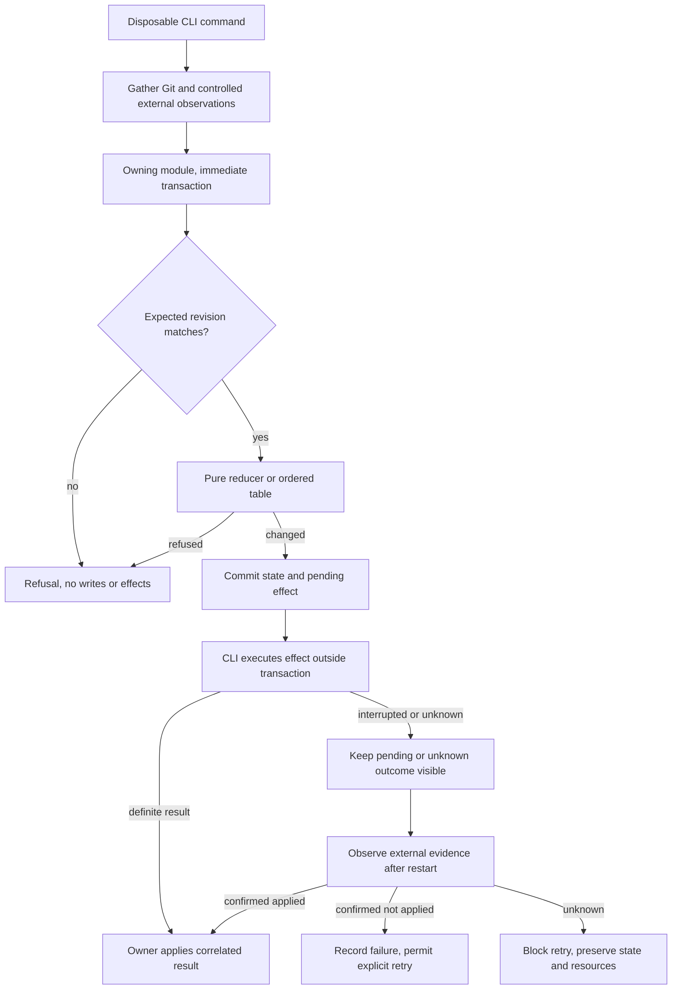

# State-machine experiment, issue 236

Disposable development code, not production workflow support.
The person will compare both prototypes before choosing.
No recommendation here is human approval.
ADR 0003 still requires ordered transitions and module-owned policy.

## Question and limits

Does a reducer or an ordered table give assignment and review owners a clearer implementation of the same decision contract?
The experiment compares executable code and consuming commands, not only diagrams.
Both designs use the same schemas, result constructors, supplied facts, result interpretation, cases, and CLI adapter.
Their transition selection, guard order, merge gate, report disposition, and review-event computation are separate implementations.
Sharing the test oracle does not let either design call the other.

This is a bounded completion experiment, not complete dispatch, cleanup, draft validation, or review integration.
Validation and GitHub checks appear as already gathered facts.
Report bodies are represented by durable references.
The fixture has one workflow record, so its effect keys are local to that record.
Production keys must also identify their owning record.
The scratch SQLite adapter is not a choice of production schema or a replacement for the planned Drizzle module.

## Run

```sh
bun test --isolate --timeout=30000 scripts/prototypes/state-machines
bun scripts/prototypes/state-machines/prove-guards.ts
```

Tests exercise both implementations with identical cases, then compare 1,352 assignment decisions and 1,584 review decisions.
They also compare the next-actions results for those state and fact combinations.
Direct type tests reject open event names and crossed PR/report completion states.
The process cases invoke the disposable CLI with real Git and SQLite, explicit scratch roots, and a controlled external process.
They check concurrent starts, failures, retries, interruption before execution and before result recording, and fresh-process recovery.
Refusals check unchanged database bytes and no new external actions.

The experiment CLI requires an existing real directory named `/tmp/opencode/operator-236-*`.
It never uses a default device root or a checkout's Operator state.
It reads one JSON request on standard input.
`init` creates only the scratch schema, `step` runs one command, and `show` reads the saved record.
These are not `operator` commands.

For a minimal manual PR example:

```sh
root=$(mktemp -d /tmp/opencode/operator-236-XXXXXX)
bun scripts/prototypes/state-machines/cli.ts "$root" <<'JSON'
{"command":"init","input":{"workflow":"assignment","state":{"completion":"pr","phase":"pr-open","operation":{"status":"idle"},"generation":0}}}
JSON
bun scripts/prototypes/state-machines/cli.ts "$root" <<'JSON'
{"command":"step","input":{"workflow":"assignment","design":"table","revision":0,"event":{"type":"merge"},"facts":{"dependenciesReady":true,"actor":"superagent","worker":"running","approved":false,"checks":"pass","threadsResolved":true,"defaultBase":true,"safeToRemove":true,"observation":"unknown"}}}
JSON
```

The second invocation exits with code 3 and reports `approval-required` without changing the record or requesting an external action.
Change `design` to `reducer` to run the other implementation.
An accepted step only returns a plan unless `execute` is explicitly true.
The controlled process changes scratch evidence only, never GitHub or Herdr resources.

## Start reading

- `assignment/reducer.ts` and `assignment/table.ts` contain the assignment choices.
- `review/reducer.ts` and `review/table.ts` contain the review choices.
- Each workflow's `model.ts` owns its schemas, effect interpretation, and CLI guidance.
- Each workflow's `main.ts` is an executable consuming-module call site.
- `cli.ts` gathers external facts, calls the owning interface, and executes only the effects returned by that invocation.
- `first-match.ts` is the only shared transition-selection function.
- `comparison.test.ts` checks equality independently of each design's beside-tests.

The caller changes only `design` between the two options.
It never supplies transition callbacks, recomputes review events, or performs a second merge gate.
The owner rereads state and checks the expected revision inside an immediate transaction.
The decision reads no database, Git repository, network, clock, or random source.
The owner commits state before the command executes its effects.
The external fixture acquires the database write lock itself, so the process tests also check that no state write transaction remains open during external work.



An absent external record is not proof of non-application.
The `not-done` fact means established non-application with no earlier request still able to apply, not an empty lookup or an expired timeout.
The controlled process can provide that fact for its known failures.
This experiment does not establish that any live service can do so.
No exactly-once guarantee, generic replay ledger, worker ownership protocol, or automatic human approval follows from the effect key.

## Proposed recommendation, not a selection

Prefer the ordered table, with named, ordered decision rows private to each owner.
It preserves ADR 0003 without a decision change.
The merge gate lists refusal priority directly, and the review table makes the head-check-before-post order visible.
The reducer has fewer lines and TypeScript narrows events naturally inside its switch.
It remains a viable alternative for the person to consider.

Both expose the same proposed private decision shape:

```ts
decide({ state, event, facts }): {
  status: "changed" | "refused";
  reason: string;
  state: State;
  effects: Effect[];
}
```

The command receives the committed result, revision, blockers, permitted next actions, waits, and attention flags from its owner.
This is a prototype interface, not a new public Operator contract.
Guidance probes the same pure decisions instead of copying guards.
That costs extra decision evaluations and requires payload placeholders for parameterized actions.
A production owner can replace that projection if a concrete caller proves the cost or presentation is wrong, while retaining one guard implementation.

### Placement

The demonstrated reusable function is `firstMatch`, an ordered first-defined-result loop.
Two workflows call it without application types or imports.
It would fit a focused `lib/first-match.ts` with its beside-test if production callers still need it.
It does not justify a state-machine module, state registry, mandatory engine, or Redux dependency.
No production `lib` file is added by this experiment.

Assignment states, report authority, dependency rules, merge policy, cleanup order, and resource safety stay private to the assignment owner.
Review states, head movement, round triggers, review-event policy, and posting recovery stay private to the review owner.
Similar operation-result code remains duplicated in the prototypes because its effect payloads and completion consequences differ.
Database transactions belong to the planned state capability, not root `lib`.

### Costs and alternatives for the person

| Option                                         | Benefit                                                                                                 | Cost or reason not to select it now                                                                                                                       |
| ---------------------------------------------- | ------------------------------------------------------------------------------------------------------- | --------------------------------------------------------------------------------------------------------------------------------------------------------- |
| Ordered table, proposed                        | Guard priority is explicit and named. Both workflows reuse a small loop. It preserves the accepted ADR. | Broad input unions need narrowing inside rows. Row order needs tests. Missing rows need an explicit refusal.                                              |
| Reducer                                        | Direct event narrowing, exhaustive switches, fewer lines. Same observable behavior in this experiment.  | Guard priority is spread through branches. Selecting it instead of the required ordered table needs explicit ADR resolution.                              |
| Hybrid switch plus event-specific ordered rows | Could reduce repeated narrowing.                                                                        | Not implemented or tested here. It adds a second organization scheme without a demonstrated caller need.                                                  |
| Redux or another runtime library               | Could supply subscriptions or tooling if a caller needed them.                                          | Neither CLI workflow needs subscriptions, middleware, or a global store. No such need was demonstrated.                                                   |
| Generic workflow engine                        | Could centralize every lifecycle.                                                                       | It would move workflow facts and callbacks through a shared interface. The two callers need shared selection order, not shared policy or state ownership. |
| No shared function                             | Each owner can inline the ordered loop.                                                                 | Valid under ADR 0003. It duplicates a small, demonstrated mechanism but avoids another import.                                                            |

Both working designs pay for explicit pending-effect state, result correlation, and recovery observations.
Neither removes the need for owner-specific external evidence or safe cleanup checks.
Neither proves live GitHub, Herdr, host, or Slack behavior.

## Delivery and pending decision

The experiment stays under development scripts on the requested delivery branch.
This follows the person's existing-branch instruction rather than the prototype skill's default throwaway-branch capture.
A release test builds the actual artifact, checks that it contains no prototype or script files, and executes its help command.
The public CLI still supports only help and version.
The existing release-smoke tests remain the installed-consumer checks.

The person's later request assigns the HTML explanation, visuals, code snippets, and pros and cons to a new OpenCode agent in a new Herdr tab.
That presentation is for the person's consideration before selection.
No durable ADR amendment is made here.
If the person chooses the ordered table, the existing architectural contract can remain unchanged.
If the person chooses the reducer or changes the ownership or recovery contract, resolve that decision and any qualifying ADR change before dependent production work.
